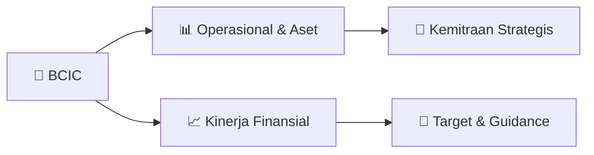

# 📊 Materi Public Expose: [BCIC]

🏢 **Emiten**: `BCIC` | 📅 **Tanggal Pelaksanaan**: `2026-09-25` | 📑 **Total Slide**: `17 Slide`
⬅️ [[knowledge-base/daily-digests/BCIC_20260925|Kembali ke Daily Digest]] | 🎛️ [[Dashboard/BCIC|Ke Dashboard Emiten]]

> [!NOTE]
> Ringkasan materi presentasi resmi Public Expose BCIC yang disampaikan oleh manajemen kepada investor dan bursa. Seluruh poin strategis, matriks operasional, dan angka kinerja diekstrak langsung dari slide deck resmi.

---

## 📅 1. Jadwal & Metadata Penyelenggaraan

| Parameter | Detail Informasi |
|---|---|
| **Nomor Surat Pengantar** | 036/CSD/JTRUST/IX/2026 |
| **Perihal Pengumuman** | Penyampaian Materi Public Expose Tahunan |
| **Waktu Pelaksanaan** | 2026-09-25 25-09-2026 15:28 |
| **Lokasi / Media** | Aplikasi Zoom / Daring |
| **Lampiran Resmi** | `1` |

## 📋 2. Agenda Paparan Publik

- Pemaparan Profil & Struktur Bisnis Perseroan
- Kinerja Operasional & Keuangan
- Arah Strategi Usaha & Target Pertumbuhan
- Sesi Tanya Jawab (Q&A)

## 🏢 3. Profil & Pilar Portofolio Bisnis

## 🏗️ 4. Kinerja Operasional & Portofolio Aset

> Pertumbuhan
Des 2025 – Juni 2026
Audited Des 2025 39.348 26.937 33.559
3.927
3.122
26.508
3.151
2.915
485
2.314
363
2.360
-3
-1,994
555 480 1,23% 8,59% 1,08% 60,10%
-0,10%
-7,52%
17,60% 16,46% Ikhtisar Keuangan
Momentum Pertumbuhan Kredit
Dalam Miliar Rupiah
Total Aset Total Kredit
Total Dana Pihak Ketiga
Giro Tabungan Deposito Total Modal
Total Modal Inti
40.258 26.528 33.899
2.996
2.134
28.769
3.501
3.251
Audited Des 2024 Juni 2026 39.834 29.251 33.922 6.288
3.120
24.514
3.706
3.395

> Ikhtisar Keuangan Perkembangan Finansial
Dalam Miliar Rupiah
Pendapatan Bunga - Neto
Beban Operasional Lainnya
Laba Operasional
Pendapatan (Beban) Non-Operasional - Neto
Laba Sebelum Pajak
Laba (Rugi) Bersih
-29,32
-3,40
-40,77
-8,15
-32,62
-32,62
Juni 2026 360,97 417,15 82,93 2,69 80,23 80,23 Audited Des 2024 802,13 414,57 98,39 8,08 106,47 2,83 Audited Des 2025 768,59
-1291,82
-316,82
-15,17
-332,00
-428,42
Pertumbuhan
June 25–June 26
-7,51%
-32,96%
-75,15%
-28,91%
-28,91%
Liabilitas, Ekuitas, Aset
Total Kredit vs NPL
Dalam Trilliun Rupiah
Total DPK vs Biaya Dana
Dalam Trilliun Rupiah
Dalam Trilliun Rupiah
Juni 2025 390,29
-420,55
123,70 10,84 112,86 112,86
Pendapatan Operasional Lainnya
-1.118,31
153,96 206,39 139,11
-14.85
-9,64%
-0,81%

> Performa keuangan terlihat kuat dan sustain

Pertumbuhan yang Berkelanjutan dalam Kredit dan
DPK
Memiliki TOP MANAGEMENT  dengan pengalaman
panjang dalam industri perbankan nasional
Memperoleh Dukungan Penuh dari seluruh Pemangku
Kepentingan Bank
Ikhtisar Performa J Trust Bank
Rasio Keuangan Tren Pertumbuhan CAGR Aset 0,15% 6,21% 2,40% 4,63% 12,04% 4,12% CAGR Kredit CAGR DPK Pertumbuhan DPK
Des 2025- June 2026
Pertumbuhan Kredit
Des 2025 -June
2026 Pertumbuhan Aset Des 2025-June 2026 CAGR 2023-2025 Ikhtisar Keuangan
Performa yang kuat sampai dengan Juni 2026
CAR NPL Net NIM 14,04% 0,71% 2,67% 2023 14,53% 1,78% 2,11% Juni 2026 13,89% 1,43% 2,30% 2024 12,53% 2,26% 2,22% 2025 0,89% 0,09%
-12,97%
4,71% ROE
J Trust vs Industri Perbankan – Pertumbuhan
Kredit 2023 2024 Des-25 Jun-26 Growth Banking
Growth J Trust

## 📈 5. Kinerja Keuangan & Posisi Finansial

## 🧭 6. Inisiatif Strategis, Kolaborasi, & Kemitraan

- Aktivitas Corporate Social Responsibility (CSR)
J Trust Bank menunjukkan
komitmen nyata dalam pelestarian
lingkungan dengan mendukung
peringatan World Rhino Day 2025
yang diselenggarakan oleh Yayasan
Badak Indonesia (YABI) di Habitat
Park, SCBD – Jakarta.
J Trust Bank kembali menunjukkan
komitmennya terhadap keberlanjutan
dengan mendukung penyelenggaraan
SPOGOMI Jakarta 2025, kompetisi olahraga
ramah lingkungan yang memadukan unsur
sport (olahraga) dan gomi (sampah).
Dalam rangka memperkuat komitmen
terhadap pendidikan dan pelestarian
lingkungan sejak usia dini, J Trust Bank
berpartisipasi dalam kegiatan bertajuk
“Growing Green Together with Eco-Fun
Learning” yang diselenggarakan oleh TK
Al-Azhar BSD.
J Trust Bank bekerja sama dengan Unit
Pengelola Darah RSUPN Dr Cipto
Mangunkusumo menggelar kegiatan
donor darah bertajuk “Care for
Thalassemia Survivors” di Sahid
Sudirman Center.
J Trust Bank menyelenggarakan kegiatan
Literasi Keuangan bertajuk “Merancang
Masa Depan Finansial” yang dilaksanakan
di TK Al-Azhar BSD pada 9 Desember
2025.
Dalam semangat menyambut Hari
Raya Natal, J Trust Bank menyalurkan
bantuan kepada Yayasan Sosial
Tangan Kasih yang berlokasi di
Tangerang, Banten.

- Aktivitas Corporate Social Responsibility (CSR)
J Trust Bank membentuk karakter
generasi muda yang peduli
lingkungan sejak dini dengan
peluncuran program CSR “School
Adoption Program: Building
Environmental Awareness &
Sustainable Waste Management
Behavior”.
J Trust Bank menyatakan dukungan dan
partisipasinya dalam ajang Walk for Autism
Jakarta 2026. Kegiatan yang diinisiasi oleh JCI
Nusantara ini berlangsung pada Minggu, 23
Agustus 2026, bertempat di Fountain Area
Plaza Senayan, Jakarta.
J Trust Bank menunjukkan kembali
komitmennya terhadap keberlanjutan
lingkungan melalui partisipasinya dalam
SPOGOMI 2026, memungut dan memilah
sampah dalam bentuk kompetisi olahraga
yang mengedepankan kerja sama tim,
kedisiplinan, dan kepedulian terhadap
lingkungan.

## 🎯 7. Target Pertumbuhan & Guidance Manajemen

*Target pertumbuhan ditetapkan mengacu pada prospek industri dan kondisi makroekonomi terkini.*

## 🗺️ 8. Peta Jalur Strategis & Eksekusi

## 📑 9. Daftar Indeks Slide Presentasi

| Slide # | Judul / Topik Slide | Ringkasan Konten |
|---|---|---|
| Slide 1 | **PT Bank JTrust Indonesia Tbk berizin dan diawasi Otoritas Jasa Keuangan dan Bank Indonesia,** | serta merupakan Peserta Penjaminan LPS. Paparan Publik Desember 2025 (Audited) dan Juni 2026 |
| Slide 2 | **01 Tentang** | Tentang Kami |
| Slide 3 | **Tentang Kami** | Sekilas JTrust Bank Susunan Pemegang Saham (Agustus 2026) Jaringan Kantor |
| Slide 4 | **Tentang Kami** | Dewan Komisaris NOBUIKU CHIBA |
| Slide 5 | **Tentang Kami** | Dewan Direksi RITSUO FUKADAI |
| Slide 6 | **02 Ikhtisar** | Ikhtisar Keuangan |
| Slide 7 | **Pertumbuhan** | Des 2025 – Juni 2026 Audited Des 2025 |
| Slide 8 | **Ikhtisar Keuangan** | Perkembangan Finansial Dalam Miliar Rupiah Pendapatan Bunga - Neto |
| Slide 9 | **Performa keuangan terlihat kuat dan sustain** |  Pertumbuhan yang Berkelanjutan dalam Kredit dan DPK |
| Slide 10 | **Pertumbuhan Kredit** | Portfolio Kredit berdasarkan Sektor Ekonomi Klasifikasi Sektor Ekonomi Posisi Juni 2026 18,50% |
| Slide 11 | **03 Rencana** | Rencana Strategis |
| Slide 12 | **Rencana Strategis** | Rencana Perusahaan 12 |
| Slide 13 | **04 Aktivitas Corporate** | Aktivitas Corporate Social Responsibility (CSR) |
| Slide 14 | **Aktivitas Corporate Social Responsibility (CSR)** | J Trust Bank menunjukkan komitmen nyata dalam pelestarian lingkungan dengan mendukung |
| Slide 15 | **Aktivitas Corporate Social Responsibility (CSR)** | J Trust Bank menyelenggarkan kegiatan CSR bertajuk “Food Loss & Waste Management: How to Make |
| Slide 16 | **Aktivitas Corporate Social Responsibility (CSR)** | J Trust Bank membentuk karakter generasi muda yang peduli lingkungan sejak dini dengan |
| Slide 17 | **PT Bank JTrust Indonesia Tbk** | Sahid Sudirman Center Building 33rd Floor Jalan Jendral Sudirman No. 86 Jakarta Pusat |

---

*Dokumen diolah otomatis oleh **Swarm Intelijen Pasar Modal Indonesia** pada 2026-10-12 16:42 WIB.*