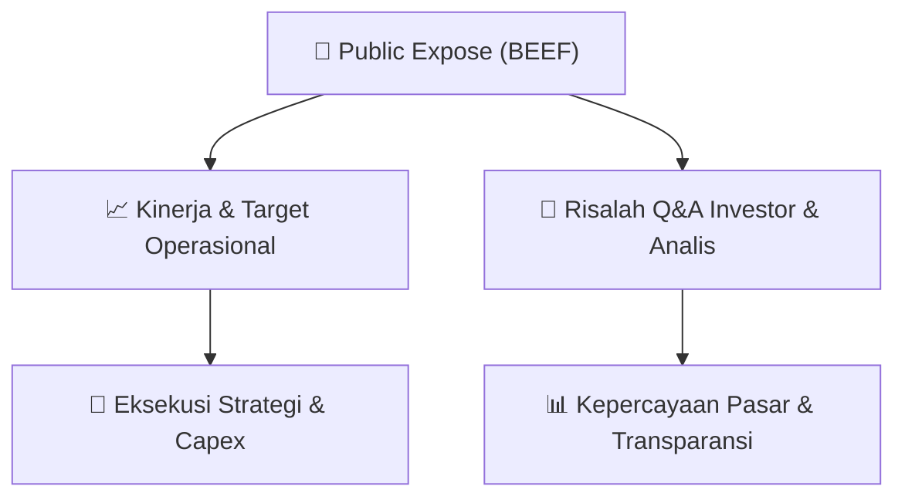

# 📢 Laporan Intelijen Paparan Publik (Public Expose) - [[BEEF]]
🏢 **Emiten**: `[[BEEF]]` | 📅 **Tanggal Pelaksanaan**: `2026-08-20` | 📑 **Dokumen**: `Public Expose`
⬅️ [[knowledge-base/daily-digests/Daily_Digest_20260820|Kembali ke Daily Digest]] | 🎛️ [[Dashboard|Ke Dashboard Utama]]

---

## 📌 1. Ringkasan Eksekutif & Paparan Direksi
> [!NOTE]
> PT Estika Tata Tiara Tbk (BEEF) mengumumkan rencana penyelenggaraan Public Expose Insidentil secara online (webinar) pada 24 Agustus 2026 pukul 14:00 WIB, dengan agenda keterbukaan informasi terkait suspensi cooling down atas saham BEEF. Public expose ini dilaksanakan atas permintaan Otoritas Jasa Keuangan (OJK) dengan referensi surat Peng-SPT-00149/BEI.WAS/08-2026. Pengumuman disampaikan oleh Corporate Secretary Ratna Sari Ismianti pada 20 Agustus 2026.

#### 🎯 Guidance Operasional & Target Strategis
- Tidak terdapat rincian target kinerja, ekspansi, atau capex dalam dokumen ini. Dokumen hanya merupakan pemberitahuan rencana Public Expose Insidentil yang bertujuan memberikan keterbukaan informasi sehubungan dengan suspensi cooling down saham BEEF. Investor perlu menantikan materi paparan pada tanggal 24 Agustus 2026 untuk memperoleh penjelasan manajemen mengenai penyebab suspensi dan langkah-langkah perseroan.

## 📊 2. Matriks Indikator Operasional & Parameter Kunci
| Parameter Utama | Nilai / Keterangan Resmi |
| :--- | :--- |
| **Nama Perusahaan** | `PT Estika Tata Tiara Tbk` |
| **Kode Emiten** | `BEEF` |
| **Jenis Public Expose** | `Insidentil` |
| **Latar Belakang Pelaksanaan** | `Permintaan Otoritas Jasa Keuangan (OJK)` |
| **Referensi Surat** | `Peng-SPT-00149/BEI.WAS/08-2026` |
| **Tempat** | `Webinar Online Pubex BEEF` |
| **Hari/Tanggal** | `24 Agustus 2026` |
| **Waktu** | `14:00` |
| **Agenda** | `Keterbukaan Informasi dari adanya Suspensi Cooling Down atas saham BEEF` |
| **Corporate Secretary** | `Ratna Sari Ismianti` |
| **Tanggal Pengumuman** | `20 Agustus 2026 10:41` |

---

## 💬 3. Risalah Tanya Jawab (Q&A Session)
`Materi presentasi Public Expose / Risalah Q&A terlampir dalam dokumen resmi bursa.`

## 📌 4. Peta Jalur Strategis & Roadmap

---

## 🔗 Knowledge Graph
- [[knowledge-base/daily-digests/Daily_Digest_20260820|📄 Daily Digest 2026-08-20]]
- [[knowledge-base/calendars/Action_Calendar|🗓️ Kalender Terpusat Aksi Korporasi]]
- [[Dashboard|🎛️ Kembali ke Dashboard Utama]]