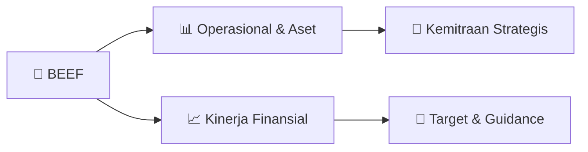

# 📊 Materi Public Expose: [BEEF]

🏢 **Emiten**: `BEEF` | 📅 **Tanggal Pelaksanaan**: `2026-08-20` | 📑 **Total Slide**: `2 Slide`
⬅️ [[knowledge-base/daily-digests/BEEF_20260820|Kembali ke Daily Digest]] | 🎛️ [[Dashboard/BEEF|Ke Dashboard Emiten]]

> [!NOTE]
> Ringkasan materi presentasi resmi Public Expose BEEF yang disampaikan oleh manajemen kepada investor dan bursa. Seluruh poin strategis, matriks operasional, dan angka kinerja diekstrak langsung dari slide deck resmi.

---

## 📅 1. Jadwal & Metadata Penyelenggaraan

| Parameter | Detail Informasi |
|---|---|
| **Nomor Surat Pengantar** | B.028-Corpsec-ETT-BEEF-VIII-2026 |
| **Perihal Pengumuman** | Penyampaian Materi Public Expose Insidentil |
| **Waktu Pelaksanaan** | 2026-08-20 20-08-2026 23:29 |
| **Lokasi / Media** | Aplikasi Zoom / Daring |
| **Lampiran Resmi** | `0` |

## 📋 2. Agenda Paparan Publik

- Pemaparan Profil & Struktur Bisnis Perseroan
- Kinerja Operasional & Keuangan
- Arah Strategi Usaha & Target Pertumbuhan
- Sesi Tanya Jawab (Q&A)

## 🏢 3. Profil & Pilar Portofolio Bisnis

## 🏗️ 4. Kinerja Operasional & Portofolio Aset

*Detail aset operasional terlampir pada dokumen slide resmi.*

## 📈 5. Kinerja Keuangan & Posisi Finansial

## 🧭 6. Inisiatif Strategis, Kolaborasi, & Kemitraan

- Letter / Announcement No.
Issuer Name Issuer Code Attachment Subject B.028-Corpsec-ETT-BEEF-VIII-2026
PT Estika Tata Tiara Tbk.
BEEF
Public Expose Material Submission
Go To Indonesian Page
Background Voluntary
Requested by IDX
Requested by OJK
Public Expose Material Submission
Reffering to Company's public expose announcement Incidental in Letter No. B.027-Corpsec-ETT-BEEF-VIII-2026
date 20 August 2026 Company submitted public expose material as attached.
Respectfully,
Thus to be informed accordingly.
PT Estika Tata Tiara Tbk.
Ratna Sari Ismianti
Corporate secretary
Ratna Sari Ismianti
Sender Name
PT Estika Tata Tiara Tbk.
Jl. Prof. DR. Soepomo No.176A, RT.1/RW.15, Menteng Dalam, Kec. Tebet, Kota
Phone : -, Fax : -, www.kibif.com
Corporate secretary Function
Date and Time
20-08-2026 23:29
This is an official document of PT Estika Tata Tiara Tbk. that does not require a signature as it was generated
electronically by the electronic reporting system. PT Estika Tata Tiara Tbk. is fully responsible for the information

## 🎯 7. Target Pertumbuhan & Guidance Manajemen

*Target pertumbuhan ditetapkan mengacu pada prospek industri dan kondisi makroekonomi terkini.*

## 🗺️ 8. Peta Jalur Strategis & Eksekusi

## 📑 9. Daftar Indeks Slide Presentasi

| Slide # | Judul / Topik Slide | Ringkasan Konten |
|---|---|---|
| Slide 1 | **Nomor Surat** | Nama Perusahaan Kode Emiten Lampiran |
| Slide 2 | **Letter / Announcement No.** | Issuer Name Issuer Code Attachment |

---

*Dokumen diolah otomatis oleh **Swarm Intelijen Pasar Modal Indonesia** pada 2026-10-12 16:42 WIB.*