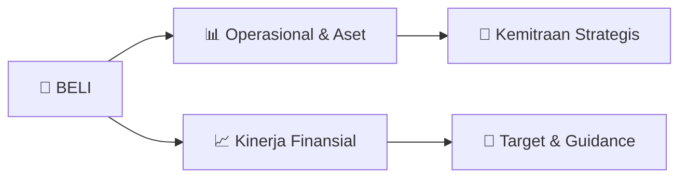

# 📊 Materi Public Expose: [BELI]

🏢 **Emiten**: `BELI` | 📅 **Tanggal Pelaksanaan**: `2026-09-30` | 📑 **Total Slide**: `2 Slide`
⬅️ [[knowledge-base/daily-digests/BELI_20260930|Kembali ke Daily Digest]] | 🎛️ [[Dashboard/BELI|Ke Dashboard Emiten]]

> [!NOTE]
> Ringkasan materi presentasi resmi Public Expose BELI yang disampaikan oleh manajemen kepada investor dan bursa. Seluruh poin strategis, matriks operasional, dan angka kinerja diekstrak langsung dari slide deck resmi.

---

## 📅 1. Jadwal & Metadata Penyelenggaraan

| Parameter | Detail Informasi |
|---|---|
| **Nomor Surat Pengantar** | 047/GDN-LEG/Corsec/SKL/IX/2026 |
| **Perihal Pengumuman** | Rencana Penyelenggaraan Public Expose Tahunan |
| **Waktu Pelaksanaan** | 14 Oktober 2026 14:00 |
| **Lokasi / Media** | Virtual melalui Zoom webinar yang dapat diakses melalui tautan |
| **Lampiran Resmi** | `1` |

## 📋 2. Agenda Paparan Publik

1. No.: 047/GDN-LEG/Corsec/SKL/IX/202
2. Jakarta, 30 September 202 6
3. Kepada Yth.: /
4. Direktur Penilaian Perusahaan
5. PT Bursa Efek Indonesia
6. (“BEI” atau “IDX”)
7. Gedung Bursa Efek Indonesia Tower 1
8. Jl. Jend. Sudirman Kav. 52 -53
9. Jakarta 12190
10. Perihal / Regarding : Pemberitahuan Rencana
11. Penyelenggaraan
12. Paparan Publ ik (Public
13. Expose ) Tahun 202 6 PT Global Digital Niaga Tbk
14. (“Perseroan”) /
15. Notification of Plan to Hold the Public Expose Year 202
16. 6 of PT
17. Global Digital Niaga Tbk (the “Company”)
18. Dengan hormat, /
19. Dear Sir/Madam,
20. Merujuk pada ketentuan
21. poin III.3 . Surat Keputusan Direksi BEI No.
22. Kep-00087/BEI/12 -2025
23. tentang Peraturan Nomor I-E tentang Kewajiban Penyampaian Informasi
24. (“Peraturan BE I No. I -
25. E”) dan Surat Edaran BEI No. SE -00003/BEI/05 -2020 perihal Tata Cara Pelaksanaan
26. Public
27. Expose Secara Elektronik , dengan ini kami menyampaikan rencana penyelenggaraan
28. Public
29. Expose Perseroan untuk Tahun 202 6, yang akan dilaksanakan secara virtual pada: /
30. Referring to the provision under point III.3. of the Decree of the Board of Directors of
31. the IDX No.
32. Kep -00087/BEI/12 -2025 on the Regulation No. I -E on Obligation of Information Disclosure (“IDX
33. Regulation No. I-E”) and IDX Circular Letter No. SE -00003/BEI/05 -2020 , hereby we submit the
34. plan to hold the Company's Public Expose for the Year 202
35. 6, which will be held virtually on:
36. Hari/Tanggal /
37. Day/Date
38. Rabu , 14 Oktober 202 6 /
39. Wednesday , 14 October 202 6
40. Waktu /
41. 14.00 – 15.00 WIB /
42. 2.00 – 3.00 PM Western Indonesia Time
43. Tempat /
44. Venue
45. Zoom Webinar
46. Tautan /
47. http://blib.li/BELIpubex2026
48. Agenda /
49. Agenda
50. Pemaparan Kinerja Perseroan
51. Presentation on the Company’s Performance

## 🏢 3. Profil & Pilar Portofolio Bisnis

## 🏗️ 4. Kinerja Operasional & Portofolio Aset

*Detail aset operasional terlampir pada dokumen slide resmi.*

## 📈 5. Kinerja Keuangan & Posisi Finansial

## 🧭 6. Inisiatif Strategis, Kolaborasi, & Kemitraan

- Public Expose ini akan dihadiri oleh anggota Direksi Perseroan sebagai berikut : /
This Public Expose will be attended by the
member s of the Board of Directors of the Company
, as follows:
•
Kusumo Martanto (Direktur Utama) / (President Director)
•
Eric Alamsjah Winarta (Direktur) * / (Director) *
•
Ronald Winardi (Direktur) / (Director)
•
Hendry (Direktur) / (Director)
•
Lisa Widodo (Direktur) / (Director)
•
Andy Untono (Direktur ) / (Director)
*Merangkap jabatan sebagai Sekretaris Perusahaan /
*Concurrent position as Corporate Secretary
Selanjutnya, m ateri Public Expose akan kami sampaikan
paling lambat 3 (tiga) hari bursa
sebelum tanggal penyelenggaraan
Public Expose
sesuai dengan ketentuan poin III.3.3.2
Peraturan BEI No. I -E. /
Furthermore, the Public Expose material
will be submitted no later than 3 (three) trading days
before the date of the Public Expose in accordance with th
e provision under point III.3. 3.2 of IDX
Regulation No. I -E.
Apabila terdapat pertanyaan lebih lanjut mengenai hal tersebut di atas
, mohon agar dapat
menghubungi Perseroan melalui email corp.sec@gdn -commerce.com . /
If there are any further queries on the above matter, please kindly contact the Company through
email to corp.sec@gdn -commerce.com .
Demikian pemberitahuan ini kami sampaikan, atas perhatiannya kami ucapkan terima kasih. /
Thus, we convey this notification, thank you for your attention.
Hormat kami, /
Yours sincerely ,
PT Global Digital Niaga Tbk
Eric Alamsjah Winarta
Direktur

## 🎯 7. Target Pertumbuhan & Guidance Manajemen

*Target pertumbuhan ditetapkan mengacu pada prospek industri dan kondisi makroekonomi terkini.*

## 🗺️ 8. Peta Jalur Strategis & Eksekusi

## 📑 9. Daftar Indeks Slide Presentasi

| Slide # | Judul / Topik Slide | Ringkasan Konten |
|---|---|---|
| Slide 1 | **1 No.: 047/GDN-LEG/Corsec/SKL/IX/202** | No.: 047/GDN-LEG/Corsec/SKL/IX/202 6 Jakarta, 30 September 202 6 |
| Slide 2 | **2 Public Expose ini akan dihadiri oleh anggota Direksi Perseroan sebagai berikut : /** | Public Expose ini akan dihadiri oleh anggota Direksi Perseroan sebagai berikut : / This Public Expose will be attended by the member s of the Board of |

---

*Dokumen diolah otomatis oleh **Swarm Intelijen Pasar Modal Indonesia** pada 2026-10-12 16:42 WIB.*