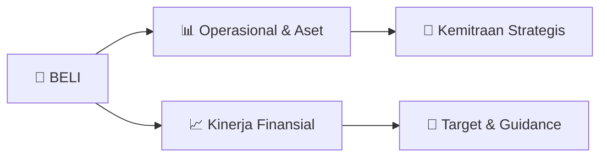

# 📊 Materi Public Expose: [BELI]

🏢 **Emiten**: `BELI` | 📅 **Tanggal Pelaksanaan**: `2026-10-09` | 📑 **Total Slide**: `28 Slide`
⬅️ [[knowledge-base/daily-digests/BELI_20261009|Kembali ke Daily Digest]] | 🎛️ [[Dashboard/BELI|Ke Dashboard Emiten]]

> [!NOTE]
> Ringkasan materi presentasi resmi Public Expose BELI yang disampaikan oleh manajemen kepada investor dan bursa. Seluruh poin strategis, matriks operasional, dan angka kinerja diekstrak langsung dari slide deck resmi.

---

## 📅 1. Jadwal & Metadata Penyelenggaraan

| Parameter | Detail Informasi |
|---|---|
| **Nomor Surat Pengantar** | 049/GDN-LEG/Corsec/SKL/X/2026 |
| **Perihal Pengumuman** | Penyampaian Materi Public Expose Tahunan |
| **Waktu Pelaksanaan** | 2026-10-09 09-10-2026 16:53 |
| **Lokasi / Media** | Aplikasi Zoom / Daring |
| **Lampiran Resmi** | `2` |

## 📋 2. Agenda Paparan Publik

1. Dukungan Penuh Pemegang Saham terhadap Prospek Jangka Panjang Perseroan pada RUPST & RUPSLB
2. Rapat Umum Pemegang Saham Tahunan & Luar
3. Biasa
4. Agenda yang Disetujui – RUPS Tahunan (4 Jun 2026)
5. Agenda yang Disetujui – RUPS Luar Biasa (15 Jun 2026)
6. Laporan Direksi untuk tahun buku yang berakhir pada 31 Desember 2025 , serta
7. laporan pelaksanaan tugas pengawasan Dewan Komisaris
8. Gaji dan tunjangan lain bagi Dewan Komisaris , serta pemberian wewenang kepada
9. Dewan Komisaris untuk menetapkan gaji dan tunjangan lain bagi Direksi untuk
10. tahun buku 2026
11. Wewenang Dewan Direksi untuk menunjuk Kantor Akuntan Publik untuk
12. melakukan audit atas laporan keuangan yang berakhir pada 31 Desember 2026
13. Perubahan susunan Dewan Komisaris Perseroan *)
14. Rencana Perseroan untuk melakukan Penambahan Modal Tanpa Hak Memesan
15. Efek Terlebih Dahulu (PMTHMETD) dalam rangka Program MESOP dan Selain
16. Program MESOP
17. Perubahan dan/atau penyesuaian Anggaran Dasar agar selaras dengan KBLI 2025
18. Catatan :
19. *) Imron Hendrata diangkat sebagai Komisaris Utama, menggantikan Martin Basuki Hartono;  Cyrillus Harinowo diangkat sebagai Komisaris Independen

## 🏢 3. Profil & Pilar Portofolio Bisnis

## 🏗️ 4. Kinerja Operasional & Portofolio Aset

> Paparan Publik – PT Global Digital Niaga Tbk
Catatan :
1. Earnings Before Interest, Tax, Depreciation and Amortization
(EBITDA) merupakan laba sebelum bunga, pajak, depresiasi aset tetap dan amortisasi aset tidak berwujud, dan tidak termasuk item tidak berulang , selama periode yang relevan
Fokus Produk Margin Lebih Tinggi dan Berbagai Langkah Efisiensi Menghasilkan Peningkatan EBITDA yang Berkelanjutan
Kinerja EBITDA EBITDA
(1) & Persentase EBITDA Terhadap TPV
(Rp miliar | %)
(997) (349) 1H 2025 1H 2026 (2,5%) (0,8 %) 0. +65% 0. +170bps

## 📈 5. Kinerja Keuangan & Posisi Finansial

### 📊 Ringkasan Finansial
```text
Paparan Publik – PT Global Digital Niaga Tbk
Mohon dapat dibaca sebelum melanjutkan ke bagian berikutnya
Dokumen ini (“Presentasi ”) disiapkan oleh PT Global Digital Niaga Tbk. (“Perseroan”) untuk tujuan informasi dan bukan merupakan rekomendasi atau penawaran untuk membeli sekuritas/efek apapun yang
dikeluarkan oleh Perseroan . Informasi yang terkandung dalam Presentasi ini tidak diverifikasi, disetujui, dan/atau didukung secara independen serta dapat berubah secara material. Informasi dan pendapat dalam
Presentasi ini bersifat awal, dapat berubah tanpa pemberitahuan , keakuratannya tidak dijamin, dan terdapat kemungkinan tidak memuat semua informasi material mengenai Perseroan . Tidak satu pun pihak dari
Perseroan, manajemen, afiliasi, pemegang saham, direktur, karyawan, agen , dan/atau penasihatnya masing-masing (bersama-sama, "Grup ") yang bertanggung jawab atau berkewajiban apa pun (karena kelalaian
atau sebaliknya ) atas keakuratan atau kelengkapan atau kelalaian apapun terkait informasi apapun yang terkandung di sini atau kerugian apapun yang timbul dari penggunaan informasi apapun di dalamnya.
Informasi yang terkandung dalam Presentasi ini harus dipertimbangkan dalam kontek
```

### 📊 Ringkasan Finansial
```text
Paparan Publik – PT Global Digital Niaga Tbk
Tinjauan Perseroan Ikhtisar Usaha
Ringkasan Kinerja Keuangan
BAGIAN 1
```

### 📊 Ringkasan Finansial
```text
Paparan Publik – PT Global Digital Niaga Tbk
Tinjauan Perseroan Ikhtisar Usaha
Ringkasan Kinerja Keuangan
BAGIAN 2
```

### 📊 Ringkasan Finansial
```text
Paparan Publik – PT Global Digital Niaga Tbk
Tinjauan Perseroan Ikhtisar Usaha
Ringkasan Kinerja Keuangan
BAGIAN 3
```

## 🧭 6. Inisiatif Strategis, Kolaborasi, & Kemitraan

- Paparan Publik – PT Global Digital Niaga Tbk
Catatan :
Data per 30 Sep 2026
1. Hingga 30-hari selama periode puncak (Idul Fitri, Natal, dll)
2. Medali Emas dalam Penghargaan Contact Center Terbaik Indonesia Tahun 2025 oleh ICCA
Jaringan Rantai Pasok dan Distribusi Terintegrasi
Jaringan Pergudangan Modern
Kapabilitas Pemenuhan yang Kuat
Pengiriman Konsumen Akhir Terintegrasi
Manajemen Retur Terbaik
15 Gudang
4 Jabodetabek, 5 Jawa, and 6 Non-Jawa
200.000+ m
Jumlah luas area gudang
24/7 Operasional 365 hari
19 Pusat Distribusi
Model Hub -and-Spoke
Gudang Marunda
~100.000 m 2 luas area
Manajemen logistik & rantai pasok pintar
Pengiriman 1PL
250+ kurir terlatih
250+ armada pengiriman
40+ kota terjangkau
15+ of 3PL
Kemitraan strategis 100% Jangkauan nasional
Pengiriman 2-Jam Sampai
480.000+ SKUs di 43 kota
Fulfillment at Speed
Layanan Pemenuhan Terpadu
Fulfillment by Blibli
Jaminan layanan & kualitas
Solusi Retur Fleksibel & Cepat
Cakupan Retur yang Luas
15-hari (1) Kebijakan retur
Hari yang Sama
Waktu Resolusi 56.000+
Titik pengembalian nasional
420+ Kota
Tersedia untuk pengambilan
Kontak Layanan Pemenang
Penghargaan (2) Pengiriman Prioritas
Pesanan sampai mulai dari 30 menit
Pergudangan Modern, Pemenuhan Pesanan , Pengiriman Konsumen Akhir serta Penanganan Retur & Layanan Pelanggan

## 🎯 7. Target Pertumbuhan & Guidance Manajemen

*Target pertumbuhan ditetapkan mengacu pada prospek industri dan kondisi makroekonomi terkini.*

## 🗺️ 8. Peta Jalur Strategis & Eksekusi



## 📑 9. Daftar Indeks Slide Presentasi

| Slide # | Judul / Topik Slide | Ringkasan Konten |
|---|---|---|
| Slide 1 | **Kode BEI: BELI** | Paparan Publik PT Global Digital Niaga Tbk 14 Oktober 2026 |
| Slide 2 | **Paparan Publik – PT Global Digital Niaga Tbk** | Mohon dapat dibaca sebelum melanjutkan ke bagian berikutnya 2 Dokumen ini (“Presentasi ”) disiapkan oleh PT Global Digital Niaga Tbk. (“Perseroan”) un |
| Slide 3 | **Paparan Publik – PT Global Digital Niaga Tbk** | Pertumbuhan Sehat dengan Peningkatan Marjin yang Kuat; Ekspansi Omnichannel dan Integrasi Ekosistem yang Berkelanjutan Struktur biaya yang lebih baik  |
| Slide 4 | **Paparan Publik – PT Global Digital Niaga Tbk** | Dukungan Penuh Pemegang Saham terhadap Prospek Jangka Panjang Perseroan pada RUPST & RUPSLB 4 Rapat Umum Pemegang Saham Tahunan & Luar |
| Slide 5 | **Paparan Publik – PT Global Digital Niaga Tbk** | Tinjauan Perseroan Ikhtisar Usaha Ringkasan Kinerja Keuangan |
| Slide 6 | **Paparan Publik – PT Global Digital Niaga Tbk** | 6 VISI Menjadi Ekosistem Perdagangan Pilihan Bagi |
| Slide 7 | **Paparan Publik – PT Global Digital Niaga Tbk** | 7 Membangun Layanan dan |
| Slide 8 | **Paparan Publik – PT Global Digital Niaga Tbk** | 8 z Platform Daring |
| Slide 9 | **Paparan Publik – PT Global Digital Niaga Tbk** | 9 Pelanggan Menumbuhkan kesadaran melalui |
| Slide 10 | **Paparan Publik – PT Global Digital Niaga Tbk** | Tinjauan Perseroan Ikhtisar Usaha Ringkasan Kinerja Keuangan |
| Slide 11 | **Paparan Publik – PT Global Digital Niaga Tbk** | Toko Fisik Elektronik Konsumen |
| Slide 12 | **Paparan Publik – PT Global Digital Niaga Tbk** | 12 Catatan : Jumlah kehadiran omnichannel per 30 Sep 2026 |
| Slide 13 | **Paparan Publik – PT Global Digital Niaga Tbk** | 13 Notes: Jumlah kehadiran omnichannel per 30 Sep 2026 |
| Slide 14 | **Paparan Publik – PT Global Digital Niaga Tbk** | Catatan : Jumlah kehadiran omnichannel per 30 Sep 2026 1. |
| Slide 15 | **Paparan Publik – PT Global Digital Niaga Tbk** | 15 Catatan : Data per 30 Sep 2026 |
| Slide 16 | **Paparan Publik – PT Global Digital Niaga Tbk** | 16 Meningkatkan Integrasi Rantai Pasok dan Mempercepat Efisiensi Pemenuhan Pesanan bagi Pelanggan & Mitra Layanan Fulfillment at Speed |
| Slide 17 | **Paparan Publik – PT Global Digital Niaga Tbk** | 17 Keanggotaan Terpadu Program Loyalitas Terpadu |
| Slide 18 | **Paparan Publik – PT Global Digital Niaga Tbk** | 18 Catatan : Data per 30 Jun 2026 |
| Slide 19 | **Paparan Publik – PT Global Digital Niaga Tbk** | 19 Catatan : Data per 30 Jun 2026 |
| Slide 20 | **Paparan Publik – PT Global Digital Niaga Tbk** | 20 Melangkah Maju Melalui Aksi Demi Masa Depan yang Berkelanjutan Komitmen Keberlanjutan |
| Slide 21 | **Paparan Publik – PT Global Digital Niaga Tbk** | Tinjauan Perseroan Ikhtisar Usaha Ringkasan Kinerja Keuangan |
| Slide 22 | **Paparan Publik – PT Global Digital Niaga Tbk** | 22% 11% 58% |
| Slide 23 | **Paparan Publik – PT Global Digital Niaga Tbk** | 2.135 3.016 420 |
| Slide 24 | **Paparan Publik – PT Global Digital Niaga Tbk** | 111,2 63,8 106,0 |
| Slide 25 | **Paparan Publik – PT Global Digital Niaga Tbk** | 454 225 291 |
| Slide 26 | **Paparan Publik – PT Global Digital Niaga Tbk** | 26 Catatan : 1. Beban Penjualan Lain-lain merupakan Jumlah Beban Penjualan setelah dikurangi Beban Iklan & Pemasaran serta Beban Gudang, Pengepakan &  |
| Slide 27 | **Paparan Publik – PT Global Digital Niaga Tbk** | 27 Catatan : 1. Earnings Before Interest, Tax, Depreciation and Amortization |
| Slide 28 | **Terima Kasih** | Untuk informasi lebih lanjut, silakan hubungi : corp.sec@gdn -commerce.com |

---

*Dokumen diolah otomatis oleh **Swarm Intelijen Pasar Modal Indonesia** pada 2026-10-12 16:43 WIB.*