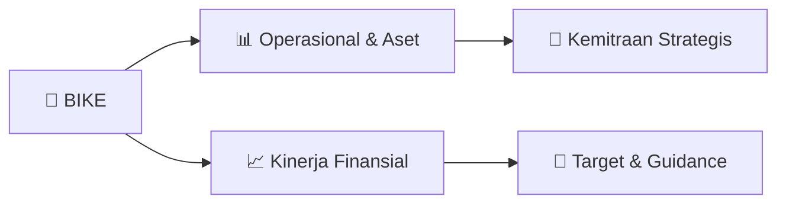

# 📊 Materi Public Expose: [BIKE]

🏢 **Emiten**: `BIKE` | 📅 **Tanggal Pelaksanaan**: `2026-09-22` | 📑 **Total Slide**: `1 Slide`
⬅️ [[knowledge-base/daily-digests/BIKE_20260922|Kembali ke Daily Digest]] | 🎛️ [[Dashboard/BIKE|Ke Dashboard Emiten]]

> [!NOTE]
> Ringkasan materi presentasi resmi Public Expose BIKE yang disampaikan oleh manajemen kepada investor dan bursa. Seluruh poin strategis, matriks operasional, dan angka kinerja diekstrak langsung dari slide deck resmi.

---

## 📅 1. Jadwal & Metadata Penyelenggaraan

| Parameter | Detail Informasi |
|---|---|
| **Nomor Surat Pengantar** | 2026/261/IX/BIKE/EK |
| **Perihal Pengumuman** | Rencana Penyelenggaraan Public Expose Insidentil |
| **Waktu Pelaksanaan** | 24 September 2026 15:00 |
| **Lokasi / Media** | ONLINE |
| **Lampiran Resmi** | `1` |

## 📋 2. Agenda Paparan Publik

1. : 2026/261/IX/BIKE/EK
2. Perihal  : Penyampaian Rencana Penyelenggaraan Public Expose Insidentil PT BIKE Tbk.
3. Kepada Yth Direktur Utama
4. PT Bursa Efek Indonesia
5. Gedung Bursa Efek Indonesia Menara I Lantai 6
6. Jl. Jend. Sudirman Kav. 52-53
7. Jakarta
8. Dengan Hormat,
9. Sehubungan
10. dengan
11. Pengumuman
12. Bursa
13. Indonesia
14. Nomor
15. Peng-SPT-
16. 00181/BEI.WAS/09-2026 tanggal 21 September 2026 perihal penghentian sementara
17. perdagangan saham PT Bhineka Inovasi Ketahanan Energi Tbk (BIKE) atau Suspensi
18. Cooling Down tanggal 21 September 2026 dan merujuk pada permintaan BEI via email
19. tanggal 21 September 2026 perihal Permintaan Pelaksanaan Public Expose Insidentil,
20. bersama ini kami sampaikan rencana penyelenggaran Public Expose Insidentil PT Bhineka
21. Inovasi Ketahanan Energi Tbk (BIKE) sebagai berikut:
22. Hari/Tanggal    : Kamis, 24 September 2026
23. Waktu
24. : 15.00 WIB
25. Media
26. : Online (Zoom)
27. Agenda           :
28. 1. Informasi terkait perkembangan kinerja dan operasional terkini
29. Perseroan dan anak perusahaan,
30. 2. Summary Laporan Keuangan terakhir/terkini,
31. 3. Rencana Usaha Perseroan dan anak perusahaan ke depannya,
32. 4. Informasi material lainnya yang belum disampaikan kepada publik.
33. Link Registrasi : https://bit.ly/4AlxdeB
34. Kami akan menyampaikan tautan (link) live zoom acara Public Expose melalui email kepada
35. peserta yang telah melakukan registrasi pada tautan yang telah disediakan pada
36. pemberitahuan ini. Lebih lanjut materi Public Expose Insidentil akan kami sampaikan pada
37. hari Rabu, 23 September 2026.
38. Demikian surat penyampaian rencana penyelenggaraan Public Expose Insidentil ini kami
39. sampaikan. Atas perhatian dan kerjasama yang diberikan kami ucapkan terima kasih.
40. Hormat kami,
41. PT Bhineka Inovasi Ketahanan Energi Tbk.
42. (Erick Kusuma)
43. Direktur Utama

## 🏢 3. Profil & Pilar Portofolio Bisnis

## 🏗️ 4. Kinerja Operasional & Portofolio Aset

*Detail aset operasional terlampir pada dokumen slide resmi.*

## 📈 5. Kinerja Keuangan & Posisi Finansial

## 🧭 6. Inisiatif Strategis, Kolaborasi, & Kemitraan

*Strategi usaha difokuskan pada penguatan fundamental dan ekspansi operasional.*

## 🎯 7. Target Pertumbuhan & Guidance Manajemen

*Target pertumbuhan ditetapkan mengacu pada prospek industri dan kondisi makroekonomi terkini.*

## 🗺️ 8. Peta Jalur Strategis & Eksekusi

## 📑 9. Daftar Indeks Slide Presentasi

| Slide # | Judul / Topik Slide | Ringkasan Konten |
|---|---|---|
| Slide 1 | **Tangerang, 22 September 2026** | No : 2026/261/IX/BIKE/EK Perihal  : Penyampaian Rencana Penyelenggaraan Public Expose Insidentil PT BIKE Tbk. |

---

*Dokumen diolah otomatis oleh **Swarm Intelijen Pasar Modal Indonesia** pada 2026-10-12 16:43 WIB.*