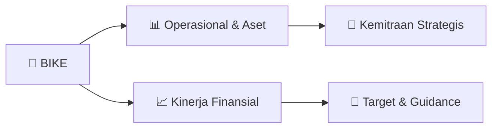

# 📊 Materi Public Expose: [BIKE]

🏢 **Emiten**: `BIKE` | 📅 **Tanggal Pelaksanaan**: `2026-09-23` | 📑 **Total Slide**: `13 Slide`
⬅️ [[knowledge-base/daily-digests/BIKE_20260923|Kembali ke Daily Digest]] | 🎛️ [[Dashboard/BIKE|Ke Dashboard Emiten]]

> [!NOTE]
> Ringkasan materi presentasi resmi Public Expose BIKE yang disampaikan oleh manajemen kepada investor dan bursa. Seluruh poin strategis, matriks operasional, dan angka kinerja diekstrak langsung dari slide deck resmi.

---

## 📅 1. Jadwal & Metadata Penyelenggaraan

| Parameter | Detail Informasi |
|---|---|
| **Nomor Surat Pengantar** | 2026/262/IX/BIKE/EK |
| **Perihal Pengumuman** | Penyampaian Materi Public Expose Insidentil |
| **Waktu Pelaksanaan** | 2026-09-23 23-09-2026 23:46 |
| **Lokasi / Media** | Aplikasi Zoom / Daring |
| **Lampiran Resmi** | `2` |

## 📋 2. Agenda Paparan Publik

1. 1. Informasi terkait perkembangan kinerja dan operasional terkini Perseroan dan
2. anak perusahaan,
3. 2.Summary Laporan Keuangan terakhir/terkini,
4. 3.Rencana Usaha Perseroan dan anak perusahaan ke depannya,
5. 4.Informasi material lainnya yang belum disampaikan kepada publik.

## 🏢 3. Profil & Pilar Portofolio Bisnis

## 🏗️ 4. Kinerja Operasional & Portofolio Aset

> Summary Laporan Keuangan
Terkini
Ringkasan Kondisi Keuangan Terkini per 30 Juni 2026
Pendapatan Bersih : Rp121,12 M
Rugi Bersih
: Rp19,18 M
Total Aset
: Rp98,02 M
Total Liabilitas
: Rp32,50 M
Total Ekuitas
: Rp65,52 M
• Pendapatan bersih dan rugi bersih merupakan periode 1 Januari–30 Juni 2026.
Total aset, liabilitas, dan ekuitas merupakan posisi per 30 Juni 2026.

> Penguatan Modal Kerja :Mendukung kebutuhan operasional dan pengembangan
usaha.
Dukungan Anak Perusahaan : Penyediaan fasilitas pendanaan kepada anak
perusahaan yang akan diakuisisi.
Pengembangan Usaha : Mendukung pelaksanaan kegiatan usaha dan proyek
sesuai dengan kebutuhan dan rencana usaha.
Rencana Penyuntikan/Peminjaman Modal Kerja
Penguatan modal kerja secara bertahap untuk mendukung operasional
dan pengembangan usaha Perseroan serta anak perusahaan

## 📈 5. Kinerja Keuangan & Posisi Finansial

## 🧭 6. Inisiatif Strategis, Kolaborasi, & Kemitraan

- Informasi Terkait Perkembangan dan Operasional Terkini
Perseroan dan Anak Perusahaan
Perseroan tetap menjalankan kegiatan usaha eksisting di bidang sepeda dan
alat olahraga. Sejalan dengan perkembangan usaha, Perseroan mulai
menjajaki kerja sama dengan beberapa pihak dan telah menandatangani
beberapa MoU sebagai tahap awal kerja sama.
Saat ini, Perseroan sedang mempersiapkan rencana pengembangan usaha
dan penguatan modal kerja. Rencana pengembangan usaha sedang dalam
proses penyusunan Feasibility Study (FS) oleh KJPP, sedangkan rencana
penguatan modal kerja sedang dikaji melalui Fairness Opinion (FO) oleh KJPP.
Rencana tersebut masih dalam tahap proses kajian pihak KJPP dan sesuai
dengan ketentuan yang berlaku serta demi terpenuhinya persetujuan
dan/atau perizinan yang diperlukan.

## 🎯 7. Target Pertumbuhan & Guidance Manajemen

*Target pertumbuhan ditetapkan mengacu pada prospek industri dan kondisi makroekonomi terkini.*

## 🗺️ 8. Peta Jalur Strategis & Eksekusi

## 📑 9. Daftar Indeks Slide Presentasi

| Slide # | Judul / Topik Slide | Ringkasan Konten |
|---|---|---|
| Slide 1 | **PUBLIC EXPOSE** | INSIDENTIL PT BHINEKA INOVASI KETAHANAN ENERGI TBK Jakarta , 24 September 2026 |
| Slide 2 | **AGENDA** | 1. Informasi terkait perkembangan kinerja dan operasional terkini Perseroan dan anak perusahaan, 2.Summary Laporan Keuangan terakhir/terkini, |
| Slide 3 | **TATA TERTIB PUBLIC EXPOSE INSIDENTIL** | 1. Public Expose Insidentil diselenggarakan secara Zoom Meeting (Online). 2.Pelaksanaan Public |
| Slide 4 | **LATAR BELAKANG** | Public Expose Insidentil 21 September 20266 Surat Penghentian Sementara Perdagangan Saham atau Suspensi Cooling Down dari BEI |
| Slide 5 | **Saham BIKE mengalami kenaikan harga kumulatif yang signifikan,** | sehingga BEI melakukan |
| Slide 6 | **INFORMASI MATERIAL LAINNYA** | Pergerakan Harga Saham 01 |
| Slide 7 | **Informasi** | Terkait Perkembangan dan Operasional Terkini |
| Slide 8 | **Summary Laporan Keuangan** | Terkini 02 Ringkasan Kondisi Keuangan Terkini per 30 Juni 2026 |
| Slide 9 | **Rencana Usaha Perseroan dan Anak** | Perusaan Kedepannya Stra te g i Pe n g e m b a n g a n Pe rs e roa n d a n m e m p e rlu a s lin i b is n is u s a h a . |
| Slide 10 | **Perseroan sudah melakukan kajian atas rencana akuisisi anak perusahaan** | seperti PT.RK, PT.PEG,PT.FDP, PT.SMI,PT.MTI dan PTK.BI  dengan mempertimbangkan hasil kajian/due diligence serta persetujuan dan pemenuhan ketentuan y |
| Slide 11 | **Penguatan Modal Kerja :Mendukung kebutuhan operasional dan pengembangan** | usaha. Dukungan Anak Perusahaan : Penyediaan fasilitas pendanaan kepada anak perusahaan yang akan diakuisisi. |
| Slide 12 | **Informasi** | Material Lainnya Yang Belum Disampaikan Kepada Publik |
| Slide 13 | **THANK YOU** | (021) 3005 26330 www.bike-tbk.co.id Jl. Boulevard Alam Sutera No. 12A, |

---

*Dokumen diolah otomatis oleh **Swarm Intelijen Pasar Modal Indonesia** pada 2026-10-12 16:43 WIB.*