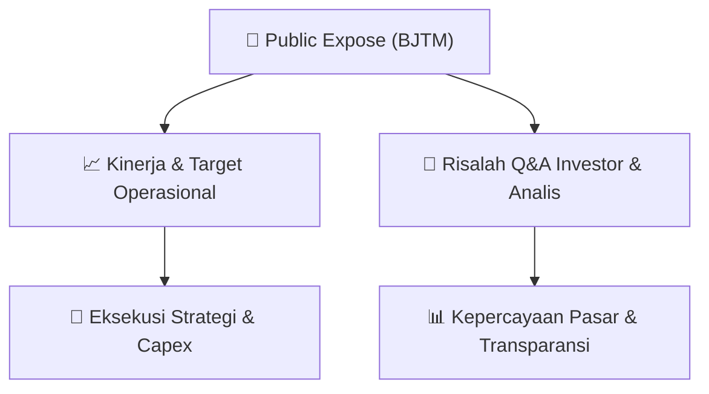

# 📢 Laporan Intelijen Paparan Publik (Public Expose) - [[BJTM]]
🏢 **Emiten**: `[[BJTM]]` | 📅 **Tanggal Pelaksanaan**: `2026-08-26` | 📑 **Dokumen**: `Public Expose`
⬅️ [[knowledge-base/daily-digests/Daily_Digest_20260826|Kembali ke Daily Digest]] | 🎛️ [[Dashboard|Ke Dashboard Utama]]

---

## 📌 1. Ringkasan Eksekutif & Paparan Direksi
> [!NOTE]
> Bank Pembangunan Daerah Jawa Timur Tbk (BJTM) menyampaikan pengumuman resmi rencana penyelenggaraan Public Expose Tahunan untuk tahun buku yang berakhir pada 2026. Acara akan dilaksanakan pada 09 September 2026 pukul 11:00 melalui platform Public Expose Live 2026 yang tercantum pada website idx.co.id, dengan agenda pemaparan kinerja perseroan. Dokumen ini hanya merupakan pemberitahuan jadwal dan tidak memuat rincian kinerja keuangan, materi presentasi, atau tanya jawab.

#### 🎯 Guidance Operasional & Target Strategis
- Dokumen tidak memuat guidance operasional, target kinerja, rencana ekspansi, alokasi belanja modal, maupun proyeksi keuangan. Informasi yang tersedia hanya sebatas rencana pelaksanaan Public Expose Tahunan BJTM pada 09 September 2026 pukul 11:00 WIB melalui Public Expose Live 2026 di website idx.co.id dengan agenda pemaparan kinerja perseroan.

## 📊 2. Matriks Indikator Operasional & Parameter Kunci
| Parameter Utama | Nilai / Keterangan Resmi |
| :--- | :--- |
| **Nama Perusahaan** | `Bank Pembangunan Daerah Jawa Timur Tbk` |
| **Kode Emiten** | `BJTM` |
| **Jenis Acara** | `Public Expose Tahunan` |
| **Tahun Buku** | `2026` |
| **Tempat** | `Public Expose Live 2026 yang tercantum pada website idx.co.id` |
| **Hari/Tanggal** | `09 September 2026` |
| **Waktu** | `11:00` |
| **Agenda** | `Pemaparan Kinerja Perseroan` |
| **Corporate Secretary** | `Fenty Rischana K` |
| **Alamat** | `Jl Basuki Rachmad 98-104 Surabaya` |
| **Telepon** | `(031) 5310090-99 ext.463` |
| **Fax** | `(031) 5310838` |
| **Website** | `www.bankjatim.co.id` |
| **Tanggal Pengumuman** | `26-08-2026 09:12` |

---

## 💬 3. Risalah Tanya Jawab (Q&A Session)
`Materi presentasi Public Expose / Risalah Q&A terlampir dalam dokumen resmi bursa.`

## 📌 4. Peta Jalur Strategis & Roadmap

---

## 🔗 Knowledge Graph
- [[knowledge-base/daily-digests/Daily_Digest_20260826|📄 Daily Digest 2026-08-26]]
- [[knowledge-base/calendars/Action_Calendar|🗓️ Kalender Terpusat Aksi Korporasi]]
- [[Dashboard|🎛️ Kembali ke Dashboard Utama]]