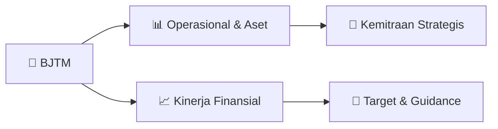

# 📊 Materi Public Expose: [BJTM]

🏢 **Emiten**: `BJTM` | 📅 **Tanggal Pelaksanaan**: `2026-09-04` | 📑 **Total Slide**: `24 Slide`
⬅️ [[knowledge-base/daily-digests/BJTM_20260904|Kembali ke Daily Digest]] | 🎛️ [[Dashboard/BJTM|Ke Dashboard Emiten]]

> [!NOTE]
> Ringkasan materi presentasi resmi Public Expose BJTM yang disampaikan oleh manajemen kepada investor dan bursa. Seluruh poin strategis, matriks operasional, dan angka kinerja diekstrak langsung dari slide deck resmi.

---

## 📅 1. Jadwal & Metadata Penyelenggaraan

| Parameter | Detail Informasi |
|---|---|
| **Nomor Surat Pengantar** | 065/19/CSE/CMAI/Srt |
| **Perihal Pengumuman** | Penyampaian Materi Public Expose Tahunan |
| **Waktu Pelaksanaan** | 2026-09-04 04-09-2026 13:50 |
| **Lokasi / Media** | Aplikasi Zoom / Daring |
| **Lampiran Resmi** | `1` |

## 📋 2. Agenda Paparan Publik

- Pemaparan Profil & Struktur Bisnis Perseroan
- Kinerja Operasional & Keuangan
- Arah Strategi Usaha & Target Pertumbuhan
- Sesi Tanya Jawab (Q&A)

## 🏢 3. Profil & Pilar Portofolio Bisnis

### 🏛️ Pilar Usaha & Aset Utama
- Pilar Utama Transformasi
Visi Misi Indikator Utama Transformasi Roadmap Strategi Support
Menjadi BPD Nomor 1 di Indonesia
Akselerasi kinerja dan transformasi bisnis
yang sehat menuju digital bank dengan
SDM yang berdaya saing tinggi
Memberikan kontribusi
pertumbuhan ekonomi Jawa
Timur Menerapkan prinsip-prinsip keuangan berkelanjutan Pilar 1 Pilar 2 Pilar 3 Pilar 4 Pilar 5
Rule making Rules beserta
penguatan Tata Kelola &
Manajemen Risiko Optimalisasi Ekosistem
Bisnis Konven dan Syariah
Transformasi Human Capital
Fokus pada 4 pilar
Transformasi IT dan Digital
Banking Support to Bisnis
Transformasi Jaringan &
Optimalisasi KUB
• Pengkinian peraturan internal
agar relevan dengan praktik
bisnis perbankan namun tidak
meninggalkan prinsip kehati-
hatian sesuai dengan
peraturan yang berlaku
• Penguatan tata Kelola dan
manajemen risiko proses
bisnis internal berbasis
customer-centric
• Memperluas akses kredit
terintegrasi melalui kemitraan
strategis dan ekosistem
UMKM sekaligus
mengakselerasi 

## 🏗️ 4. Kinerja Operasional & Portofolio Aset

> Mendorong Pertumbuhan Ekonomi Melalui Penetrasi Penguasaan Pasar
Pemerintah Daerah
• Transaksi Keuangan Pemerintah Daerah & Desa
(Payroll, Anggaran)
• Fasilitas & Layanan Keuangan  bagi Aparatur Siil
Negara UMKM
• Potensi jutaan UMKM di Jawa Timur
• Jaringan  & Layanan Digital di seluruh kota dan
kabupaten di Jawa Timur
Sektor Swasta
• Transaksi Keuangan pada Sektor
Publik/Swasta
• Fasilitas & Layanan Keuangan  kepada
Institusi, Proyek Pemerintah, dan Swasta
EDC

> Tumbuh Berkembang Secara Berkesinambungan
Optimalisasi Pengelolaan Likuiditas
Penyaluran Pinjaman Secara Selektif
Manajemen Pendapatan & Beban Keuangan
Pengendalian Kualitas Aset
Pemenuhan dan penyediaan likuiditas melalui dana murah masyarakat melalui layanan transaksional berbasis digital
dan pengelolaan dana dari dunia korporasi.
Fokus pada penyaluran pinjaman secara selektif pada sektor yang prospektif  dan memiliki potensi Risiko yang
moderat.
Disiplin dalam pengaturan pos pendapatan dan beban melalui efisiensi dan meningkatkan volume transaksi digital.
Pengendalian kualitas asset agar sesuai dengan risk appetitte.

> Kinerja Keuangan Juni 2026 (Konsolidasi)
Neraca (YoY %)
Laba/Rugi (YoY %)
12,568 91,600 78,551 118,156 13,063 120,425 111,288 162,057
3.94%
31.47% 41.68% 37.16% Ekuitas DPK KYD Aset %
1H26 (Rp Miliar)
1H25 (Rp Miliar)
708 811 1,886 3,339 4,842 729 1,245 2,329 4,661 6,607
3.05%
53.49% 23.45% 39.59% 36.46%
Laba Bersih yang
Dapat Distribusikan kepada Pemilik Entitas Induk Laba Bersih Laba Operasional Sebelum Provisi Pendapatan Bunga Bersih Pendapatan Bunga %
1H26 (Rp Miliar)
1H25

> KINERJA KUB BJTM (Juni 2026)
Aset 16,921,982 18,850,936 12,981,346 11,555,273 10,401,529 Loan 12,508,372 13,844,488 9,573,692 7,911,832 5,959,813 Deposit 13,207,466 15,099,302 9,397,530 8,934,491 6,763,123 Laba Bersih 102,544 81,195 196,330 133,623 21,360 CAR 20.58% 25.97% 37.32% 29.23% 33.73% ROE 11.45% 6.15% 17.79% 17.25%
2.74%
ROA
1.53%
0.98%
4.00%
3.01%
0.41% NIM
5.58%
4.66%
8.09% 7.01%
3.19%
BOPO 82.41% 89.25% 61.27% 72.94% 91.47% NPL Gross
3.38%
3.49%
1.07%
2.86%
4.51%
LDR 94.71% 91.69% 101.87% 88.55% 85.58% CASA 49.20% 45.61% 57.28% 50.78% 23.48%

> Neraca & Laporan Laba/Rugi (Bank Only)
(Rp Miliar) 7M25 7M26 YoY FY25 1Q26 1H26 Aset 105,047 98,094
-6.62% 106,108 101,068 101,899
Penempatan pada Bank
5,686 5,577
-1.92%
6,074 7,526 7,823
Surat Berharga yang Dimiliki
27,975 21,959 -21.51% 29,136 23,969 23,065 KYD 68,293 66,461
-2.68%
67,244 65,978 67,450 CKPN (2,519) (2,739) 8.76% (2,744) (2,913) (2,963)
--Surat Berharga
(0.55) (0.16) -70.93% (0.23) (0.19) (0.19)
- Kredit
(2,439) (2,660) 9.06% (2,665) (2,833) (2,883)
- Lainnya
(79) (80) 0.21% (80) (80) (80) DPK 81,662 72,967 -10.65% 78,607 72,551 73,786
-  Giro
20,624 17,542 -14.94% 21,407 16,828 17,755
- Tabungan
29,622 29,048
-1.94%
30,858 29,020 29,653
-  Deposito Berjangka
31,415 26,377 -16.04% 26,342 26,703 26,379 EKUITAS 12,700 13,107
3.21%
13,659 13,745 13,047
(Rp Miliar) 7M25 7M26 YoY FY25 1Q26 1H26 Pendapatan Bunga 4,865 4,586 -5.74% 8,555 1,981 3,926 Beban Bunga (1,445) (1,194) -17.38% (2,425) (511) (1,016)
Pendapatan Bunga Bersih
3,420 3,392 -0.82% 6,130 1,470 2,909
Pendapatan Ops. Non-Bunga
622 650
4.56%
1,096 298 584
Beban Ops. Non-Bunga
(2,098) (2,261) 7.74% (3,530) (989) (1,943)
Laba Operasional Sebelum
Provisi 1,943 1,781 -8.34% 3,696 779 1,550 CKPN (889) (822)
-7.

> Rasio Keuangan Triwulanan (Bank Only)
RATIO 3M24 1H24 9M24 FY24 3M25 1H25 9M25 FY25 3M26 1H26 7M26 Profitabilitas ROA
1.59%
1.53%
1.63%
1.60%
1.50%
1.77%
1.76%
1.90%
1.90%
1.80%
1.75%
ROE 11.24% 10.85% 11.57% 11.89% 10.37% 12.33% 12.36% 13.35% 11.75% 11.43% 11.19% NIM
5.43%
5.50%
5.72%
5.86%
6.32% 6.15% 6.09% 6.15%
5.95%
5.90%
5.93%
BOPO 81.20% 81.35% 80.40% 81.89% 84.20% 80.45% 80.51% 79.92% 84.54% 82.14% 82.15% Likuiditas LDR 70.49% 71.68% 70.85% 82.05% 85.89% 85.00% 80.29% 85.39% 90.76% 91.24% 90.92% CAR 23.73% 22.53% 23.06% 23.49% 24.37% 23.14% 23.14% 25.38% 26.22% 23.72% 24.29% CASA 60.59% 59.22% 56.90% 65.14% 62.53% 61.55% 60.20% 66.49% 63.19% 64.25% 63.85% Kualitas Aset NPL
2.82%
3.08%
2.97%
3.45%
3.87%
4.15%
4.10%
3.88%
4.29%
4.38%
4.24%
Coverage Ratio 100.88%
86.14% 88.12% 90.07% 88.42% 86.66% 90.94% 102.12% 100.07% 97.56% 94.34% Credit Cost
2.05%
1.42%
1.48%
1.95%
2.73%
2.26%
2.60%
2.55%
2.53%
2.17%
2.12%

> East   Java   Economic
Penyehatan Kualitas Asset
NPL berdasarkan Segmentasi
Pengendalian NPL Refocusing Kualitas Aset Credit Cost
Hapus Buku & Recovery
METODE KURATIF:
1.
Restrukturisasi & Hapus Buku;
2.
Keringanan Bunga & Denda;
3.
Lelang Agunan dan Penebusan Sebagian
Agunan Kredit;
4.
Gugatan Sederhana METODE PREVENTIF:
1.
Perbaikan business process terutama
untuk sektor tertentu yang memilik risk
profile khusus;
2.
Peningkatan Kompetensi Pegawai;
3.
Program Rewards;
4.
Monitoring & Controlling Berkala.
1.18%
1.21%
1.21%
1.32%
1.35%
1.43%
1.54%
2.98%
2.89%
2.68%
2.92%
2.94%
2.95%
2.71%
4.15%
4.10%
3.88%
4.24%
4.29%
4.38%
4.24%
1H25 9M25 FY25 2M26 3M26 1H26 7M26 Konsumer Non-Konsumer NPL
90.07% 88.42% 86.66%
90.94% 102.12%100.07%97.56% 94.34% FY24 3M25 1H25 9M25 FY25 3M26 1H26 7M26 Coverage Ratio
3.45%
3.87%
4.15%
4.10%
3.88%
4.29%
4.38%
4.24%
NPL
1.95%
2.37% 2.26% 2.32% 2.55% 2.53%
2.17% 2.12%
FY24 3M25 1H25 9M25 FY25 3M26 1H26 7M26 Credit Cost 1,988 2,275 2,423 2,541 2,668 2,833 2,883 2,660 CKPN 451 197 584 632 192 575 18.60% 16.19% Jan-Des 25 Jan-Jul 26
Hapus Buku (Otomatis)
Hapus Buku (Manual)
Recovery Tingkat Recovery
Proses evaluasi  atas kualitas asset yang
mengalami permas

## 📈 5. Kinerja Keuangan & Posisi Finansial

## 🧭 6. Inisiatif Strategis, Kolaborasi, & Kemitraan

*Strategi usaha difokuskan pada penguatan fundamental dan ekspansi operasional.*

## 🎯 7. Target Pertumbuhan & Guidance Manajemen

*Target pertumbuhan ditetapkan mengacu pada prospek industri dan kondisi makroekonomi terkini.*

## 🗺️ 8. Peta Jalur Strategis & Eksekusi

## 📑 9. Daftar Indeks Slide Presentasi

| Slide # | Judul / Topik Slide | Ringkasan Konten |
|---|---|---|
| Slide 1 | **PUBLIC** | EXPOSE-BJTM SEPTEMBER 2026 PT BANK PEMBANGUNAN DAERAH JAWA TIMUR Tbk |
| Slide 2 | **Sekilas Bank Jatim** | Visi Menjadi "BPD No. 1" di Indonesia |
| Slide 3 | **Pilar Utama Transformasi** | Visi Misi Indikator Utama |
| Slide 4 | **Mendorong Pertumbuhan Ekonomi Melalui Penetrasi Penguasaan Pasar** | Pemerintah Daerah • Transaksi Keuangan Pemerintah Daerah & Desa (Payroll, Anggaran) |
| Slide 5 | **Tetap Tangguh di Tengah Dinamika** | 5 Isu Domestik Pengetatan likuiditas, konsumsi pemerintah |
| Slide 6 | **Ekonomi  Dalam Angka** | Pertumbuhan Ekonomi Indonesia Pertumbuhan Ekonomi Jawa Timur BI Rate  x  Inflasi |
| Slide 7 | **Tumbuh Berkembang Secara Berkesinambungan** | 7 Optimalisasi Pengelolaan Likuiditas Penyaluran Pinjaman Secara Selektif |
| Slide 8 | **KINERJA** | KEUANGAN 8 |
| Slide 9 | **Kinerja Keuangan Juni 2026 (Konsolidasi)** | Neraca (YoY %) Laba/Rugi (YoY %) 12,568 |
| Slide 10 | **Sinergi Bisnis KUB 2026** | 10 Implementasi Bisnis Internasional Banking Penyediaan Layanan Custody & Bank Notes |
| Slide 11 | **KINERJA KUB BJTM (Juni 2026)** | Aset 16,921,982 18,850,936 |
| Slide 12 | **Neraca & Laporan Laba/Rugi (Bank Only)** | (Rp Miliar) 7M25 7M26 |
| Slide 13 | **Rasio Keuangan Triwulanan (Bank Only)** | RATIO 3M24 1H24 |
| Slide 14 | **DANA PIHAK** | KETIGA 14 |
| Slide 15 | **Kinerja DPK (Bank Only)** | Kinerja DPK Triwulanan Komposisi DPK Triwulanan PERTUMBUHAN DPK |
| Slide 16 | **Kinerja Digital** | Jaringan Online Jconnect Mobile Jconnect Internet Banking Corporate |
| Slide 17 | **KREDIT  YANG** | DISALURKAN 17 |
| Slide 18 | **Kinerja Kredit (Bank Only)** | Konsumer Mikro Kecil & Menengah |
| Slide 19 | **East   Java   Economic** | Penyehatan Kualitas Asset NPL berdasarkan Segmentasi Pengendalian NPL |
| Slide 20 | **FOKUS** | KEBERLANJUTAN 20 |
| Slide 21 | **Fokus Keberlanjutan** | 2023 2024 2025 |
| Slide 22 | **TERIMA** | KASIH PT BANK PEMBANGUNAN DAERAH JAWA TIMUR Tbk Manajemen Investor |
| Slide 23 | **PENUTUP** | 23 |
| Slide 24 | **Penutup** | 24 1 2 |

---

*Dokumen diolah otomatis oleh **Swarm Intelijen Pasar Modal Indonesia** pada 2026-10-12 16:43 WIB.*