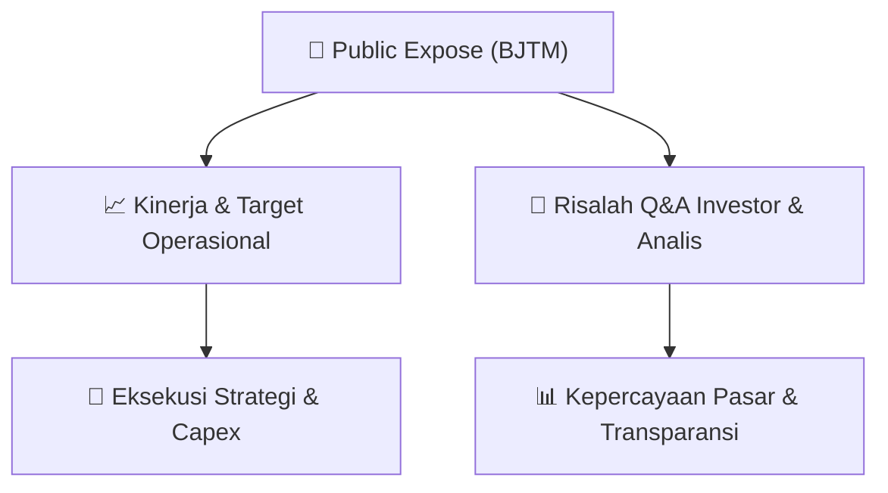

# 📢 Laporan Intelijen Paparan Publik (Public Expose) - [[BJTM]]
🏢 **Emiten**: `[[BJTM]]` | 📅 **Tanggal Pelaksanaan**: `2026-09-04` | 📑 **Dokumen**: `Public Expose`
⬅️ [[knowledge-base/daily-digests/Daily_Digest_20260904|Kembali ke Daily Digest]] | 🎛️ [[Dashboard|Ke Dashboard Utama]]

---

## 📌 1. Ringkasan Eksekutif & Paparan Direksi
> [!NOTE]
> Dokumen yang diterima merupakan surat resmi penyampaian materi Public Expose Tahunan Bank Pembangunan Daerah Jawa Timur Tbk (BJTM) kepada otoritas/publik, bukan materi presentasi Public Expose itu sendiri. Surat bernomor 065/19/CSE/CMAI/Srt ini merujuk pada rencana penyelenggaraan Public Expose Tahunan yang telah disampaikan melalui Surat No. 065/435/CSE/CMAI/Srt tanggal 24 Agustus 2026. Materi Public Expose dilampirkan dalam file 'BJTM Public Expose 2026.v1.pdf'. Dokumen ini dinyatakan sebagai dokumen resmi elektronik yang tidak memerlukan tanda tangan basah, dan manajemen bertanggung jawab penuh atas informasi yang tercantum di dalamnya. Tidak terdapat rincian kinerja keuangan, target operasional, atau substansi paparan publik dalam teks surat ini.

#### 🎯 Guidance Operasional & Target Strategis
- Tidak tersedia katalis, guidance, target kinerja, ekspansi, atau rencana capex dalam teks dokumen. Surat hanya mengonfirmasi penyampaian materi Public Expose Tahunan BJTM pada 4 September 2026 pukul 13:50, dengan lampiran materi yang belum dirinci dalam teks yang diberikan.

## 📊 2. Matriks Indikator Operasional & Parameter Kunci
| Parameter Utama | Nilai / Keterangan Resmi |
| :--- | :--- |
| **Nama Perusahaan** | `Bank Pembangunan Daerah Jawa Timur Tbk` |
| **Kode Emiten** | `BJTM` |
| **Nomor Surat Penyampaian Materi** | `065/19/CSE/CMAI/Srt` |
| **Perihal** | `Penyampaian Materi Public Expose Tahunan` |
| **Rujukan Surat Pengumuman Public Expose** | `No. 065/435/CSE/CMAI/Srt tanggal 24 Agustus 2026` |
| **Tanggal dan Waktu Penyampaian** | `04-09-2026 13:50` |
| **Lampiran** | `BJTM Public Expose 2026.v1.pdf` |
| **Corporate Secretary** | `Fenty Rischana K` |
| **Alamat Kantor** | `Jl Basuki Rachmad 98-104 Surabaya` |
| **Kontak** | `Telepon (031) 5310090-99 ext.463, Fax (031) 5310838, www.bankjatim.co.id` |

---

## 💬 3. Risalah Tanya Jawab (Q&A Session)
`Materi presentasi Public Expose / Risalah Q&A terlampir dalam dokumen resmi bursa.`

## 📌 4. Peta Jalur Strategis & Roadmap

---

## 🔗 Knowledge Graph
- [[knowledge-base/daily-digests/Daily_Digest_20260904|📄 Daily Digest 2026-09-04]]
- [[knowledge-base/calendars/Action_Calendar|🗓️ Kalender Terpusat Aksi Korporasi]]
- [[Dashboard|🎛️ Kembali ke Dashboard Utama]]