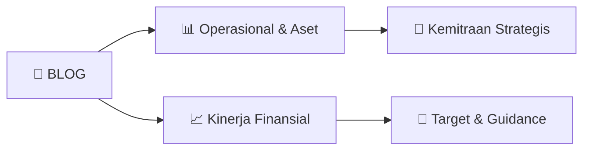

# 📊 Materi Public Expose: [BLOG]

🏢 **Emiten**: `BLOG` | 📅 **Tanggal Pelaksanaan**: `2026-08-24` | 📑 **Total Slide**: `2 Slide`
⬅️ [[knowledge-base/daily-digests/BLOG_20260824|Kembali ke Daily Digest]] | 🎛️ [[Dashboard/BLOG|Ke Dashboard Emiten]]

> [!NOTE]
> Ringkasan materi presentasi resmi Public Expose BLOG yang disampaikan oleh manajemen kepada investor dan bursa. Seluruh poin strategis, matriks operasional, dan angka kinerja diekstrak langsung dari slide deck resmi.

---

## 📅 1. Jadwal & Metadata Penyelenggaraan

| Parameter | Detail Informasi |
|---|---|
| **Nomor Surat Pengantar** | 40/SK/CLI/TTP/VIII/2026 |
| **Perihal Pengumuman** | Rencana Penyelenggaraan Public Expose Tahunan |
| **Waktu Pelaksanaan** | 08 September 2026 11:00 |
| **Lokasi / Media** | Pubex Live IDX 2026 |
| **Lampiran Resmi** | `0` |

## 📋 2. Agenda Paparan Publik

1. Nama Perusahaan
2. Kode Emiten
3. Lampiran
4. Perihal
5. 40/SK/CLI/TTP/VIII/2026
6. PT Trimitra Trans Persada Tbk
7. Rencana Penyelenggaraan Public Expose Tahunan
8. Go To English Page
9. Perseroan melaporkan rencana Public Expose Tahunan sebagai berikut:
10. Rencana Penyelenggaraan Public Expose
11. Tahun Buku yang Berakhir pada
12. Tempat
13. : Pubex Live IDX 2026
14. Hari/Tanggal
15. : 08 September 2026
16. Waktu
17. 11:00
18. Agenda
19. : 1. Pemutaran Video Perusahaan
20. 2. Sesi Presentasi
21. 3.Tanya Jawab
22. 4. Penutupan
23. Hormat Kami,
24. Demikian untuk diketahui.
25. Alfa Tower, lantai 28 Jl. Jalur Sutera Barat, Kav 7-9 Alam Sutera, Tangerang,
26. Direktur / Coorporate Secretary
27. Nama Pengirim
28. Telepon :  (021)80821778, Fax :  , https://b-log.co.id/id/home-id/
29. PT Trimitra Trans Persada Tbk
30. Wanny Wijaya
31. PT Trimitra Trans Persada Tbk
32. Wanny Wijaya
33. Jabatan
34. Direktur / Coorporate Secretary
35. Tanggal dan Waktu
36. 24-08-2026 10:06
37. Dokumen ini merupakan dokumen resmi PT Trimitra Trans Persada Tbk yang tidak memerlukan tanda tangan
38. karena dihasilkan secara elektronik oleh sistem pelaporan elektronik. PT Trimitra Trans Persada Tbk bertanggung
39. jawab penuh atas informasi yang tertera didalam dokumen ini.
40. Issuer Name
41. Issuer Code
42. Attachment
43. Subject
44. 40/SK/CLI/TTP/VIII/2026
45. PT Trimitra Trans Persada Tbk
46. General Announcement Public Expose
47. Go To Indonesian Page
48. Company announces public expose plan Annual as follows:
49. Public Expose Announcement
50. Fiscal Year
51. Place
52. : Pubex Live IDX 2026
53. : 08 September 2026
54. 11:00
55. Agenda
56. : 1. Company Video Screening
57. 2. Presentation Session
58. 3. Q&A
59. 4. Closing
60. Respectfully,
61. Thus to be informed accordingly.
62. PT Trimitra Trans Persada Tbk
63. Wanny Wijaya
64. Direktur / Coorporate Secretary
65. Wanny Wijaya
66. Sender Name
67. PT Trimitra Trans Persada Tbk
68. Alfa Tower, lantai 28 Jl. Jalur Sutera Barat, Kav 7-9 Alam Sutera, Tangerang,
69. Phone :  (021)80821778, Fax :  , https://b-log.co.id/id/home-id/
70. Direktur / Coorporate Secretary
71. Function
72. Date and Time
73. 24-08-2026 10:06
74. This is an official document of PT Trimitra Trans Persada Tbk that does not require a signature as it was generated
75. electronically by the electronic reporting system. PT Trimitra Trans Persada Tbk is fully responsible for the

## 🏢 3. Profil & Pilar Portofolio Bisnis

## 🏗️ 4. Kinerja Operasional & Portofolio Aset

*Detail aset operasional terlampir pada dokumen slide resmi.*

## 📈 5. Kinerja Keuangan & Posisi Finansial

## 🧭 6. Inisiatif Strategis, Kolaborasi, & Kemitraan

*Strategi usaha difokuskan pada penguatan fundamental dan ekspansi operasional.*

## 🎯 7. Target Pertumbuhan & Guidance Manajemen

*Target pertumbuhan ditetapkan mengacu pada prospek industri dan kondisi makroekonomi terkini.*

## 🗺️ 8. Peta Jalur Strategis & Eksekusi

## 📑 9. Daftar Indeks Slide Presentasi

| Slide # | Judul / Topik Slide | Ringkasan Konten |
|---|---|---|
| Slide 1 | **Nomor Surat** | Nama Perusahaan Kode Emiten Lampiran |
| Slide 2 | **Letter / Announcement No.** | Issuer Name Issuer Code Attachment |

---

*Dokumen diolah otomatis oleh **Swarm Intelijen Pasar Modal Indonesia** pada 2026-10-12 16:43 WIB.*