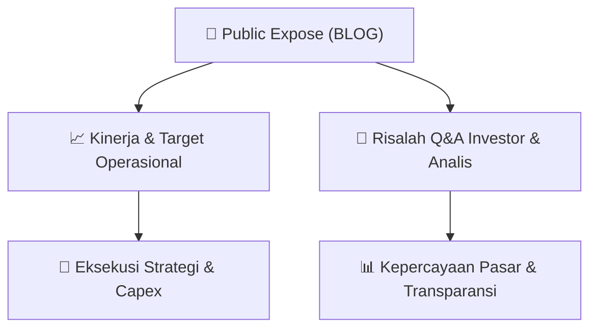

# 📢 Laporan Intelijen Paparan Publik (Public Expose) - [[BLOG]]
🏢 **Emiten**: `[[BLOG]]` | 📅 **Tanggal Pelaksanaan**: `2026-09-11` | 📑 **Dokumen**: `Public Expose`
⬅️ [[knowledge-base/daily-digests/Daily_Digest_20260911|Kembali ke Daily Digest]] | 🎛️ [[Dashboard|Ke Dashboard Utama]]

---

## 📌 1. Ringkasan Eksekutif & Paparan Direksi
> [!NOTE]
> PT Trimitra Trans Persada Tbk (BLOG) menyelenggarakan Public Expose Tahunan pada 03 September 2026 berdasarkan surat No. 41/SK/CLI/TTP/IX/2026. Acara dihadiri oleh 77 peserta (tidak termasuk manajemen dan karyawan). Laporan hasil Public Expose disampaikan secara resmi melalui sistem pelaporan elektronik pada 11 September 2026. Dokumen ini merupakan laporan administratif penyampaian hasil Public Expose, namun tidak memuat detail materi presentasi, paparan kinerja, maupun sesi tanya jawab secara eksplisit dalam teks yang tersedia.

#### 🎯 Guidance Operasional & Target Strategis
- Dokumen yang tersedia tidak memuat informasi spesifik mengenai target kinerja, ekspansi, capex, atau guidance operasional emiten. Seluruh konten hanya berisi konfirmasi administratif penyelenggaraan Public Expose Tahunan dan jumlah peserta yang hadir. Untuk mendapatkan informasi katalis dan guidance, diperlukan akses ke lampiran 'Laporan Hasil PUBEX 2026 - BLOG.pdf' yang disebutkan dalam dokumen.

## 📊 2. Matriks Indikator Operasional & Parameter Kunci
| Parameter Utama | Nilai / Keterangan Resmi |
| :--- | :--- |
| **Tanggal Penyelenggaraan Public Expose** | `03 September 2026` |
| **Nomor Surat Penyampaian Materi** | `41/SK/CLI/TTP/IX/2026` |
| **Nomor Surat Laporan Hasil** | `044/K/CLI/TTP/IX/2026` |
| **Jumlah Peserta Hadir** | `77 orang (tidak termasuk manajemen dan karyawan)` |
| **Tanggal Penyampaian Laporan** | `11 September 2026` |
| **Nama Pelapor** | `Wanny Wijaya (Direktur / Corporate Secretary)` |
| **Alamat Kantor** | `Alfa Tower, Lantai 28, Jl. Jalur Sutera Barat, Kav 7-9, Alam Sutera, Tangerang` |

---

## 💬 3. Risalah Tanya Jawab (Q&A Session)
`Materi presentasi Public Expose / Risalah Q&A terlampir dalam dokumen resmi bursa.`

## 📌 4. Peta Jalur Strategis & Roadmap

---

## 🔗 Knowledge Graph
- [[knowledge-base/daily-digests/Daily_Digest_20260911|📄 Daily Digest 2026-09-11]]
- [[knowledge-base/calendars/Action_Calendar|🗓️ Kalender Terpusat Aksi Korporasi]]
- [[Dashboard|🎛️ Kembali ke Dashboard Utama]]