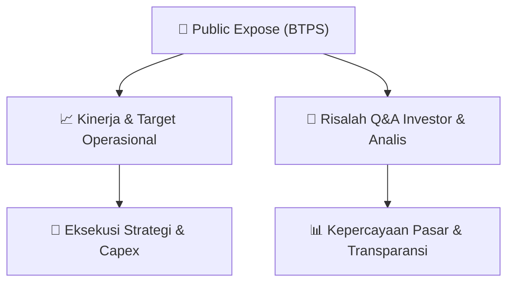

# 📢 Laporan Intelijen Paparan Publik (Public Expose) - [[BTPS]]
🏢 **Emiten**: `[[BTPS]]` | 📅 **Tanggal Pelaksanaan**: `2026-09-02` | 📑 **Dokumen**: `Public Expose`
⬅️ [[knowledge-base/daily-digests/Daily_Digest_20260902|Kembali ke Daily Digest]] | 🎛️ [[Dashboard|Ke Dashboard Utama]]

---

## 📌 1. Ringkasan Eksekutif & Paparan Direksi
> [!NOTE]
> PT Bank BTPN Syariah Tbk (BTPS) menyampaikan materi Public Expose Tahunan melalui Surat No. S.340/DIR/CSGC/IX/2026 tertanggal 2 September 2026. Penyampaian ini merujuk pada pengumuman rencana Public Expose Tahunan yang disampaikan sebelumnya melalui Surat No. S.332/DIR/CSGC/VIII/2026 tertanggal 21 Agustus 2026. Materi Public Expose dilampirkan dalam tiga dokumen, yaitu surat penyampaian materi, materi Public Expose versi Bahasa Indonesia, dan versi Bahasa Inggris. Dokumen pengumuman tidak memuat rincian isi materi Public Expose, data keuangan, target kinerja, maupun tanya jawab dengan analis/investor.

#### 🎯 Guidance Operasional & Target Strategis
- Tidak tersedia dalam teks yang diberikan. Dokumen yang diterima hanya berupa surat penyampaian materi Public Expose dan tidak memuat rincian target kinerja, ekspansi, belanja modal, maupun panduan operasional BTPS.

## 📊 2. Matriks Indikator Operasional & Parameter Kunci
| Parameter Utama | Nilai / Keterangan Resmi |
| :--- | :--- |
| **Nama Perusahaan** | `PT Bank BTPN Syariah Tbk.` |
| **Kode Emiten** | `BTPS` |
| **Nomor Surat Penyampaian Materi Public Expose** | `S.340/DIR/CSGC/IX/2026` |
| **Tanggal Surat Penyampaian Materi** | `2 September 2026` |
| **Perihal** | `Penyampaian Materi Public Expose Tahunan` |
| **Rujukan Surat Pengumuman Public Expose** | `S.332/DIR/CSGC/VIII/2026 tertanggal 21 Agustus 2026` |
| **Lampiran** | `3 dokumen: S.340 Penyampaian Materi PUBEX 2026.pdf; BTPS Pubex - IND - sent 2 Sep.pdf; BTPS Pubex - ENG - sent 2 Sep.pdf` |
| **Pejabat Penanggung Jawab** | `Yunita C. Haerani, Corporate Secretary and General Counsel Head` |
| **Alamat Perseroan** | `Menara SMBC Lantai 12, CBD Mega Kuningan, Jl. DR Ide Anak Agung Gde Agung, Jakarta` |

---

## 💬 3. Risalah Tanya Jawab (Q&A Session)
`Materi presentasi Public Expose / Risalah Q&A terlampir dalam dokumen resmi bursa.`

## 📌 4. Peta Jalur Strategis & Roadmap

---

## 🔗 Knowledge Graph
- [[knowledge-base/daily-digests/Daily_Digest_20260902|📄 Daily Digest 2026-09-02]]
- [[knowledge-base/calendars/Action_Calendar|🗓️ Kalender Terpusat Aksi Korporasi]]
- [[Dashboard|🎛️ Kembali ke Dashboard Utama]]