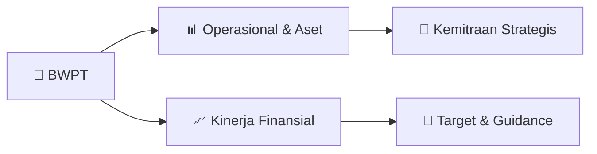

# 📊 Materi Public Expose: [BWPT]

🏢 **Emiten**: `BWPT` | 📅 **Tanggal Pelaksanaan**: `2026-08-12` | 📑 **Total Slide**: `2 Slide`
⬅️ [[knowledge-base/daily-digests/BWPT_20260812|Kembali ke Daily Digest]] | 🎛️ [[Dashboard/BWPT|Ke Dashboard Emiten]]

> [!NOTE]
> Ringkasan materi presentasi resmi Public Expose BWPT yang disampaikan oleh manajemen kepada investor dan bursa. Seluruh poin strategis, matriks operasional, dan angka kinerja diekstrak langsung dari slide deck resmi.

---

## 📅 1. Jadwal & Metadata Penyelenggaraan

| Parameter | Detail Informasi |
|---|---|
| **Nomor Surat Pengantar** | 100/BOD/EHP/VIII/2026 |
| **Perihal Pengumuman** | Rencana Penyelenggaraan Public Expose Insidentil |
| **Waktu Pelaksanaan** | 27 Agustus 2026 10:00 |
| **Lokasi / Media** | Melalui platform Webinar Zoom |
| **Lampiran Resmi** | `1` |

## 📋 2. Agenda Paparan Publik

1. Nomor
2. : 100/BOD/EHP/VIII/2026
3. Lampiran
4. Perihal
5. Rencana Penyelenggaraan Public Expose PT Eagle High Plantations Tbk (“Perseroan”)
6. Kepada :
7. PT Bursa Efek Indonesia
8. Gedung Bursa Efek Indonesia
9. Jl. Jend. Sudirman Kav. 52-53
10. Jakarta 12190, Indonesia
11. U.P.: Yth. Direktur Penilaian Perusahaan
12. Dengan hormat,
13. Merujuk kepada:
14. 1. Surat Edaran Bursa Nomor SE-00006/BEI/10-2019 tanggal 28 Oktober 2019 perihal Tata Cara
15. Penyampaian Laporan Secara Elektronik Oleh Perusahaan Tercatat;
16. 2. Surat Edaran nomor SE-00003/BEI/05-2020 tanggal 29 Mei 2020 perihal Tata Cara
17. Pelaksanaan Public Expose Secara Elektronik; dan
18. 3. Surat Keputusan Direksi PT Bursa Efek Indonesia Nomor Kep-00087/BEI/12-2025 tanggal
19. 12 Desember 2025 perihal Peraturan Nomor I-E tentang Kewajiban Penyampaian Informasi.
20. Dengan ini Perseroan menyampaikan rencana penyelenggaraan Public Expose yang akan
21. diselenggarakan secara elektronik pada:
22. Hari/Tanggal
23. Kamis, 27 Agustus 2026
24. Waktu
25. 10:00 sd 11:15 WIB
26. Kehadiran Secara Elektronik
27. Melalui platform Webinar Zoom
28. ID : 813 9139 7656
29. Pihak yang akan hadir
30. Direksi Perseroan
31. Agenda
32. 1. Profil Perseroan
33. 2. Prospek Usaha
34. 3. Kinerja Operasional dan Keuangan
35. 4. Strategi dan Arah Bisnis
36. Link Zoom
37. https://bit.ly/PublicExposeBWPT
38. Perseroan akan menyampaikan materi Public Expose pada tanggal 24 Agustus 2026 sesuai dengan
39. ketentuan yang berlaku.

## 🏢 3. Profil & Pilar Portofolio Bisnis

## 🏗️ 4. Kinerja Operasional & Portofolio Aset

*Detail aset operasional terlampir pada dokumen slide resmi.*

## 📈 5. Kinerja Keuangan & Posisi Finansial

## 🧭 6. Inisiatif Strategis, Kolaborasi, & Kemitraan

*Strategi usaha difokuskan pada penguatan fundamental dan ekspansi operasional.*

## 🎯 7. Target Pertumbuhan & Guidance Manajemen

*Target pertumbuhan ditetapkan mengacu pada prospek industri dan kondisi makroekonomi terkini.*

## 🗺️ 8. Peta Jalur Strategis & Eksekusi

## 📑 9. Daftar Indeks Slide Presentasi

| Slide # | Judul / Topik Slide | Ringkasan Konten |
|---|---|---|
| Slide 1 | **Jakarta, 12 Agustus 2026** | Nomor : 100/BOD/EHP/VIII/2026 Lampiran |

---

*Dokumen diolah otomatis oleh **Swarm Intelijen Pasar Modal Indonesia** pada 2026-10-12 16:43 WIB.*