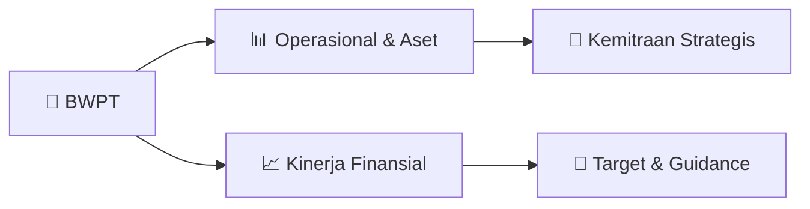

# 📊 Materi Public Expose: [BWPT]

🏢 **Emiten**: `BWPT` | 📅 **Tanggal Pelaksanaan**: `2026-08-21` | 📑 **Total Slide**: `24 Slide`
⬅️ [[knowledge-base/daily-digests/BWPT_20260821|Kembali ke Daily Digest]] | 🎛️ [[Dashboard/BWPT|Ke Dashboard Emiten]]

> [!NOTE]
> Ringkasan materi presentasi resmi Public Expose BWPT yang disampaikan oleh manajemen kepada investor dan bursa. Seluruh poin strategis, matriks operasional, dan angka kinerja diekstrak langsung dari slide deck resmi.

---

## 📅 1. Jadwal & Metadata Penyelenggaraan

| Parameter | Detail Informasi |
|---|---|
| **Nomor Surat Pengantar** | 063/BWPT/Corsec/VIII/2026 |
| **Perihal Pengumuman** | Penyampaian Materi Public Expose Insidentil |
| **Waktu Pelaksanaan** | 2026-08-21 21-08-2026 16:18 |
| **Lokasi / Media** | Aplikasi Zoom / Daring |
| **Lampiran Resmi** | `2` |

## 📋 2. Agenda Paparan Publik

- Pemaparan Profil & Struktur Bisnis Perseroan
- Kinerja Operasional & Keuangan
- Arah Strategi Usaha & Target Pertumbuhan
- Sesi Tanya Jawab (Q&A)

## 🏢 3. Profil & Pilar Portofolio Bisnis

## 🏗️ 4. Kinerja Operasional & Portofolio Aset

> STRICTLY CONFIDENTIAL – for the internal use of PT Eagle High Plantations Tbk and no other party may rely on any representations, and no warranties shall be given in this document. This document is the property of PT Eagle High Plantations Tbk and must not be disclosed, distributed, or reproduced
in any form. Any party other than PT Eagle High Plantations Tbk who, by accident or otherwise, is in possession of the original or a photocopy of this document must return it to PT Eagle High Plantations Tbk or, at the request of PT Eagle High Plantations Tbk, destroy it. PT Eagle High Plantations Tbk
reserves all rights under the law for any abuse by any party of this document.
Care Unity Responsibility Integrity Growth Respect Excellence
Aset Perkebunan - Kalimantan Selatan
Bulking berkapasitas 15.000 MT
Kebun Batu Bulan dilengkapi PKS berkapasitas 70 MT per jam dan PLT Biogas 2,4 MW
Luas Perkebunan 23.000 Ha | 2 PKS Kapasitas 115 MT/Jam | Biogas 2,4MW | Kapasitas Storage 31.000 MT | 1 Jetty

> STRICTLY CONFIDENTIAL – for the internal use of PT Eagle High Plantations Tbk and no other party may rely on any representations, and no warranties shall be given in this document. This document is the property of PT Eagle High Plantations Tbk and must not be disclosed, distributed, or reproduced
in any form. Any party other than PT Eagle High Plantations Tbk who, by accident or otherwise, is in possession of the original or a photocopy of this document must return it to PT Eagle High Plantations Tbk or, at the request of PT Eagle High Plantations Tbk, destroy it. PT Eagle High Plantations Tbk
reserves all rights under the law for any abuse by any party of this document.
Care Unity Responsibility Integrity Growth Respect Excellence
Aset Perkebunan - Kalimantan Tengah
Luas Perkebunan 27.000 Ha | 3 PKS Kapasitas 150 MT/Jam | Kapasitas Storage 32.000 MT | 2 Jetty
Kebun BHL dilengkapi PKS berkapasitas 60 MT per jam
Jetty Serimbang mendukung logistik Perseroan
Pembangunan KCP kapasitas 200 MT per hari

> STRICTLY CONFIDENTIAL – for the internal use of PT Eagle High Plantations Tbk and no other party may rely on any representations, and no warranties shall be given in this document. This document is the property of PT Eagle High Plantations Tbk and must not be disclosed, distributed, or reproduced
in any form. Any party other than PT Eagle High Plantations Tbk who, by accident or otherwise, is in possession of the original or a photocopy of this document must return it to PT Eagle High Plantations Tbk or, at the request of PT Eagle High Plantations Tbk, destroy it. PT Eagle High Plantations Tbk
reserves all rights under the law for any abuse by any party of this document.
Care Unity Responsibility Integrity Growth Respect Excellence
Aset Perkebunan - Kalimantan Timur
Bulking Mahakam berkapasitas 10.000 MT
Fasilitas bersertifikasi EUDR
Kebun Bangkirai dilengkapi PKS berkapasitas 90 MT per jam
Luas Perkebunan 20.000 Ha | 1 PKS Kapasitas 90 MT/Jam | Kapasitas Storage 20.000 MT | 1 Jetty

> STRICTLY CONFIDENTIAL – for the internal use of PT Eagle High Plantations Tbk and no other party may rely on any representations, and no warranties shall be given in this document. This document is the property of PT Eagle High Plantations Tbk and must not be disclosed, distributed, or reproduced
in any form. Any party other than PT Eagle High Plantations Tbk who, by accident or otherwise, is in possession of the original or a photocopy of this document must return it to PT Eagle High Plantations Tbk or, at the request of PT Eagle High Plantations Tbk, destroy it. PT Eagle High Plantations Tbk
reserves all rights under the law for any abuse by any party of this document.
Care Unity Responsibility Integrity Growth Respect Excellence
Aset Perkebunan - Papua
Fasilitas PKS di Kebun Tulip berkapasitas 45 MT per jam
Area Kebun Tulip
Luas Perkebunan 12.000 Ha | 1 PKS Kapasitas 45 MT/Jam | Kapasitas Storage 11.000 MT

> STRICTLY CONFIDENTIAL – for the internal use of PT Eagle High Plantations Tbk and no other party may rely on any representations, and no warranties shall be given in this document. This document is the property of PT Eagle High Plantations Tbk and must not be disclosed, distributed, or reproduced
in any form. Any party other than PT Eagle High Plantations Tbk who, by accident or otherwise, is in possession of the original or a photocopy of this document must return it to PT Eagle High Plantations Tbk or, at the request of PT Eagle High Plantations Tbk, destroy it. PT Eagle High Plantations Tbk
reserves all rights under the law for any abuse by any party of this document.
Care Unity Responsibility Integrity Growth Respect Excellence
Stabilisasi TBS diolah dan
peningkatan yield
Pertumbuhan volume penjualan
CPO & PK
Menjaga OER >23% dan KER >4%
Perluasan Plasma Mandiri untuk
menjaga pasokan TBS
Pertumbuhan pendapatan dan laba
Menjaga margin EBITDA >28%
Melanjutkan deleveraging
Rencana Kuasi Reorganisasi
Perluasan sertifikasi RSPO dan
kepatuhan ISPO
Penyelesaian penilaian kesiapan EUDR
Peningkatan peringkat SPOTT dan CDP
Pengembangan aset karbon dan
indeks ESG
TBS diolah +11,0% YoY
Yie

> STRICTLY CONFIDENTIAL – for the internal use of PT Eagle High Plantations Tbk and no other party may rely on any representations, and no warranties shall be given in this document. This document is the property of PT Eagle High Plantations Tbk and must not be disclosed, distributed, or reproduced
in any form. Any party other than PT Eagle High Plantations Tbk who, by accident or otherwise, is in possession of the original or a photocopy of this document must return it to PT Eagle High Plantations Tbk or, at the request of PT Eagle High Plantations Tbk, destroy it. PT Eagle High Plantations Tbk
reserves all rights under the law for any abuse by any party of this document.
Care Unity Responsibility Integrity Growth Respect Excellence
Rasio Keuangan dan Profil Pasar
1.6%
2.8%
3.7%
7.3% 11.1% 13.4%
3.7
3.0
2.6
2.3
-5
-3
-1
-1%
1% 3% 5% 7% 9% 11% 13% 15% 17% 2023 2024 2025 H1 2026 ROA ROE DER
Rasio Profitabilitas dan Leverage
5.0
3.1
2.8
2.5
2.1
3.3
3.9
4.4
(3.0) (2.0) (1.0)
-
1.0
2.0
3.0
4.0
5.0
-100%
100% 300% 500% 700% 900% 1100% 1300% 1500% 2023 2024 2025 H1 2026 Loan/ EBITDA ICR
Rasio Solvabilitas dan Coverage
Informasi Pasar
Harga saham 30 Jun 2026
IDR 73 Market cap. IDR 2,3T 52-W

> STRICTLY CONFIDENTIAL – for the internal use of PT Eagle High Plantations Tbk and no other party may rely on any representations, and no warranties shall be given in this document. This document is the property of PT Eagle High Plantations Tbk and must not be disclosed, distributed, or reproduced
in any form. Any party other than PT Eagle High Plantations Tbk who, by accident or otherwise, is in possession of the original or a photocopy of this document must return it to PT Eagle High Plantations Tbk or, at the request of PT Eagle High Plantations Tbk, destroy it. PT Eagle High Plantations Tbk
reserves all rights under the law for any abuse by any party of this document.
Care Unity Responsibility Integrity Growth Respect Excellence
Pathway to Sustainable Growth
Produktivitas Perkebunan
Meningkatkan produktivitas melalui
mekanisasi, replanting, dan optimalisasi kebun
untuk mencapai FFB yield 18 MT/Ha.
Pembangunan Pabrik KCP
Meningkatkan nilai tambah produk melalui
produksi PKO 27.000 MT/tahun serta
penambahan KCP baru secara bertahap.
Energi Terbarukan
Memanfaatkan POME menjadi energi
terbarukan melalui pengembangan biogas,
Bio-CNG, dan energi rendah karbon lainnya.
Core Business
Fu

## 📈 5. Kinerja Keuangan & Posisi Finansial

### 📊 Ringkasan Finansial
```text
STRICTLY CONFIDENTIAL – for the internal use of PT Eagle High Plantations Tbk and no other party may rely on any representations, and no warranties shall be given in this document. This document is the property of PT Eagle High Plantations Tbk and must not be disclosed, distributed, or reproduced
in any form. Any party other than PT Eagle High Plantations Tbk who, by accident or otherwise, is in possession of the original or a photocopy of this document must return it to PT Eagle High Plantations Tbk or, at the request of PT Eagle High Plantations Tbk, destroy it. PT Eagle High Plantations Tbk
reserves all rights under the law for any abuse by any party of this document.
Care Unity Responsibility Integrity Growth Respect Excellence
EBITDA konsisten tumbuh double digit seiring efisiensi operasional
Pendapatan meningkat didorong oleh kenaikan volume dan ASP
Pertumbuhan Laba Kotor konsisten menjaga marjin tetap solid
Laba bersih tumbuh seiring struktur modal yang lebih prudent
Kinerja Keuangan Perseroan
Rp Miliar Rp Miliar Rp Miliar Rp Miliar 4,205 4,303 5,761 500 1,500 2,500 3,500 4,500 5,500 6,500 7,500 8,500 2023 2024 2025 2,779 3,255
-
1,000 2,000 3,000 4,000 5,000 6,000 7,000 8,0
```

## 🧭 6. Inisiatif Strategis, Kolaborasi, & Kemitraan

- STRICTLY CONFIDENTIAL – for the internal use of PT Eagle High Plantations Tbk and no other party may rely on any representations, and no warranties shall be given in this document. This document is the property of PT Eagle High Plantations Tbk and must not be disclosed, distributed, or reproduced
in any form. Any party other than PT Eagle High Plantations Tbk who, by accident or otherwise, is in possession of the original or a photocopy of this document must return it to PT Eagle High Plantations Tbk or, at the request of PT Eagle High Plantations Tbk, destroy it. PT Eagle High Plantations Tbk
reserves all rights under the law for any abuse by any party of this document.
Care Unity Responsibility Integrity Growth Respect Excellence
Strategi Perseroan Tahun 2026
Climate & Energy Transition ESG Achievement
Standar RSPO & ISPO, kesiapan
EUDR, peringkat CDP menjadi B,
#3 SPOTT Indonesia
(#18 Global), dan masuk indeks
SRI-KEHATI. Pemberdayaan petani
mandiri dengan membantu
pengelolaan kebun sawit
dan menjadi mitra pembeli
atas hasil panen.
Perseroan akan terus melakukan ekspansi
kerja sama dengan petani mandiri untuk
meningkatkan utilisasi pabrik.
Menerapkan Net Zero Emissions
(NZE) melalui biomassa dan
biogas untuk mengurangi emisi
di seluruh kegiatan operasional.
Aplikasi mobile terintegrasi
untuk pengelolaan operasional
Mekanisasi proses panen dan
transportasi
Pemantauan visual dan
pemetaan via drone

## 🎯 7. Target Pertumbuhan & Guidance Manajemen

> STRICTLY CONFIDENTIAL – for the internal use of PT Eagle High Plantations Tbk and no other party may rely on any representations, and no warranties shall be given in this document. This document is the property of PT Eagle High Plantations Tbk and must not be disclosed, distributed, or reproduced
in any form. Any party other than PT Eagle High Plantations Tbk who, by accident or otherwise, is in possession of the original or a photocopy of this document must return it to PT Eagle High Plantations Tbk or, at the request of PT Eagle High Plantations Tbk, destroy it. PT Eagle High Plantations Tbk
reserves all rights under the law for any abuse by any party of this document.
Care Unity Responsibility Integrity Growth Respect Excellence
Peringkat Perusahaan dengan Outlook Stabil
Lembaga Pemeringkat Peringkat Perusahaan Rating Rationale irA/Stable idA-/Stable

## 🗺️ 8. Peta Jalur Strategis & Eksekusi



## 📑 9. Daftar Indeks Slide Presentasi

| Slide # | Judul / Topik Slide | Ringkasan Konten |
|---|---|---|
| Slide 1 | **STRICTLY CONFIDENTIAL – for the internal use of PT Eagle High Plantations Tbk and no other party may rely on any representations, and no warranties shall be given in this document. This document is the property of PT Eagle High Plantations Tbk and must not be disclosed, distributed, or reproduced** | in any form. Any party other than PT Eagle High Plantations Tbk who, by accident or otherwise, is in possession of the original or a photocopy of this |
| Slide 2 | **STRICTLY CONFIDENTIAL – for the internal use of PT Eagle High Plantations Tbk and no other party may rely on any representations, and no warranties shall be given in this document. This document is the property of PT Eagle High Plantations Tbk and must not be disclosed, distributed, or reproduced** | in any form. Any party other than PT Eagle High Plantations Tbk who, by accident or otherwise, is in possession of the original or a photocopy of this |
| Slide 3 | **STRICTLY CONFIDENTIAL – for the internal use of PT Eagle High Plantations Tbk and no other party may rely on any representations, and no warranties shall be given in this document. This document is the property of PT Eagle High Plantations Tbk and must not be disclosed, distributed, or reproduced** | in any form. Any party other than PT Eagle High Plantations Tbk who, by accident or otherwise, is in possession of the original or a photocopy of this |
| Slide 4 | **STRICTLY CONFIDENTIAL – for the internal use of PT Eagle High Plantations Tbk and no other party may rely on any representations, and no warranties shall be given in this document. This document is the property of PT Eagle High Plantations Tbk and must not be disclosed, distributed, or reproduced** | in any form. Any party other than PT Eagle High Plantations Tbk who, by accident or otherwise, is in possession of the original or a photocopy of this |
| Slide 5 | **STRICTLY CONFIDENTIAL – for the internal use of PT Eagle High Plantations Tbk and no other party may rely on any representations, and no warranties shall be given in this document. This document is the property of PT Eagle High Plantations Tbk and must not be disclosed, distributed, or reproduced** | in any form. Any party other than PT Eagle High Plantations Tbk who, by accident or otherwise, is in possession of the original or a photocopy of this |
| Slide 6 | **STRICTLY CONFIDENTIAL – for the internal use of PT Eagle High Plantations Tbk and no other party may rely on any representations, and no warranties shall be given in this document. This document is the property of PT Eagle High Plantations Tbk and must not be disclosed, distributed, or reproduced** | in any form. Any party other than PT Eagle High Plantations Tbk who, by accident or otherwise, is in possession of the original or a photocopy of this |
| Slide 7 | **STRICTLY CONFIDENTIAL – for the internal use of PT Eagle High Plantations Tbk and no other party may rely on any representations, and no warranties shall be given in this document. This document is the property of PT Eagle High Plantations Tbk and must not be disclosed, distributed, or reproduced** | in any form. Any party other than PT Eagle High Plantations Tbk who, by accident or otherwise, is in possession of the original or a photocopy of this |
| Slide 8 | **STRICTLY CONFIDENTIAL – for the internal use of PT Eagle High Plantations Tbk and no other party may rely on any representations, and no warranties shall be given in this document. This document is the property of PT Eagle High Plantations Tbk and must not be disclosed, distributed, or reproduced** | in any form. Any party other than PT Eagle High Plantations Tbk who, by accident or otherwise, is in possession of the original or a photocopy of this |
| Slide 9 | **STRICTLY CONFIDENTIAL – for the internal use of PT Eagle High Plantations Tbk and no other party may rely on any representations, and no warranties shall be given in this document. This document is the property of PT Eagle High Plantations Tbk and must not be disclosed, distributed, or reproduced** | in any form. Any party other than PT Eagle High Plantations Tbk who, by accident or otherwise, is in possession of the original or a photocopy of this |
| Slide 10 | **STRICTLY CONFIDENTIAL – for the internal use of PT Eagle High Plantations Tbk and no other party may rely on any representations, and no warranties shall be given in this document. This document is the property of PT Eagle High Plantations Tbk and must not be disclosed, distributed, or reproduced** | in any form. Any party other than PT Eagle High Plantations Tbk who, by accident or otherwise, is in possession of the original or a photocopy of this |
| Slide 11 | **STRICTLY CONFIDENTIAL – for the internal use of PT Eagle High Plantations Tbk and no other party may rely on any representations, and no warranties shall be given in this document. This document is the property of PT Eagle High Plantations Tbk and must not be disclosed, distributed, or reproduced** | in any form. Any party other than PT Eagle High Plantations Tbk who, by accident or otherwise, is in possession of the original or a photocopy of this |
| Slide 12 | **STRICTLY CONFIDENTIAL – for the internal use of PT Eagle High Plantations Tbk and no other party may rely on any representations, and no warranties shall be given in this document. This document is the property of PT Eagle High Plantations Tbk and must not be disclosed, distributed, or reproduced** | in any form. Any party other than PT Eagle High Plantations Tbk who, by accident or otherwise, is in possession of the original or a photocopy of this |
| Slide 13 | **STRICTLY CONFIDENTIAL – for the internal use of PT Eagle High Plantations Tbk and no other party may rely on any representations, and no warranties shall be given in this document. This document is the property of PT Eagle High Plantations Tbk and must not be disclosed, distributed, or reproduced** | in any form. Any party other than PT Eagle High Plantations Tbk who, by accident or otherwise, is in possession of the original or a photocopy of this |
| Slide 14 | **STRICTLY CONFIDENTIAL – for the internal use of PT Eagle High Plantations Tbk and no other party may rely on any representations, and no warranties shall be given in this document. This document is the property of PT Eagle High Plantations Tbk and must not be disclosed, distributed, or reproduced** | in any form. Any party other than PT Eagle High Plantations Tbk who, by accident or otherwise, is in possession of the original or a photocopy of this |
| Slide 15 | **STRICTLY CONFIDENTIAL – for the internal use of PT Eagle High Plantations Tbk and no other party may rely on any representations, and no warranties shall be given in this document. This document is the property of PT Eagle High Plantations Tbk and must not be disclosed, distributed, or reproduced** | in any form. Any party other than PT Eagle High Plantations Tbk who, by accident or otherwise, is in possession of the original or a photocopy of this |
| Slide 16 | **STRICTLY CONFIDENTIAL – for the internal use of PT Eagle High Plantations Tbk and no other party may rely on any representations, and no warranties shall be given in this document. This document is the property of PT Eagle High Plantations Tbk and must not be disclosed, distributed, or reproduced** | in any form. Any party other than PT Eagle High Plantations Tbk who, by accident or otherwise, is in possession of the original or a photocopy of this |
| Slide 17 | **STRICTLY CONFIDENTIAL – for the internal use of PT Eagle High Plantations Tbk and no other party may rely on any representations, and no warranties shall be given in this document. This document is the property of PT Eagle High Plantations Tbk and must not be disclosed, distributed, or reproduced** | in any form. Any party other than PT Eagle High Plantations Tbk who, by accident or otherwise, is in possession of the original or a photocopy of this |
| Slide 18 | **STRICTLY CONFIDENTIAL – for the internal use of PT Eagle High Plantations Tbk and no other party may rely on any representations, and no warranties shall be given in this document. This document is the property of PT Eagle High Plantations Tbk and must not be disclosed, distributed, or reproduced** | in any form. Any party other than PT Eagle High Plantations Tbk who, by accident or otherwise, is in possession of the original or a photocopy of this |
| Slide 19 | **STRICTLY CONFIDENTIAL – for the internal use of PT Eagle High Plantations Tbk and no other party may rely on any representations, and no warranties shall be given in this document. This document is the property of PT Eagle High Plantations Tbk and must not be disclosed, distributed, or reproduced** | in any form. Any party other than PT Eagle High Plantations Tbk who, by accident or otherwise, is in possession of the original or a photocopy of this |
| Slide 20 | **STRICTLY CONFIDENTIAL – for the internal use of PT Eagle High Plantations Tbk and no other party may rely on any representations, and no warranties shall be given in this document. This document is the property of PT Eagle High Plantations Tbk and must not be disclosed, distributed, or reproduced** | in any form. Any party other than PT Eagle High Plantations Tbk who, by accident or otherwise, is in possession of the original or a photocopy of this |
| Slide 21 | **STRICTLY CONFIDENTIAL – for the internal use of PT Eagle High Plantations Tbk and no other party may rely on any representations, and no warranties shall be given in this document. This document is the property of PT Eagle High Plantations Tbk and must not be disclosed, distributed, or reproduced** | in any form. Any party other than PT Eagle High Plantations Tbk who, by accident or otherwise, is in possession of the original or a photocopy of this |
| Slide 22 | **Address** | : Rajawali Place Lt. 28, Jl. HR Rasuna Said Kav. B/4, RT 003/RW 07, Kel. Setiabudi, Kec. Setiabudi, Jakarta Selatan 12910 |
| Slide 23 | **STRICTLY CONFIDENTIAL – for the internal use of PT Eagle High Plantations Tbk and no other party may rely on any representations, and no warranties shall be given in this document. This document is the property of PT Eagle High Plantations Tbk and must not be disclosed, distributed, or reproduced** | in any form. Any party other than PT Eagle High Plantations Tbk who, by accident or otherwise, is in possession of the original or a photocopy of this |
| Slide 24 | **Address** | : Rajawali Place Lt. 28, Jl. HR Rasuna Said Kav. B/4, RT 003/RW 07, Kel. Setiabudi, Kec. Setiabudi, Jakarta Selatan 12910 |

---

*Dokumen diolah otomatis oleh **Swarm Intelijen Pasar Modal Indonesia** pada 2026-10-12 16:44 WIB.*