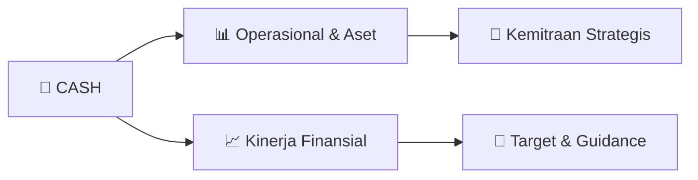

# 📊 Materi Public Expose: [CASH]

🏢 **Emiten**: `CASH` | 📅 **Tanggal Pelaksanaan**: `2026-10-05` | 📑 **Total Slide**: `20 Slide`
⬅️ [[knowledge-base/daily-digests/CASH_20261005|Kembali ke Daily Digest]] | 🎛️ [[Dashboard/CASH|Ke Dashboard Emiten]]

> [!NOTE]
> Ringkasan materi presentasi resmi Public Expose CASH yang disampaikan oleh manajemen kepada investor dan bursa. Seluruh poin strategis, matriks operasional, dan angka kinerja diekstrak langsung dari slide deck resmi.

---

## 📅 1. Jadwal & Metadata Penyelenggaraan

| Parameter | Detail Informasi |
|---|---|
| **Nomor Surat Pengantar** | 430/SK/CSC-CWI/X/2026 |
| **Perihal Pengumuman** | Penyampaian Materi Public Expose Tahunan |
| **Waktu Pelaksanaan** | 2026-10-05 05-10-2026 17:54 |
| **Lokasi / Media** | Aplikasi Zoom / Daring |
| **Lampiran Resmi** | `1` |

## 📋 2. Agenda Paparan Publik

1. Company Profile
2. Profil PT Cashlez Worldwide Indonesia Tbk
3. Kinerja Perusahaan
4. Kinerja Perusahaan Semester 1 2026
5. Growth Potential
6. Building Sustainable Growth through
7. Transformation
8. AGENDA
9. AGENDA
10. Company Profile
11. AGENDA
12. Kinerja Perusahaan
13. Semester 1 2026
14. AGENDA
15. Driving Sustainable
16. Business Growth through
17. Transformation

## 🏢 3. Profil & Pilar Portofolio Bisnis

## 🏗️ 4. Kinerja Operasional & Portofolio Aset

*Detail aset operasional terlampir pada dokumen slide resmi.*

## 📈 5. Kinerja Keuangan & Posisi Finansial

### 📊 Ringkasan Finansial
```text
Copyright @2025 PT Cashlez Worldwide Indonesia Tbk. All rights reserved
%
Kinerja Keuangan Semester 1 2026
Penjualan/Sewa Perangkat 71% Managed Services 21% Transaction Fee 8%
Komposisi pendapatan cashUP
Perseroan berhasil membukukan Gross
Profit (yoy) sebesar Rp19
Miliar naik sebesar
21% dibandingkan tahun
sebelumnya.
Rp 19 miliar
gross profit
```

## 🧭 6. Inisiatif Strategis, Kolaborasi, & Kemitraan

- Copyright @2025 PT Cashlez Worldwide Indonesia Tbk. All rights reserved
Core Values R I S E Responsive Perusahaan menerapkan strategi yang responsif dengan
menyederhanakan proses internal, menetapkan standar layanan
yang jelas, dan menyesuaikan pengembangan produk mengikuti
perkembangan teknologi dan kebutuhan pasar.
Innovative Secara aktif membangun kemitraan dan melakukan
benchmarking dengan berbagai pemangku kepentingan, serta
menjalankan riset pasar berkelanjutan untuk mengarahkan inovasi
solusi pembayaran dan layanan yang relevan bagi kebutuhan
pengguna. Solution-Driven
Perusahaan menumbuhkan budaya kerja yang profesional dan
berorientasi solusi dengan selalu fokus pada penyelesaian isu
secara konstruktif dan memastikan setiap keputusan diarahkan
pada tercapainya kebutuhan serta kepuasan pelanggan.
Excellence Perusahaan senantiasa menerapkan tata kelola kerja
yang terstruktur melalui pedoman operasional yang jelas dan
peninjauan berkala, sehingga tetap adaptif terhadap dinamika
perkembangan bisnis.

- Copyright @2025 PT Cashlez Worldwide Indonesia Tbk. All rights reserved
Berpartisipasi aktif dalam berbagai
event nasional dan internasional dengan menyediakan solusi
pembayaran terintegrasi sekaligus
memperkuat kolaborasi dengan partner.
Sebagai wujud komitmen dalam mendukung
ekosistem pembayaran digital, Perseroan
memperluas jaringan bisnis di tingkat global
melalui kolaborasi strategis dengan mitra
terkemuka seperti GoTyme dan PT Bank
Syariah Indonesia Tbk (BSI) guna meningkatkan efisiensi operasional,
keamanan dan kepercayaan dalam setiap
transaksi.
Sebagai wujud komitmen terhadap
keamanan transaksi dan pelindungan data pribadi, Perusahaan rutin mengadakan
edukasi daring guna mendukung
program Bank Indonesia, OJK, dan
Indonesia Anti-Scam Center.
Transformasi Bisnis Model melalui Kemitraan
Strategis

## 🎯 7. Target Pertumbuhan & Guidance Manajemen

*Target pertumbuhan ditetapkan mengacu pada prospek industri dan kondisi makroekonomi terkini.*

## 🗺️ 8. Peta Jalur Strategis & Eksekusi



## 📑 9. Daftar Indeks Slide Presentasi

| Slide # | Judul / Topik Slide | Ringkasan Konten |
|---|---|---|
| Slide 1 | **Copyright @2025 PT Cashlez Worldwide Indonesia Tbk. All rights reserved** | PUBLIC EXPOSE 2026 PT Cashlez Worldwide Indonesia Tbk 8 Oktober 2026 |
| Slide 2 | **Copyright @2025 PT Cashlez Worldwide Indonesia Tbk. All rights reserved** | Company Profile Profil PT Cashlez Worldwide Indonesia Tbk Kinerja Perusahaan |
| Slide 3 | **Copyright @2025 PT Cashlez Worldwide Indonesia Tbk. All rights reserved** | AGENDA Company Profile 1 |
| Slide 4 | **Copyright @2025 PT Cashlez Worldwide Indonesia Tbk. All rights reserved** | Awal Mula Cashlez Worldwide Indonesia berawal dari Cashlez yang berdiri pada tahun 2015, merupakan perusahaan teknologi finansial yang terdaftar di Bu |
| Slide 5 | **Copyright @2025 PT Cashlez Worldwide Indonesia Tbk. All rights reserved** | Core Values R I |
| Slide 6 | **Copyright @2025 PT Cashlez Worldwide Indonesia Tbk. All rights reserved** | Milestone 2018 Terdaftar di Bank |
| Slide 7 | **Copyright @2025 PT Cashlez Worldwide Indonesia Tbk. All rights reserved** | Certifications and Licenses 2019 Payment Gateway License |
| Slide 8 | **cashlez** | cashDevice cashUPay cashPOS |
| Slide 9 | **Copyright @2025 PT Cashlez Worldwide Indonesia Tbk. All rights reserved** | Strategic Partners Aplikasi POS Switching |
| Slide 10 | **Copyright @2025 PT Cashlez Worldwide Indonesia Tbk. All rights reserved** | Merchants ...dan 30 ribu merchant lainnya |
| Slide 11 | **Copyright @2025 PT Cashlez Worldwide Indonesia Tbk. All rights reserved** | AGENDA Kinerja Perusahaan Semester 1 2026 |
| Slide 12 | **Copyright @2025 PT Cashlez Worldwide Indonesia Tbk. All rights reserved** | % Kinerja Keuangan Semester 1 2026 Penjualan/Sewa Perangkat |
| Slide 13 | **Copyright @2025 PT Cashlez Worldwide Indonesia Tbk. All rights reserved** | Tren Peningkatan Kinerja Bisnis Populasi Merchant 30.761 |
| Slide 14 | **Copyright @2025 PT Cashlez Worldwide Indonesia Tbk. All rights reserved** | Berpartisipasi aktif dalam berbagai event nasional |
| Slide 15 | **Copyright @2025 PT Cashlez Worldwide Indonesia Tbk. All rights reserved** | Dukungan Perseroan pada Event Nasional & Internasional |
| Slide 16 | **Copyright @2025 PT Cashlez Worldwide Indonesia Tbk. All rights reserved** | AGENDA Driving Sustainable Business Growth through |
| Slide 17 | **Copyright @2025 PT Cashlez Worldwide Indonesia Tbk. All rights reserved** | Pengembangan dan Inovasi Produk cashVM cashUPay |
| Slide 18 | **Copyright @2025 PT Cashlez Worldwide Indonesia Tbk. All rights reserved** | Implementasi AI untuk Iklan Promosi |
| Slide 19 | **Copyright @2025 PT Cashlez Worldwide Indonesia Tbk. All rights reserved** | Kegiatan ESG (Environmental, Social, and Governance) Perseroan menyelenggarakan kegiatan |
| Slide 20 | **Copyright @2025 PT Cashlez Worldwide Indonesia Tbk. All rights reserved** | Thank You PT Cashlez Worldwide Indonesia Tbk Luminary Tower, Lantai 69 |

---

*Dokumen diolah otomatis oleh **Swarm Intelijen Pasar Modal Indonesia** pada 2026-10-12 16:44 WIB.*