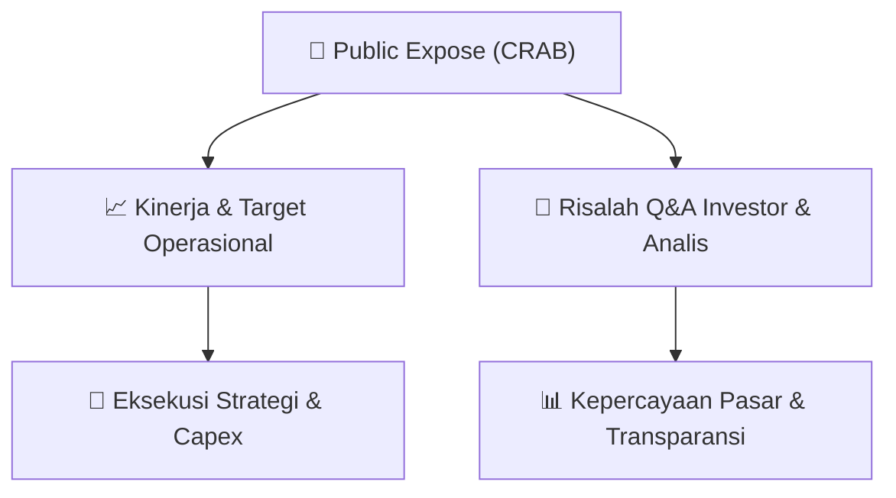

# 📢 Laporan Intelijen Paparan Publik (Public Expose) - [[CRAB]]
🏢 **Emiten**: `[[CRAB]]` | 📅 **Tanggal Pelaksanaan**: `2026-09-10` | 📑 **Dokumen**: `Public Expose`
⬅️ [[knowledge-base/daily-digests/Daily_Digest_20260910|Kembali ke Daily Digest]] | 🎛️ [[Dashboard|Ke Dashboard Utama]]

---

## 📌 1. Ringkasan Eksekutif & Paparan Direksi
> [!NOTE]
> PT Toba Surimi Industries Tbk (CRAB) mengumumkan rencana penyelenggaraan Public Expose Tahunan untuk Tahun Buku 2026. Acara akan diselenggarakan pada 25 September 2026 pukul 15:30 WIB di Grand City Hall Medan, Lt 2 Ruang Rosewood, Jl. Balai Kota No.1, Medan, Sumatera Utara. Agenda acara meliputi pemaparan profil perusahaan, pemaparan kinerja perusahaan, dan sesi tanya jawab. Pengumuman ini disampaikan oleh Direktur Utama Gindra Tardy pada 10 September 2026. Dokumen ini merupakan pengumuman resmi yang disampaikan melalui sistem pelaporan elektronik OJK/BEI.

#### 🎯 Guidance Operasional & Target Strategis
- Dokumen ini hanya berisi pengumuman rencana penyelenggaraan Public Expose Tahunan. Tidak terdapat informasi spesifik mengenai target kinerja, ekspansi, atau capex dalam pengumuman ini. Informasi tersebut diharapkan akan dipaparkan pada saat acara Public Expose berlangsung pada 25 September 2026. Investor yang ingin mendapatkan informasi lebih detail mengenai kinerja dan rencana perusahaan diharapkan untuk menghadiri acara tersebut atau memantau keterbukaan informasi selanjutnya dari emiten.

## 📊 2. Matriks Indikator Operasional & Parameter Kunci
| Parameter Utama | Nilai / Keterangan Resmi |
| :--- | :--- |
| **Jenis Acara** | `Public Expose Tahunan (Paparan Publik) Tahun Buku 2026` |
| **Tanggal Pelaksanaan** | `25 September 2026` |
| **Waktu Pelaksanaan** | `15:30 WIB` |
| **Tempat Pelaksanaan** | `Grand City Hall Medan, Lt 2 Ruang Rosewood, Jl. Balai Kota No.1, Medan, Sumatera Utara` |
| **Agenda Acara** | `1. Pemaparan Profil Perusahaan; 2. Pemaparan Kinerja Perusahaan; 3. Sesi Tanya Jawab` |
| **Tanggal Pengumuman** | `10 September 2026` |
| **Penanggung Jawab / Penandatangan** | `Gindra Tardy (Direktur Utama)` |
| **Nomor Surat** | `031/TSI/CORSEC/IX/2026` |

---

## 💬 3. Risalah Tanya Jawab (Q&A Session)
### ❓ Pertanyaan 1 (Tidak tersedia (belum ada sesi tanya jawab))
**Pertanyaan**: Belum ada pertanyaan karena dokumen ini hanya berisi pengumuman rencana penyelenggaraan Public Expose. Sesi tanya jawab akan dilaksanakan pada saat acara berlangsung.

**Jawaban Manajemen**: Belum ada jawaban manajemen. Manajemen akan memberikan pemaparan kinerja dan menjawab pertanyaan investor/analis pada saat acara Public Expose Tahunan pada 25 September 2026.

> [!TIP]
> **Implikasi Bagi Investor**: Investor dan analis diharapkan untuk menghadiri acara Public Expose Tahunan pada 25 September 2026 untuk mendapatkan informasi terkini mengenai kinerja keuangan, prospek bisnis, dan strategi perusahaan. Informasi yang disampaikan dalam acara tersebut dapat menjadi bahan pertimbangan dalam pengambilan keputusan investasi.

## 📌 4. Peta Jalur Strategis & Roadmap

---

## 🔗 Knowledge Graph
- [[knowledge-base/daily-digests/Daily_Digest_20260910|📄 Daily Digest 2026-09-10]]
- [[knowledge-base/calendars/Action_Calendar|🗓️ Kalender Terpusat Aksi Korporasi]]
- [[Dashboard|🎛️ Kembali ke Dashboard Utama]]