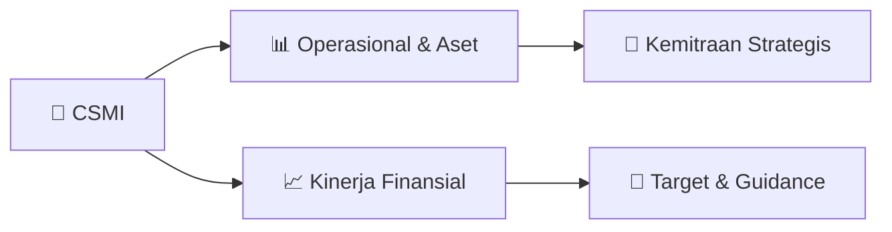

# 📊 Materi Public Expose: [CSMI]

🏢 **Emiten**: `CSMI` | 📅 **Tanggal Pelaksanaan**: `2026-08-26` | 📑 **Total Slide**: `3 Slide`
⬅️ [[knowledge-base/daily-digests/CSMI_20260826|Kembali ke Daily Digest]] | 🎛️ [[Dashboard/CSMI|Ke Dashboard Emiten]]

> [!NOTE]
> Ringkasan materi presentasi resmi Public Expose CSMI yang disampaikan oleh manajemen kepada investor dan bursa. Seluruh poin strategis, matriks operasional, dan angka kinerja diekstrak langsung dari slide deck resmi.

---

## 📅 1. Jadwal & Metadata Penyelenggaraan

| Parameter | Detail Informasi |
|---|---|
| **Nomor Surat Pengantar** | 002/OL-CSM/DIR/VIII/2026 |
| **Perihal Pengumuman** | Rencana Penyelenggaraan Public Expose Insidentil |
| **Waktu Pelaksanaan** | 28 Agustus 2026 23:59 |
| **Lokasi / Media** | https://us06web.zoom.us/webinar/register/WN_o_Rwn4xrTYGQp3 |
| **Lampiran Resmi** | `0` |

## 📋 2. Agenda Paparan Publik

1. Nama Perusahaan
2. Kode Emiten
3. Lampiran
4. Perihal
5. 002/OL-CSM/DIR/VIII/2026
6. PT Cipta Selera Murni Tbk.
7. Rencana Penyelenggaraan Public Expose Insidentil
8. Go To English Page
9. Perseroan melaporkan rencana Public Expose Insidentil sebagai berikut:
10. Rencana Penyelenggaraan Public Expose
11. Latar Belakang Pelaksanaan
12. Sukarela
13. Permintaan Bursa
14. Permintaan Otoritas Jasa Keuangan ( OJK)
15. Referensi Surat
16. Surat Elektronik Bursa
17. Tempat
18. : https://us06web.zoom.us/webinar/register/WN_o_Rwn4xrTYGQp3
19. 4yI9dlAw
20. Hari/Tanggal
21. : 28 Agustus 2026
22. Waktu
23. 23:59
24. Agenda
25. : Agenda Public Expose Insidentil
26. 1 Kinerja keuangan dan kondisi bisnis terkini Perseroan
27. 2 Rencana bisnis ke depan
28. 3 Analisa manajemen terkait dengan pergerakan harga saham
29. Perseroan
30. Hormat Kami,
31. Demikian untuk diketahui.
32. Menara Imperium, Lantai Lower Ground No.04 (LG-04) Jakarta Selatan, 12980
33. DIREKTUR
34. Nama Pengirim
35. Telepon : (021) 314 0411, Fax : (021) 314 0037, www.ciptaseleramurni.co.id
36. PT Cipta Selera Murni Tbk.
37. RADINO MIHARJO
38. PT Cipta Selera Murni Tbk.
39. RADINO MIHARJO
40. Jabatan
41. DIREKTUR
42. Tanggal dan Waktu
43. 26-08-2026 14:20
44. Issuer Name
45. Issuer Code
46. Attachment
47. Subject
48. 002/OL-CSM/DIR/VIII/2026
49. PT Cipta Selera Murni Tbk.
50. General Announcement Public Expose
51. Go To Indonesian Page
52. Company announces public expose plan Incidental as follows:
53. Public Expose Announcement
54. Background
55. Voluntary
56. Requested by IDX
57. Requested by OJK
58. Reference Letter
59. Surat Elektronik Bursa
60. Place
61. : https://us06web.zoom.us/webinar/register/WN_o_Rwn4xrTYGQp3
62. 4yI9dlAw
63. : 28 August 2026
64. 23:59
65. Agenda
66. : Agenda for Incidental Public Expose
67. 1 The Company's financial performance and current business
68. condition
69. 2 Future business plans
70. 3 Management analysis regarding the movement of the
71. Company's share price
72. Respectfully,
73. Thus to be informed accordingly.
74. PT Cipta Selera Murni Tbk.
75. RADINO MIHARJO
76. DIREKTUR
77. RADINO MIHARJO
78. Sender Name
79. PT Cipta Selera Murni Tbk.
80. Menara Imperium, Lantai Lower Ground No.04 (LG-04) Jakarta Selatan, 12980
81. Phone : (021) 314 0411, Fax : (021) 314 0037, www.ciptaseleramurni.co.id
82. DIREKTUR
83. Function
84. Date and Time
85. 26-08-2026 14:20
86. This is an official document of PT Cipta Selera Murni Tbk. that does not require a signature as it was generated
87. electronically by the electronic reporting system. PT Cipta Selera Murni Tbk. is fully responsible for the information

## 🏢 3. Profil & Pilar Portofolio Bisnis

## 🏗️ 4. Kinerja Operasional & Portofolio Aset

*Detail aset operasional terlampir pada dokumen slide resmi.*

## 📈 5. Kinerja Keuangan & Posisi Finansial

## 🧭 6. Inisiatif Strategis, Kolaborasi, & Kemitraan

*Strategi usaha difokuskan pada penguatan fundamental dan ekspansi operasional.*

## 🎯 7. Target Pertumbuhan & Guidance Manajemen

*Target pertumbuhan ditetapkan mengacu pada prospek industri dan kondisi makroekonomi terkini.*

## 🗺️ 8. Peta Jalur Strategis & Eksekusi

## 📑 9. Daftar Indeks Slide Presentasi

| Slide # | Judul / Topik Slide | Ringkasan Konten |
|---|---|---|
| Slide 1 | **Nomor Surat** | Nama Perusahaan Kode Emiten Lampiran |
| Slide 2 | **Dokumen ini merupakan dokumen resmi PT Cipta Selera Murni Tbk. yang tidak memerlukan tanda tangan karena** | dihasilkan secara elektronik oleh sistem pelaporan elektronik. PT Cipta Selera Murni Tbk. bertanggung jawab penuh atas informasi yang tertera didalam  |
| Slide 3 | **Letter / Announcement No.** | Issuer Name Issuer Code Attachment |

---

*Dokumen diolah otomatis oleh **Swarm Intelijen Pasar Modal Indonesia** pada 2026-10-12 16:44 WIB.*