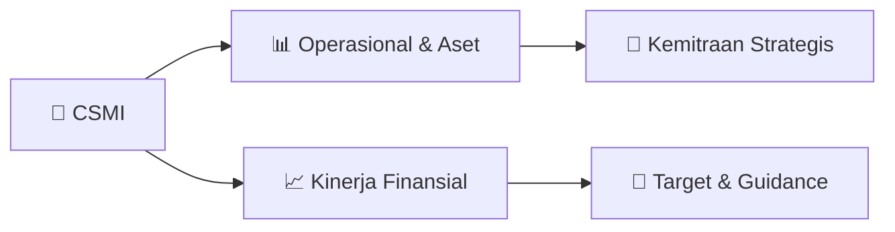

# 📊 Materi Public Expose: [CSMI]

🏢 **Emiten**: `CSMI` | 📅 **Tanggal Pelaksanaan**: `2026-08-27` | 📑 **Total Slide**: `13 Slide`
⬅️ [[knowledge-base/daily-digests/CSMI_20260827|Kembali ke Daily Digest]] | 🎛️ [[Dashboard/CSMI|Ke Dashboard Emiten]]

> [!NOTE]
> Ringkasan materi presentasi resmi Public Expose CSMI yang disampaikan oleh manajemen kepada investor dan bursa. Seluruh poin strategis, matriks operasional, dan angka kinerja diekstrak langsung dari slide deck resmi.

---

## 📅 1. Jadwal & Metadata Penyelenggaraan

| Parameter | Detail Informasi |
|---|---|
| **Nomor Surat Pengantar** | 003/OL-CSM/DIR/VIII/2026 |
| **Perihal Pengumuman** | Penyampaian Materi Public Expose Insidentil |
| **Waktu Pelaksanaan** | 2026-08-27 27-08-2026 16:10 |
| **Lokasi / Media** | Aplikasi Zoom / Daring |
| **Lampiran Resmi** | `1` |

## 📋 2. Agenda Paparan Publik

- Pemaparan Profil & Struktur Bisnis Perseroan
- Kinerja Operasional & Keuangan
- Arah Strategi Usaha & Target Pertumbuhan
- Sesi Tanya Jawab (Q&A)

## 🏢 3. Profil & Pilar Portofolio Bisnis

## 🏗️ 4. Kinerja Operasional & Portofolio Aset

> 1.576
41.898 43.473 9.614 30.121 39.735 (69.488)
3.738
1.462
43.059 44.521 9.738 30.121 39.858 (68.564)
4.662
(80.000) (60.000) (40.000) (20.000)
-
20.000 40.000 60.000 Aset Lancar
Aset Tidak Lancar
Total Aset Liabilitas Jangka Pendek Liabilitas Jangka Panjang Total Liabilitas Akumulasi Kerugian Total Ekuitas
LAPORAN POSISI KEUANGAN PERSEROAN
(DALAM JUTAAN RUPIAH)
30 Juni 2026
31 Desember 2025

> Pergerakan Harga Saham CSMI
Kenaikan harga saham CSMI dalam beberapa minggu terakhir merupakan bagian dari dinamika pasar
yang dipengaruhi oleh interaksi antara permintaan dan penawaran saham di bursa. Perseroan tidak
dapat memastikan faktor tunggal yang menyebabkan pergerakan tersebut. Namun demikian, terdapat
beberapa faktor yang kemungkinan turut berkontribusi terhadap peningkatan minat dan sentimen
investor terhadap saham Perseroan:
1. Perbaikan Kinerja Operasional dan Keuangan
•
Berdasarkan laporan keuangan per 30 Juni 2026, Perseroan mencatat peningkatan penjualan
sekitar 4,7% dan laba kotor sekitar 7,4% dibandingkan periode yang sama tahun sebelumnya.
•
Rugi periode berjalan juga menurun dari sekitar Rp1,02 miliar menjadi Rp924 juta, atau membaik
sekitar 9%.
•
Arus kas dari aktivitas operasi berbalik menjadi positif sekitar Rp97 juta, dibandingkan negatif
sekitar Rp310 juta pada periode sebelumnya.
Perbaikan indikator tersebut dapat memberikan persepsi bahwa proses penyesuaian dan efisiensi yang
dilakukan Perseroan mulai menunjukkan perkembangan.
2. Ekspektasi terhadap Transformasi Model Bisnis
•
Perseroan tengah melakukan transformasi bisnis melalui pengembangan brand NWS C

## 📈 5. Kinerja Keuangan & Posisi Finansial

## 🧭 6. Inisiatif Strategis, Kolaborasi, & Kemitraan

- Optimalisasi Model Bisnis
Baru Perseroan kini tengah
mengembangkan brand kuliner
baru yaitu "NWS Chicken", yang mengusung konsep
produk yang lebih fleksibel dan
adaptif terhadap preferensi
konsumen lokal. Dalam waktu
dekat, Perseroan akan
melakukan evaluasi performa
dari outlet yang telah beroperasi, menyusun
blueprint ekspansi gerai secara
bertahap, dan mengembangkan kemitraan strategis untuk mendukung percepatan pertumbuhan.
Efisiensi dan Reposisi
Operasional Perseroan telah melakukan
langkah-langkah efisiensi dari sisi
operasional, SDM, dan struktur
biaya tetap. Kedepan, fokus akan
diarahkan pada penguatan
struktur biaya agar lebih ramping
dan adaptif terhadap dinamika
bisnis, serta penguatan digitalisasi operasional untuk memudahkan pemantauan
kinerja gerai dan rantai pasok.
Optimalisasi Model Bisnis Baru
Setelah selesainya proses rebranding dari jaringan gerai sebelumnya, Perseroan kini
tengah mengembangkan brand
kuliner baru yaitu "NWS Chicken", yang mengusung konsep produk yang lebih
fleksibel dan adaptif terhadap
preferensi konsumen lokal.
Dalam waktu dekat, Perseroan
akan melakukan evaluasi
performa dari outlet yang telah
beroperasi, menyusun blueprint
ekspansi gerai secara bertahap,
dan mengembangkan kemitraan
strategis untuk mendukung percepatan pertumbuhan.
Efisiensi dan Reposisi
Operasional Perseroan telah melakukan
langkah-langkah efisiensi dari sisi
operasional, SDM, dan struktur
biaya tetap. Ke depan, fokus akan
diarahkan pada penguatan
struktur biaya agar leb

## 🎯 7. Target Pertumbuhan & Guidance Manajemen

*Target pertumbuhan ditetapkan mengacu pada prospek industri dan kondisi makroekonomi terkini.*

## 🗺️ 8. Peta Jalur Strategis & Eksekusi

## 📑 9. Daftar Indeks Slide Presentasi

| Slide # | Judul / Topik Slide | Ringkasan Konten |
|---|---|---|
| Slide 1 | **PT CIPTA SELERA MURNI** | TBK PUBLIC EXPOSE INSIDENTIL JAKARTA, 28 AGUSTUS 2026 |
| Slide 2 | **PROFIL** | PERSEROAN |
| Slide 3 | **Milestone Perseroan** | 1984 1996 2005 |
| Slide 4 | **Lisa Muchtar** | Masyarakat PT Cipta Selera Murni Tbk |
| Slide 5 | **RENCANA** | BISNIS |
| Slide 6 | **Optimalisasi Model Bisnis** | Baru Perseroan kini |
| Slide 7 | **KINERJA** | KEUANGAN PERSEROAN |
| Slide 8 | **1.576** | 41.898 43.473 9.614 |
| Slide 9 | **854 521** | 521 (924) 816 |
| Slide 10 | **Pergerakan Harga Saham CSMI** |  |
| Slide 11 | **Pergerakan Harga Saham CSMI** | Kenaikan harga saham CSMI dalam beberapa minggu terakhir merupakan bagian dari dinamika pasar yang dipengaruhi oleh interaksi antara permintaan dan pe |
| Slide 12 | **Pergerakan Harga Saham CSMI** | 3. Ekspektasi terhadap Pemulihan Kinerja Perseroan • Setelah melalui periode restrukturisasi dan penyesuaian model bisnis, investor dapat mulai |
| Slide 13 | **TERIMA KASIH** |  |

---

*Dokumen diolah otomatis oleh **Swarm Intelijen Pasar Modal Indonesia** pada 2026-10-12 16:44 WIB.*