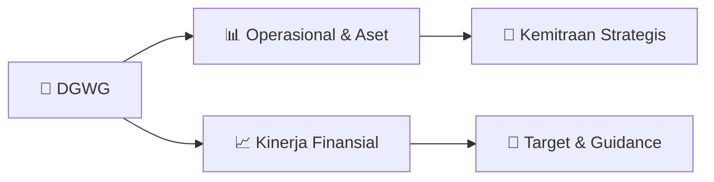

# 📊 Materi Public Expose: [DGWG]

🏢 **Emiten**: `DGWG` | 📅 **Tanggal Pelaksanaan**: `2026-09-23` | 📑 **Total Slide**: `17 Slide`
⬅️ [[knowledge-base/daily-digests/DGWG_20260923|Kembali ke Daily Digest]] | 🎛️ [[Dashboard/DGWG|Ke Dashboard Emiten]]

> [!NOTE]
> Ringkasan materi presentasi resmi Public Expose DGWG yang disampaikan oleh manajemen kepada investor dan bursa. Seluruh poin strategis, matriks operasional, dan angka kinerja diekstrak langsung dari slide deck resmi.

---

## 📅 1. Jadwal & Metadata Penyelenggaraan

| Parameter | Detail Informasi |
|---|---|
| **Nomor Surat Pengantar** | 0010/DGWG-CORSEC/IX/2026 |
| **Perihal Pengumuman** | Penyampaian Materi Public Expose Tahunan |
| **Waktu Pelaksanaan** | 2026-09-23 23-09-2026 16:23 |
| **Lokasi / Media** | Aplikasi Zoom / Daring |
| **Lampiran Resmi** | `1` |

## 📋 2. Agenda Paparan Publik

1. Tinjauan Industri
2. Dengan proyeksi tingkat pertumbuhan sebesar 16,6%, Pemerintah
3. Indonesia meningkatkan anggaran ketahanan pangan hingga
4. diperkirakan mencapai Rp164,4 Triliun pada tahun 2026, sehingga
5. menciptakan lingkungan yang kondusif bagi produsen produk-
6. produk pertanian seperti pupuk dan pestisida.
7. Anggaran Ketahanan Pangan Pemerintah (Triliun Rupiah)
8. Konsumsi pupuk dan konsumsi pestisida juga diproyeksikan tumbuh
9. masing-masing sebesar 7,3% dan 6,2%. Didukung oleh tren
10. perkembangan kebutuhan akan produk input pertanian yang
11. berkualitas tinggi, DGW berada pada jalur yang tepat untuk meraih
12. potensi yang lebih besar dari agenda ketahanan pangan Indonesia.
13. Pangsa Pasar Konsumsi Pupuk di Indonesia (Triliun Rupiah)
14. Pangsa Pasar Konsumsi Pestisida di Indonesia (Triliun Rupiah)
15. Sumber : Euromonitor, BPS

## 🏢 3. Profil & Pilar Portofolio Bisnis

> Struktur Grup yang Terintegrasi untuk Memenuhi Permintaan Pasar
Profil Perusahaan David Yaory Publik Maybank Sekuritas Indonesia
PT Agro Jaya
Mandiri
PT Dharma Guna
Wibawa
PT DGW Pupuk
Indonesia
PT Fertilizer Inti
Technology
PT Mitra International
Tunggal
PT Semesta Alam
Sejati
PT Bangun Sahabat
Tani 72.34% 14.91% 7.73%
5.02%
99.50% 94.27% 99.50% 99.50% 99.50% 99.50% Lini Bisnis Pupuk Lini Bisnis Pestisida Lini Bisnis Alat-alat Pertanian Lini Bisnis Distribusi Internal

> Pencapaian Perusahaan dari Tahun ke Tahun
Profil Perusahaan 0,5 327 437 579 1,114 1,203 1,590 3,040 4,147 4,880
Terdaftar di IDX
Pengoperasian pabrik karbamasi Peluncuran produk komersial pertama: Supremo Menjalankan operasi bottling produk agrokimia Menjalankan operasi pabrik mixing  dan bottling di Jababeka III, Bekasi Pendirian anak usaha distribusi internal dengan
gudang utama di
Tegal Memasuki bisnis pupuk dengan impor NPK Pengoperasian
Pabrik NPK di
Gresik, Jawa Timur Memasuki bisnis alat pertanian dengan penjualan mulsa dan sprayer Pengoperasian pabrik produksi mulsa di Cikande, Banten Pembangunan pabrik karbamasi di Cikande, Banten 2001 2005 2009 2010 2011 2018 2019 2020 2023 2025 Pembangunan
Pabrik NPK di
Palembang 2026F
Penjualan (dalam Miliar Rupiah)

> Tim Manajemen yang Berpengalaman
Profil Perusahaan Dewan Komisaris Direksi
Widagdo Hendro Sukoco
Komisaris Utama
• Sarjana Terapan dari AKABRI Darat Korps Zeni (1984)
• Staf Khusus KASAD
Pending Dadih Permana
Komisaris Indenpenden
• Sarjana Ekonomi Universitas Gadjah Mada (2008)
• Staf
Ahli Menteri Bidang Lingkungan Pertanian, Kementrian Pertanian David Yaory Direktur Utama
• MBA - Ross Business School, University of Michigan
• Konsultan – McKinsey & Company
• Investor aktif di sektor EV, Logistik, dan Fin-Tech
Danny Jo Putra
Direktur
• MBA - ITB Business and Management School
• Konsultan - PwC
• Pengalaman di bidang finance dan accounting di
berbagai perusahaan multinasional
Arbi Munandar Direktur
• Sarjana Ekonomi - Universitas Tarumanagara
• Pengalaman di bidang finance dan accounting di
berbagai perusahaan multinasional
Yody Suganda Direktur
• Bachelor of Science - Purdue University
• MBA - Hong Kong University of Science and Technology
• Konsultan Manajeme - BCG;
• Direktur - Shopee Indonesia

## 🏗️ 4. Kinerja Operasional & Portofolio Aset

> Sumber : Laporan Keuangan Perusahaan
Ekuitas (Miliar Rupiah)
Liabilitas (Miliar Rupiah)
Aset Tidak Lancar (Miliar Rupiah)
Aset (Miliar Rupiah)
Posisi Keuangan Pencapaian Finansial

## 📈 5. Kinerja Keuangan & Posisi Finansial

### 🧮 Rasio Keuangan Utama
```text
Sumber : Laporan Keuangan Perusahaan
Debt to Equity Ratio
Current Ratio
Return on Equity & Assets (ROE & ROA)
Rasio Keuangan Pencapaian Finansial
```

## 🧭 6. Inisiatif Strategis, Kolaborasi, & Kemitraan

*Strategi usaha difokuskan pada penguatan fundamental dan ekspansi operasional.*

## 🎯 7. Target Pertumbuhan & Guidance Manajemen

*Target pertumbuhan ditetapkan mengacu pada prospek industri dan kondisi makroekonomi terkini.*

## 🗺️ 8. Peta Jalur Strategis & Eksekusi



## 📑 9. Daftar Indeks Slide Presentasi

| Slide # | Judul / Topik Slide | Ringkasan Konten |
|---|---|---|
| Slide 2 | **Struktur Grup yang Terintegrasi untuk Memenuhi Permintaan Pasar** | Profil Perusahaan David Yaory |
| Slide 3 | **Pencapaian Perusahaan dari Tahun ke Tahun** | Profil Perusahaan 0,5 80 |
| Slide 4 | **Tim Manajemen yang Berpengalaman** | Profil Perusahaan Dewan Komisaris Direksi |
| Slide 5 | **Empat Keunggulan Kompetitif Perusahaan** | Profil Bisnis Visi: Meningkatkan Perekonomian Pedesaan Melalui Teknologi ONE STOP |
| Slide 6 | **Fasilitas Produksi Berskala Besar dengan Teknologi Terbaru** | Pabrik Pupuk NPK (Palembang) Gresik, Jawa Timur Palembang, |
| Slide 7 | **Jaringan Distribusi yang Menjangkau Lebih dari 10 Juta Petani Nasional** | Distribusi Internal Distribusi Eksternal Cakupan Agronomis DGWG |
| Slide 8 | **Portofolio Produk yang Lengkap dan Inovatif di Masing-masing Kategori** | Profil Bisnis Sales by Products – 1H2026 mencakup |
| Slide 9 | **Peristiwa Penting Perusahaan** | Profil Bisnis DGWG Meresmikan Pabrik Karbamasi untuk Mendukung Ketahanan Pangan dan Ekspansi Global |
| Slide 10 | **Peristiwa Penting Perusahaan** | Profil Bisnis Aksi Korporasi Pencatatan Perdana Saham (IPO) di |
| Slide 11 | **Tantangan Usaha & Inisiatif Perusahaan** | Profil Bisnis Tantangan Usaha Inisiatif Pengembangan Usaha |
| Slide 12 | **Momentum dari Agenda Ketahanan Pangan Nasional** | Tinjauan Industri Dengan proyeksi tingkat pertumbuhan sebesar 16,6%, Pemerintah Indonesia meningkatkan anggaran ketahanan pangan hingga |
| Slide 13 | **PENCAPAIAN FINANSIAL** |  |
| Slide 14 | **14 Sumber : Laporan Keuangan Perusahaan** | Sumber : Laporan Keuangan Perusahaan Laba Bersih (Miliar Rupiah) EBITDA (Miliar Rupiah) |
| Slide 15 | **15 Sumber : Laporan Keuangan Perusahaan** | Sumber : Laporan Keuangan Perusahaan Ekuitas (Miliar Rupiah) Liabilitas (Miliar Rupiah) |
| Slide 16 | **16 Sumber : Laporan Keuangan Perusahaan** | Sumber : Laporan Keuangan Perusahaan Debt to Equity Ratio Current Ratio |

---

*Dokumen diolah otomatis oleh **Swarm Intelijen Pasar Modal Indonesia** pada 2026-10-12 16:44 WIB.*