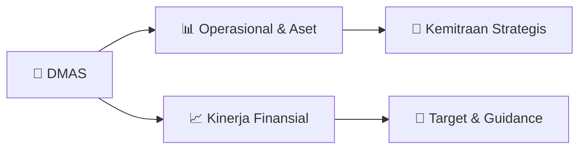

# 📊 Materi Public Expose: [DMAS]

🏢 **Emiten**: `DMAS` | 📅 **Tanggal Pelaksanaan**: `2026-09-02` | 📑 **Total Slide**: `38 Slide`
⬅️ [[knowledge-base/daily-digests/DMAS_20260902|Kembali ke Daily Digest]] | 🎛️ [[Dashboard/DMAS|Ke Dashboard Emiten]]

> [!NOTE]
> Ringkasan materi presentasi resmi Public Expose DMAS yang disampaikan oleh manajemen kepada investor dan bursa. Seluruh poin strategis, matriks operasional, dan angka kinerja diekstrak langsung dari slide deck resmi.

---

## 📅 1. Jadwal & Metadata Penyelenggaraan

| Parameter | Detail Informasi |
|---|---|
| **Nomor Surat Pengantar** | 046/DMAS/IR-CS/IX/2026 |
| **Perihal Pengumuman** | Penyampaian Materi Public Expose Tahunan |
| **Waktu Pelaksanaan** | 2026-09-02 02-09-2026 14:43 |
| **Lokasi / Media** | Aplikasi Zoom / Daring |
| **Lampiran Resmi** | `1` |

## 📋 2. Agenda Paparan Publik

1. AGENDA
2. PAGE 2
3. STRICTLY CONFIDENTIAL
4. COMPANY OVERVIEW
5. OPERATIONAL UPDATES
6. SUSTAINABLE DEVELOPMENT
7. KEY FINANCIAL INFORMATION

## 🏢 3. Profil & Pilar Portofolio Bisnis

> MACQUARIE CAPITAL//  PAGE 3
STRICTLY CONFIDENTIAL COMPANY OVERVIEW

> PAGE 4 STRICTLY CONFIDENTIAL COMPANY OVERVIEW
PT PURADELTA LESTARI TBK
Leading Integrated Township Developers at East of Jakarta
J O I N T V E N T U R E :
PT Puradelta Lestari Tbk (DMAS)
Project Title
: Kota Deltamas
Project Description
: Industrial-based Modern Integrated Township
Location
: Jalan Tol Jakarta-Cikampek KM 37, Cikarang Pusat, Bekasi
Total Area
: ± 3,185 hectares
Established in : 1993
Year of IPO
: 2015

> PAGE 5 STRICTLY CONFIDENTIAL COMPANY OVERVIEW
KEY COMPANY MILESTONES
1993 1996 2001 2002 ◼Commenced work on Greenland International Industrial Center (“GIIC”) 2008 2004 ◼Bekasi Regency Government Center in Kota Deltamas 2015 ◼Listed in IDX ◼Commenced development of light industry area ◼Launched first residential development ◼Incorporate
d as a local
investment company in Indonesia ◼Changed company
status to foreign
capital investment company ◼Sojitz Corporation (previously Nissho Iwai Corporation) became 25%
shareholder of the
Company 2017 ◼Establishme
nt of JV PT
Panahome Deltamas Indonesia ◼Obtained KLIK facility 2018 ◼Obtained Certifications of ISO 9001:2015 ISO 14001:2015 ISO 45001:2018 ◼Direct access from Jakarta- Cikampek
toll road to
Kota Deltamas 2021 ◼Commenced development of new industrial zone for data center in GIIC 2022 ◼Intensity on electric vehicle usage for the Company’s operational activities ◼Start implementing Renewable Energy (REC) 2025 ◼Commenced operation on Security, Fire, and Command Center (SFCC) ◼Commenced operation on Water Treatment Plant Recycle

> PAGE 6 STRICTLY CONFIDENTIAL COMPANY OVERVIEW SHAREHOLDING STRUCTURE
Joint Venture Company of Sinarmas Land and Sojitz Corporation
PT Sumber Arusmulia 57.28% Sojitz Corporation 25.00% PT Pembangunan Deltamas*
PT Puradelta Lestari
Tbk 99.90% Public 17.72%
Ownership Structure of the Company
Combination of Unique Strength of
Sinarmas land and Sojitz Corporation
Proven Expertise
and Long Track
Record of Property
Development and Management
•
Leading and most experienced property developer in Indonesia
•
Listed in SGX
Strong International Marketing Platform and Strategic Partnership
•
General trading conglomerate
with a worldwide
network in c. 50
countries and regions
•
Listed in TSE
PT Panahome Deltamas Indonesia** 49.00%
* Subsidiary of the Company
** Joint Venture Project

> PAGE 7 STRICTLY CONFIDENTIAL COMPANY OVERVIEW MANAGEMENT BOARD
Board of Directors
Monik William Director
Hongky J. Nantung
President Director Atsushi Uehara
Vice President Director
Tondy Suwanto Director

> PAGE 8 STRICTLY CONFIDENTIAL COMPANY OVERVIEW MANAGEMENT BOARD
Board of Commissioners
Susiyati B. Hirawan
Independent Commissioner Masayoshi Hirose Vice President Commissioner Teddy Pawitra Independent Commissioner Seiji Itagaki Commissioner Hermawan Wijaya Vice President Commissioner Teky Mailoa President Commissioner Irhoan Tanudiredja Independent Commissioner

> PAGE 9 STRICTLY CONFIDENTIAL Demand for industrial
Key industrial customers
Supporting supplier –
Tier 1
Supporting supplier –
Tier 2
Supporting supplier –
Tier 3
Supporting supplier –
Tier ... Demand for residential Demand for commercial Commercial / retail developments creating a desirable living environment Population growth driving demand for commercial
Demand for housing flowing from employees
and visitors from industrial area
Residential developments creating a conducive living
environment that attracts industrial customer workforce
Growth in workforce generating retail traffic
Commercial developments enhances workplace attractiveness
Demand for manpower
Social infrastructure
Govt centres, educational
institutions, medical,
shopping centers, etc.
Our Business Model in Brief
COMPANY OVERVIEW BUSINESS MODEL

> PAGE 10 STRICTLY CONFIDENTIAL
AUTO INDUSTRY CONCENTRATION
COMPANY OVERVIEW LOCATION Soekarno Hatta Int’l Airport Tanjung Priok Seaport Patimban Deep Seaport Bekasi Regency Karawang
• Automotive manufacturing and assembling plants in
Indonesia are concentrated in East Jakarta-
Cikampek Corridor.
• Strategically located at the epicenter of the
industrial zone along Jakarta-Cikampek Toll Road.
Cikarang

> PAGE 11 STRICTLY CONFIDENTIAL
INFRASTRUCTURE DEVELOPMENT TO SUPPORT INDUSTRY
COMPANY OVERVIEW LOCATION
37 KM    Halim Perdana Kusuma International
73 KM    Soekarno - Hatta International
139 KM Kertajati International
54 KM    Tanjung Priok
100 KM  Patimban
Jakarta – Bandung High
Speed Train Station
Jakarta - Cikampek KM37 Cikarang Pusat
Jakarta - Cikampek KM42 (Future)
South Jakarta – Cikampek KM 31 Interchange GIIC (Future)
Toll Road
High Speed Train
Seaport Soekarno Hatta Int’l Airport Tanjung Priok Seaport Patimban Deep Seaport Bekasi Regency Karawang Cikarang Cibitung Cilincing- Cibitung Toll Road Cibitung- Cimanggis Toll Road Kertajati Airport
*this picture is just an illustration
Airport Halim Perdana Kusuma Airport
PROXIMITY & INFRASTRUCTURES

> PAGE 12 STRICTLY CONFIDENTIAL COMPANY OVERVIEW
ENTRANCE TO KOTA DELTAMAS
DIRECT ACCESS TO INTERCHANGE OF KM37
JAKARTA – CIKAMPEK TOLL ROAD

> PAGE 14 STRICTLY CONFIDENTIAL
Solid Master Plan with Large Land Bank
Master Plan of Kota Deltamas
COMPANY OVERVIEW
DEVELOPMENT AREA  AND LAND BANK
Bekasi Regency Gov’t Centre Bekasi City Jakarta Tangerang
Access to other
industrial estates Karawang Cikampek Bandung Central Java Industrial Residential Commercial
Interchange KM 31
(under construction)
Interchange KM 42
(under construction) Interchange KM 37 KCIC Station
Land Bank 30 June 2026
Industrial 60 ha Commercial 357 ha Residential 164 ha TOTAL 581 ha

> PAGE 15 STRICTLY CONFIDENTIAL COMPANY OVERVIEW
ENTRANCE TO KOTA DELTAMAS
GREENLAND INTERNATIONAL INDUSTRIAL CENTER
(GIIC) KOTA DELTAMAS

> PAGE 16 STRICTLY CONFIDENTIAL COMPANY OVERVIEW INDUSTRIAL ESTATE
Greenland International Industrial Center
(“GIIC”)
One of the Largest Industrial Estate along the Jakarta-Cikampek Toll Road
• ~ 170 industrial
tenants, mostly Japanese industries
• Implementing
integrated management system (ISO9001, ISO14001, ISO45001)
• KLIK facility (direct
construction after investment facility)
• National Vital Object in
the industrial sector
Big Tenants Area Year KITIC ~200 Ha
2009 – 2011
Suzuki ~130 Ha 2011 Hyundai Motor
~ 90 Ha
2019 - 2023
Astra Honda Motor
~  85 Ha
2016 - 2021
SAIC GM Wuling
~  60 Ha
2015 Mitsubishi Motors
~  51 Ha
2014 – 2015
Kalbe
~  37 Ha
2017 – 2018
Maxxis
~  35 Ha
2014 Cai Niao
~  33 Ha
2020 Frisian Flag
~  25 Ha
2020 Kohler
~  20 Ha
2017 Daikin
~  20 Ha
2022

> PAGE 17 STRICTLY CONFIDENTIAL
Auto and Auto Related
Logistics
Food & Beverage / Related
Others
Attracting a Diverse Mix of Customers across the Various Sectors
COMPANY OVERVIEW INDUSTRIAL ESTATE

> PAGE 18 STRICTLY CONFIDENTIAL
Key Competitive Advantages of GIIC Kota Deltamas
COMPANY OVERVIEW INDUSTRIAL ESTATE
Integrated Management System
(ISO 9001, ISO 14001, ISO 45001),
KLIK facility, Obvitnas
Strategic Location & Direct
Access to Toll Road
Wide Land Bank with
Flexibility in Size and
Shape
Compehensive Facilities and Infrastructures
Premium Electricity
Supply from PLN
Water Management ddd
Water Treatment Plant (WTP), Waste Water
Treatment Plant (WWTP) and WTP Recycle
Gas Supply from PGN
Telco & Fiber Optic
from Telkom, MyRep,
& Moratel
World Class Township
Design and Planning
Experienced Management Team
Eco-friendly / Green
Environment
Integrated Business Model
Firefighter Facilities Strong Security System Nursery Center

> PAGE 19 STRICTLY CONFIDENTIAL
Updates on Industrial Estate
COMPANY OVERVIEW INDUSTRIAL ESTATE
Collaboration with PLN to develop a data
center hub in GIIC Kota Deltamas
Development of a new industrial zone inside GIIC
Kota Deltamas, dedicated for data centers or other
industries that require certain specifications
fiber optic installation road construction
Premium / Priority
Power Supply Deltamas
Premium / Priority
Power Supply Cibatu
High Voltage Switching
Transformer Station (under construction) Fiber Optic Network Water Treatment Plant Waste Water Treatment Plant Security and Command Center
12” Gas Pipe Route
Eco-friendly electricity supply, such as
renewable energy certificate, is also offered
to customers
Security and command center

> PAGE 20 STRICTLY CONFIDENTIAL
Development of Commercial Area and Public Facilities
COMPANY OVERVIEW COMMERCIAL ESTATE Shophouses
in Kota Deltamas
Deltamas Sport Centre Education Center
Hotel & Serviced Apartment
Health Facility Sport Center
Entertainment and F&B
Integrated with
Local Gov’t Center
Commercial Products in Kota Deltamas:
-
Commercial Lots
(for hotel, restaurant, office, showroom,
retail,  gas station, supermarket, bookstore,
etc)
-
Commercial Buildings
(Shophouses / Business Galleries)
Le Premier Hotel / Serviced Apartment
-
Owned and Managed by the Company
-
76 spacious modern simple-designed rooms
* under construction
*

> PAGE 21 STRICTLY CONFIDENTIAL COMPANY OVERVIEW COMMERCIAL ESTATE
Updates on Commercial Area
Via Alma Apartment Mitra Keluarga Hospital Cikarang Japanese School Karawang HSR Station / Kotawana Diamante Business Gallery Richeese Factory Eka Hospital* J-Golf Le Premier Serviced Apartment Ananda Mitra Vocational School Starbucks
Institut Teknologi &
Sains Bandung K-Education Complex AEON Mall
*under construction
Isuzu Showroom &
Service Mc Donald’s

> PAGE 22 STRICTLY CONFIDENTIAL
Development of Residential Estate
COMPANY OVERVIEW RESIDENTIAL ESTATE
Housing in Clusters
Club House Facility
•
Main Products
: Landed house in residential clusters
•
Target Market
: Middle income to high income segment
•
Selling method
: Built to sell - construction of each unit will commence upon down payment
•
Total Units Sold
: around 3,000 units
Swimming Pool Facility Fitness Centre Facility
Residential Cluster Development
Collaboration and Other Residential Development

> PAGE 23 STRICTLY CONFIDENTIAL COMPANY OVERVIEW COMMERCIAL ESTATE
Updates on Residential Area
Zona Amerika Zona Eropa Langkawi
Currently on sale:
Woodchester, De Silva, Savasa
Housing in Zona Amerika

> PAGE 25 STRICTLY CONFIDENTIAL COMPANY OVERVIEW SUSTAINABLE DEVELOPMENT
Best in Class Real Estate
A Home of World-class
Industries
Integrated Township Concept, a Sustainable One-Stop-Living City
supported Comprehensive Facilities and Utilities
Green Residential Estate
Vibrant Commercial Area
Schools and Universities Hotels, Restaurants, Entertainments
Factories and Offices
and more global data centers..

> PAGE 26 STRICTLY CONFIDENTIAL COMPANY OVERVIEW SUSTAINABLE DEVELOPMENT
Climate Change & the Environment
Usage of Renewable Energy
• Sourcing electricity from REC PLN for its operational activities
• Electric vehicle usage for the Company’s operational activities
• Solar panel usage for the streetlights and several office
operations
More High-tech Industries
Electric Vehicle Manufacturing Data Centers Selective Industrial Tenants
Pedestrian & Green Area
Development, and Tree Planting
ISO 14001 Certification
(Environmental Management)

> PAGE 27 STRICTLY CONFIDENTIAL COMPANY OVERVIEW SUSTAINABLE DEVELOPMENT
Climate Change & the Environment
•
HDPE Plastic Recycle for Asphalt Usage
Waste Management & Recycle
Waste management that produces:
•
Compost, used as plant fertilizer
•
RDF (Refuse-Derived Fuel), used as biomass fuel to be sent to
cement factories
•
Valueable, involves shredding plastic waste into fuel through
pyrolysis, and converting diaper/nappy waste into sand
•
Residue, which will be processed into concrete blocks
Water Management
• Water Treatment Plant (WTP)
• Waste Water Treatment Plant (WWTP)
• Water Treatment Plant (WTP) Recycle

> PAGE 28 STRICTLY CONFIDENTIAL COMPANY OVERVIEW SUSTAINABLE DEVELOPMENT Sustainable Community
Maintaining Health of its Residents,
Tenants, and Surrounding Communities
Blood Donor Program with PMI
Residential Fogging
Supporting and Nurturing Our
Neighbours Sacrificial Animal
Donation for Surrounding
Villages
Tools and Materials
Donation for Infrastructures
of Surrounding Villages
Cultivating Land for
Agriculture
Reservoir for The Farmers
Additional Nutrition
for Stunting Program
Clean Water Supply
Building Material
Donation for the
Mosques construction
Tree Planting around
Cipamingkis River
Tree Donation for
Villages

> PAGE 29 STRICTLY CONFIDENTIAL COMPANY OVERVIEW SUSTAINABLE DEVELOPMENT Educational Patronage
Construction of SDN Cicau 1
Economic Empowerment & Trainings
for Local Farmer Group
Education for Surrounding People
Firefighting Training
Vocational School Facilities in Town
Renovation of PAUD Arumsari

## 🏗️ 4. Kinerja Operasional & Portofolio Aset

*Detail aset operasional terlampir pada dokumen slide resmi.*

## 📈 5. Kinerja Keuangan & Posisi Finansial

## 🧭 6. Inisiatif Strategis, Kolaborasi, & Kemitraan

- PAGE 1 STRICTLY CONFIDENTIAL
THIS PRESENTATION IS FOR INFORMATION PURPOSES ONLY. IT IS NOT, IS NOT INTENDED TO BE, AND SHALL NOT BE CONSTRUED AS, AN OFFER, INDUCEMENT,
INVITATION, SOLICITATION, COMMITMENT OR ADVERTISEMENT WITH RESPECT TO THE PURCHASE, SUBSCRIPTION OR SALE OF ANY SECURITY AND NO PART OF IT SHALL
FORM THE BASIS OF, OR BE RELIED UPON IN CONNECTION WITH, ANY CONTRACT OR COMMITMENT WHATSOEVER.
The information that follows is a presentation of general background information about PT Puradelta Lestari Tbk. (the “Company”) prepared by the Company as 30 June 2026.
This presentation has been prepared for information purposes only. None of the information appearing in this presentation may be distributed to the press or other media or reproduced or
redistributed in the whole or in part in any form at any time. Any recipient of this presentation and its directors, officers, employees, agents and affiliates must hold this presentation and any
information provided in connection with this presentation in strict confidence and may not communicate, reproduce, distribute or disclose to any other person, or refer to them publicly, in whole
or in part. This presentation is not for publication, circulation or use in the United States and may not be transmitted or taken into the United States.
This presentation does not constitute an offer to sell or the solicitation of an offer to buy any securities of the Company in the United States or any other jurisdiction in which such offer

## 🎯 7. Target Pertumbuhan & Guidance Manajemen

*Target pertumbuhan ditetapkan mengacu pada prospek industri dan kondisi makroekonomi terkini.*

## 🗺️ 8. Peta Jalur Strategis & Eksekusi

## 📑 9. Daftar Indeks Slide Presentasi

| Slide # | Judul / Topik Slide | Ringkasan Konten |
|---|---|---|
| Slide 1 | **STRICTLY CONFIDENTIAL** | PT PURADELTA LESTARI TBK PUBLIC EXPOSE LIVE 2026 PRESENTATION |
| Slide 2 | **PAGE 1** | STRICTLY CONFIDENTIAL THIS PRESENTATION IS FOR INFORMATION PURPOSES ONLY. IT IS NOT, IS NOT INTENDED TO BE, AND SHALL NOT BE CONSTRUED AS, AN OFFER, I |
| Slide 3 | **1 A** | A AGENDA PAGE 2 |
| Slide 4 | **MACQUARIE CAPITAL//  PAGE 3** | STRICTLY CONFIDENTIAL COMPANY OVERVIEW 01 |
| Slide 5 | **PAGE 4** | STRICTLY CONFIDENTIAL COMPANY OVERVIEW PT PURADELTA LESTARI TBK |
| Slide 6 | **PAGE 5** | STRICTLY CONFIDENTIAL COMPANY OVERVIEW KEY COMPANY MILESTONES |
| Slide 7 | **PAGE 6** | STRICTLY CONFIDENTIAL COMPANY OVERVIEW SHAREHOLDING STRUCTURE |
| Slide 8 | **PAGE 7** | STRICTLY CONFIDENTIAL COMPANY OVERVIEW MANAGEMENT BOARD |
| Slide 9 | **PAGE 8** | STRICTLY CONFIDENTIAL COMPANY OVERVIEW MANAGEMENT BOARD |
| Slide 10 | **PAGE 9** | STRICTLY CONFIDENTIAL Demand for industrial |
| Slide 11 | **PAGE 10** | STRICTLY CONFIDENTIAL AUTO INDUSTRY CONCENTRATION COMPANY OVERVIEW |
| Slide 12 | **PAGE 11** | STRICTLY CONFIDENTIAL INFRASTRUCTURE DEVELOPMENT TO SUPPORT INDUSTRY COMPANY OVERVIEW |
| Slide 13 | **PAGE 12** | STRICTLY CONFIDENTIAL COMPANY OVERVIEW ENTRANCE TO KOTA DELTAMAS |
| Slide 14 | **MACQUARIE CAPITAL//  PAGE 13** | STRICTLY CONFIDENTIAL OPERATIONAL UPDATES 02 |
| Slide 15 | **PAGE 14** | STRICTLY CONFIDENTIAL Solid Master Plan with Large Land Bank Master Plan of Kota Deltamas |
| Slide 16 | **PAGE 15** | STRICTLY CONFIDENTIAL COMPANY OVERVIEW ENTRANCE TO KOTA DELTAMAS |
| Slide 17 | **PAGE 16** | STRICTLY CONFIDENTIAL COMPANY OVERVIEW INDUSTRIAL ESTATE |
| Slide 18 | **PAGE 17** | STRICTLY CONFIDENTIAL Auto and Auto Related Logistics |
| Slide 19 | **PAGE 18** | STRICTLY CONFIDENTIAL Key Competitive Advantages of GIIC Kota Deltamas COMPANY OVERVIEW |
| Slide 20 | **PAGE 19** | STRICTLY CONFIDENTIAL Updates on Industrial Estate COMPANY OVERVIEW |
| Slide 21 | **PAGE 20** | STRICTLY CONFIDENTIAL Development of Commercial Area and Public Facilities COMPANY OVERVIEW |
| Slide 22 | **PAGE 21** | STRICTLY CONFIDENTIAL COMPANY OVERVIEW COMMERCIAL ESTATE |
| Slide 23 | **PAGE 22** | STRICTLY CONFIDENTIAL Development of Residential Estate COMPANY OVERVIEW |
| Slide 24 | **PAGE 23** | STRICTLY CONFIDENTIAL COMPANY OVERVIEW COMMERCIAL ESTATE |
| Slide 25 | **MACQUARIE CAPITAL//  PAGE 24** | STRICTLY CONFIDENTIAL SUSTAINABLE DEVELOPMENT |
| Slide 26 | **PAGE 25** | STRICTLY CONFIDENTIAL COMPANY OVERVIEW SUSTAINABLE DEVELOPMENT |
| Slide 27 | **PAGE 26** | STRICTLY CONFIDENTIAL COMPANY OVERVIEW SUSTAINABLE DEVELOPMENT |
| Slide 28 | **PAGE 27** | STRICTLY CONFIDENTIAL COMPANY OVERVIEW SUSTAINABLE DEVELOPMENT |
| Slide 29 | **PAGE 28** | STRICTLY CONFIDENTIAL COMPANY OVERVIEW SUSTAINABLE DEVELOPMENT |
| Slide 30 | **PAGE 29** | STRICTLY CONFIDENTIAL COMPANY OVERVIEW SUSTAINABLE DEVELOPMENT |
| Slide 31 | **PAGE 30** | STRICTLY CONFIDENTIAL AWARDS & RECOGNITIONS Recognitions from the Stakeholders |
| Slide 32 | **MACQUARIE CAPITAL//  PAGE 31** | STRICTLY CONFIDENTIAL KEY FINANCIAL INFORMATION |
| Slide 33 | **PAGE 32** | STRICTLY CONFIDENTIAL Marketing Sales Achievement Achievement in June 2026– IDR1.15 trillion |
| Slide 34 | **PAGE 33** | STRICTLY CONFIDENTIAL KEY FINANCIAL INFORMATION Gross Profit Margin |
| Slide 35 | **PAGE 34** | STRICTLY CONFIDENTIAL KEY FINANCIAL INFORMATION Industrial |
| Slide 36 | **PAGE 35** | STRICTLY CONFIDENTIAL KEY FINANCIAL INFORMATION Optimum Return for Shareholders |
| Slide 37 | **PAGE 36** | STRICTLY CONFIDENTIAL Income Statement in Rp Bn June 2025 |
| Slide 38 | **MACQUARIE CAPITAL//  PAGE 37** | STRICTLY CONFIDENTIAL THANK YOU For Further Information: |

---

*Dokumen diolah otomatis oleh **Swarm Intelijen Pasar Modal Indonesia** pada 2026-10-12 16:44 WIB.*