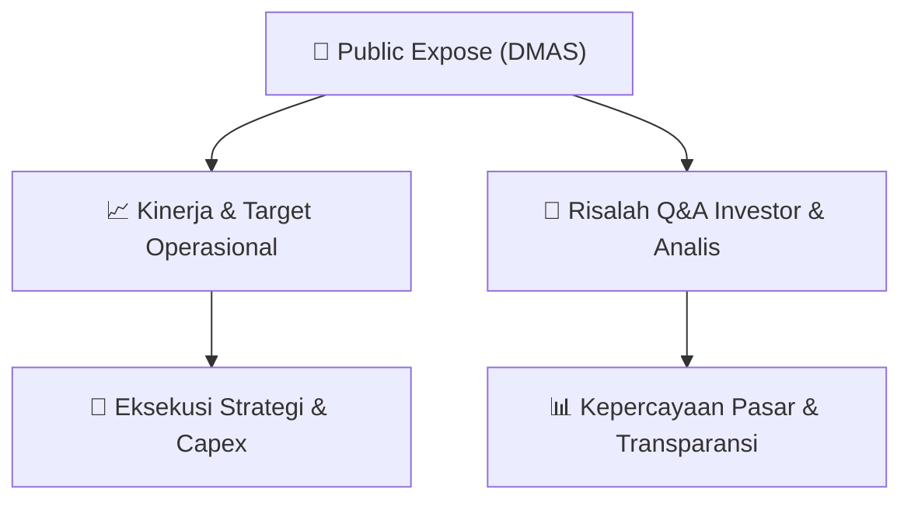

# 📢 Laporan Intelijen Paparan Publik (Public Expose) - [[DMAS]]
🏢 **Emiten**: `[[DMAS]]` | 📅 **Tanggal Pelaksanaan**: `2026-09-10` | 📑 **Dokumen**: `Public Expose`
⬅️ [[knowledge-base/daily-digests/Daily_Digest_20260910|Kembali ke Daily Digest]] | 🎛️ [[Dashboard|Ke Dashboard Utama]]

---

## 📌 1. Ringkasan Eksekutif & Paparan Direksi
> [!NOTE]
> PT Puradelta Lestari Tbk (DMAS) menyelenggarakan Public Expose Tahunan pada 02 September 2026, dengan laporan hasil disampaikan pada 10 September 2026. Acara dihadiri 130 peserta (tidak termasuk manajemen dan karyawan). Emiten pengembang kawasan industri Kota Deltamas di Cikarang ini menyampaikan paparan kinerja dan rencana strategis kepada investor dan analis. Public Expose ini merupakan agenda tahunan perusahaan untuk transparansi informasi dan komunikasi dengan pemangku kepentingan.

#### 🎯 Guidance Operasional & Target Strategis
- Berdasarkan dokumen yang tersedia, tidak terdapat rincian spesifik mengenai target kinerja, ekspansi, atau capex yang diungkapkan dalam ringkasan laporan ini. Namun sebagai pengembang kawasan industri terkemuka di Cikarang, DMAS diharapkan memberikan guidance terkait penjualan lahan industri, komersial, dan residensial, serta proyeksi pendapatan berulang dari sewa dan fasilitas. Investor perlu memantau laporan keuangan interim dan pengumuman selanjutnya untuk mendapatkan informasi kuantitatif mengenai target kinerja dan alokasi belanja modal.

## 📊 2. Matriks Indikator Operasional & Parameter Kunci
| Parameter Utama | Nilai / Keterangan Resmi |
| :--- | :--- |
| **Tanggal Pelaksanaan Public Expose** | `02 September 2026` |
| **Jumlah Peserta Hadir** | `130 orang (tidak termasuk manajemen dan karyawan)` |
| **Jenis Acara** | `Public Expose Tahunan / Annual Public Expose` |
| **Nomor Surat Pengumuman** | `048/DMAS/IR-CS/IX/2026` |
| **Tanggal Laporan Hasil** | `10 September 2026` |
| **Pelaksana Pelaporan** | `Tondy Suwanto, Corporate Secretary` |

---

## 💬 3. Risalah Tanya Jawab (Q&A Session)
### ❓ Pertanyaan 1 (Tidak tercantum dalam dokumen)
**Pertanyaan**: Tidak ada rincian Q&A yang tersedia dalam dokumen hasil public expose ini. Dokumen hanya berisi informasi administratif pelaksanaan acara.

**Jawaban Manajemen**: Tidak tersedia - Manajemen tidak memberikan rincian jawaban dalam dokumen ringkasan ini.

> [!TIP]
> **Implikasi Bagi Investor**: Investor perlu mengakses dokumen paparan lengkap atau siaran pers untuk mendapatkan informasi Q&A. Tidak adanya rincian Q&A dalam laporan ini menunjukkan keterbatasan transparansi pada level ringkasan, namun bukan berarti tidak ada diskusi substantif dalam acara tersebut.

## 📌 4. Peta Jalur Strategis & Roadmap

---

## 🔗 Knowledge Graph
- [[knowledge-base/daily-digests/Daily_Digest_20260910|📄 Daily Digest 2026-09-10]]
- [[knowledge-base/calendars/Action_Calendar|🗓️ Kalender Terpusat Aksi Korporasi]]
- [[Dashboard|🎛️ Kembali ke Dashboard Utama]]