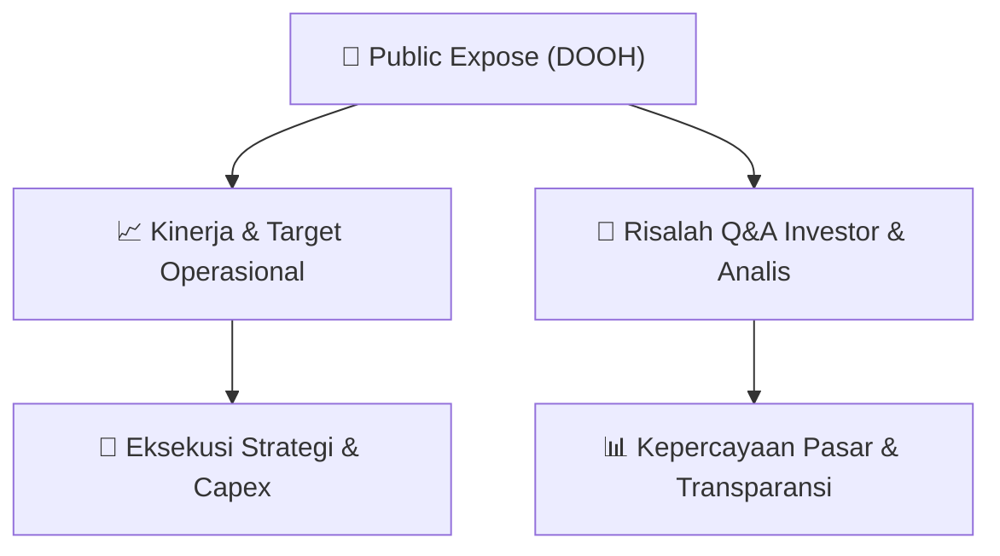

# 📢 Laporan Intelijen Paparan Publik (Public Expose) - [[DOOH]]
🏢 **Emiten**: `[[DOOH]]` | 📅 **Tanggal Pelaksanaan**: `2026-08-27` | 📑 **Dokumen**: `Public Expose`
⬅️ [[knowledge-base/daily-digests/Daily_Digest_20260827|Kembali ke Daily Digest]] | 🎛️ [[Dashboard|Ke Dashboard Utama]]

---

## 📌 1. Ringkasan Eksekutif & Paparan Direksi
> [!NOTE]
> PT Era Media Sejahtera Tbk (DOOH) mengumumkan rencana penyelenggaraan Public Expose Insidentil yang akan dilaksanakan secara online pada 04 September 2026 pukul 15:00 WIB. Public Expose ini diselenggarakan atas permintaan Otoritas Jasa Keuangan (OJK) dengan referensi surat Peng-SPT-00142/BEI.WAS/08-2026. Agenda utama meliputi: (1) Kondisi Bisnis Terkini dan Kinerja Keuangan, (2) Rencana Bisnis Perseroan di masa yang akan datang, dan (3) Analisa Manajemen terkait pergerakan harga saham Perseroan. Pengumuman disampaikan oleh Direktur Utama Vicktor Aritonang pada 27 Agustus 2026.

#### 🎯 Guidance Operasional & Target Strategis
- Dalam pengumuman ini tidak disampaikan rincian target kinerja, ekspansi, atau belanja modal (capex) secara spesifik. Namun agenda Public Expose mencakup pembahasan rencana bisnis Perseroan di masa depan, yang mengindikasikan akan ada pemaparan mengenai arah strategis dan potensi katalis. Detail guidance operasional dan keuangan diharapkan diungkapkan pada saat pelaksanaan Public Expose.

## 📊 2. Matriks Indikator Operasional & Parameter Kunci
| Parameter Utama | Nilai / Keterangan Resmi |
| :--- | :--- |
| **Nama Perusahaan** | `PT Era Media Sejahtera Tbk` |
| **Kode Emiten** | `DOOH` |
| **Nomor Surat** | `024/CORSEC/EMS/PUBEX.I/VIII/2026` |
| **Jenis Public Expose** | `Insidentil` |
| **Latar Belakang Pelaksanaan** | `Permintaan Otoritas Jasa Keuangan (OJK)` |
| **Referensi Surat Permintaan** | `Peng-SPT-00142/BEI.WAS/08-2026` |
| **Tempat Pelaksanaan** | `Online` |
| **Tanggal Pelaksanaan** | `04 September 2026` |
| **Waktu Pelaksanaan** | `15:00 WIB` |
| **Agenda 1** | `Kondisi Bisnis Terkini dan Kinerja Keuangan` |
| **Agenda 2** | `Rencana Bisnis Perseroan di masa yang akan datang` |
| **Agenda 3** | `Analisa Manajemen Terkait dengan Pergerakkan Harga Saham Perseroan` |
| **Direktur Utama** | `Vicktor Aritonang` |
| **Tanggal Pengumuman** | `27 Agustus 2026` |
| **Alamat Perseroan** | `Ruko Fatmawati Mas Blok B5 Kav 205 Jl. RS Fatmawati No 20, Cilandak Barat` |
| **Kontak Telepon** | `(021)7654937` |
| **Kontak Fax** | `(021)7654938` |
| **Website** | `https://www.sspace.id` |

---

## 💬 3. Risalah Tanya Jawab (Q&A Session)
`Materi presentasi Public Expose / Risalah Q&A terlampir dalam dokumen resmi bursa.`

## 📌 4. Peta Jalur Strategis & Roadmap

---

## 🔗 Knowledge Graph
- [[knowledge-base/daily-digests/Daily_Digest_20260827|📄 Daily Digest 2026-08-27]]
- [[knowledge-base/calendars/Action_Calendar|🗓️ Kalender Terpusat Aksi Korporasi]]
- [[Dashboard|🎛️ Kembali ke Dashboard Utama]]