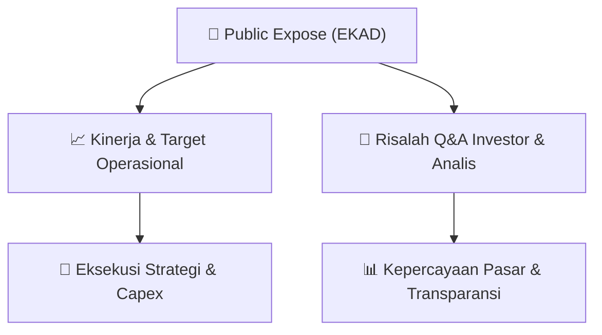

# 📢 Laporan Intelijen Paparan Publik (Public Expose) - [[EKAD]]
🏢 **Emiten**: `[[EKAD]]` | 📅 **Tanggal Pelaksanaan**: `2026-09-09` | 📑 **Dokumen**: `Public Expose`
⬅️ [[knowledge-base/daily-digests/Daily_Digest_20260909|Kembali ke Daily Digest]] | 🎛️ [[Dashboard|Ke Dashboard Utama]]

---

## 📌 1. Ringkasan Eksekutif & Paparan Direksi
> [!NOTE]
> PT Ekadharma International Tbk (EKAD) menyelenggarakan Public Expose Insidentil pada 07 September 2026, dengan laporan hasil disampaikan pada 09 September 2026. Public expose ini bersifat sukarela dan dihadiri oleh 9 peserta (tidak termasuk manajemen dan karyawan). Paparan ini merupakan tindak lanjut dari surat penyampaian materi Public Expose No. LP-EI/046/IX/2026. Dokumen ini hanya berisi laporan administratif pelaksanaan acara dan tidak memuat rincian materi paparan, data keuangan, atau sesi tanya jawab secara eksplisit dalam teks yang tersedia.

#### 🎯 Guidance Operasional & Target Strategis
- Tidak terdapat informasi mengenai target kinerja, ekspansi, capex, atau panduan operasional dalam dokumen yang tersedia. Dokumen hanya mengonfirmasi pelaksanaan Public Expose Insidentil secara sukarela dengan 9 peserta hadir, tanpa mengungkapkan substansi materi yang dipaparkan.

## 📊 2. Matriks Indikator Operasional & Parameter Kunci
| Parameter Utama | Nilai / Keterangan Resmi |
| :--- | :--- |
| **Jenis Pelaksanaan** | `Sukarela (Voluntary)` |
| **Tanggal Pelaksanaan Public Expose** | `07 September 2026` |
| **Tanggal Laporan Hasil** | `09 September 2026` |
| **Jumlah Peserta Hadir (di luar manajemen/karyawan)** | `9 orang` |
| **Nomor Surat Penyampaian Materi** | `LP-EI/046/IX/2026` |
| **Nomor Surat Laporan Hasil** | `LP-EI/047/IX/2026` |
| **Dasar Pelaksanaan** | `Permintaan Bursa dan OJK (namun bersifat sukarela)` |

---

## 💬 3. Risalah Tanya Jawab (Q&A Session)
### ❓ Pertanyaan 1 (Tidak tersedia)
**Pertanyaan**: Tidak ada sesi tanya jawab yang tercantum dalam dokumen yang tersedia.

**Jawaban Manajemen**: Tidak tersedia

> [!TIP]
> **Implikasi Bagi Investor**: Tidak ada implikasi yang dapat dianalisis dari dokumen ini karena tidak memuat substansi diskusi atau Q&A.

## 📌 4. Peta Jalur Strategis & Roadmap

---

## 🔗 Knowledge Graph
- [[knowledge-base/daily-digests/Daily_Digest_20260909|📄 Daily Digest 2026-09-09]]
- [[knowledge-base/calendars/Action_Calendar|🗓️ Kalender Terpusat Aksi Korporasi]]
- [[Dashboard|🎛️ Kembali ke Dashboard Utama]]