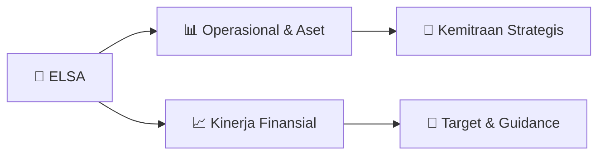

# 📊 Materi Public Expose: [ELSA]

🏢 **Emiten**: `ELSA` | 📅 **Tanggal Pelaksanaan**: `2026-09-02` | 📑 **Total Slide**: `16 Slide`
⬅️ [[knowledge-base/daily-digests/ELSA_20260902|Kembali ke Daily Digest]] | 🎛️ [[Dashboard/ELSA|Ke Dashboard Emiten]]

> [!NOTE]
> Ringkasan materi presentasi resmi Public Expose ELSA yang disampaikan oleh manajemen kepada investor dan bursa. Seluruh poin strategis, matriks operasional, dan angka kinerja diekstrak langsung dari slide deck resmi.

---

## 📅 1. Jadwal & Metadata Penyelenggaraan

| Parameter | Detail Informasi |
|---|---|
| **Nomor Surat Pengantar** | L9.013C-2026.163 |
| **Perihal Pengumuman** | Penyampaian Materi Public Expose Tahunan |
| **Waktu Pelaksanaan** | 2026-09-02 02-09-2026 16:48 |
| **Lokasi / Media** | Aplikasi Zoom / Daring |
| **Lampiran Resmi** | `2` |

## 📋 2. Agenda Paparan Publik

- Pemaparan Profil & Struktur Bisnis Perseroan
- Kinerja Operasional & Keuangan
- Arah Strategi Usaha & Target Pertumbuhan
- Sesi Tanya Jawab (Q&A)

## 🏢 3. Profil & Pilar Portofolio Bisnis

## 🏗️ 4. Kinerja Operasional & Portofolio Aset

> Company’s Overview Company Snapshot Founded
25 Jan 1969
Established
9 Sep 1969
IPO Date
6 Feb 2008 (Ticker: ELSA)
Employees
1.833    (permanent)
15.045  (incl outsources)
Market Cap
~IDR 3.8 trillion/~USD 212 million (1H26)
Total Aset
~IDR 11,47 trillion (1H26)
Business Unit
Upstream Integrated Oil & Gas Services
1.
Geoscience & Reservoir Services
2.
Drilling & Workover Services
3.
Well Intervention Services
4.
EPC & OM Services
ELSA’s subsidiaries
Upstream Integrated Oil & Gas Services
1.
PT Elnusa Geosains Indonesia
2.
PT Elnusa Oilfield Services
Energy Distribution & Logistics Services
1.
PT Elnusa Petrofin (EPN)
Oil & Gas Support Services
1.
PT Elnusa Fabrikasi Konstruksi (EFK)
2.
PT Elnusa Trans Samudera (ETSA)
3.
PT Sigma Cipta Utama (SCU)
4.
PT Patra Nusa Data (PND)
Reputable Energy Services Company by Providing Total Solutions
• Improve business sustainability and profitability in local and international energy
industries to meet shareholders’ expectations.
• Fulfill and maintain customer satisfaction by providing Total Solution through synergy,
operational excellence, HSSE and GCG principles.
• Improve employees’ welfare and growth opportunities
• Establish harmonious and mu

## 📈 5. Kinerja Keuangan & Posisi Finansial

### 📊 Ringkasan Finansial
```text
Outline ELSA Highlights
Strategy & Business Updates
Operational & Contract Performance
Financial Performance ESG Update
This presentation has been prepared by PT Elnusa Tbk (the "Company") solely for information purposes and does not constitute, and shall not be construed as, an offer to sell or a solicitation of an offer to
purchase any securities of the Company. Certain statements contained in this presentation may constitute forward-looking statements, including statements regarding the Company's business strategies, plans,
objectives, future operations, financial performance, market conditions, and industry outlook. These statements are based on current expectations, assumptions, estimates, and projections that are subject to
various risks, uncertainties, and other factors, many of which are beyond the Company's control. Actual results, performance, or achievements may differ materially from those expressed or implied in such
forward-looking statements due to a variety of factors, including but not limited to changes in economic conditions, commodity prices, foreign exchange rates, interest rates, regulatory developments, market
competition, project execution risks, operational
```

### 📊 Ringkasan Finansial
```text
Financial Performance 1H26
Rp. 7,58 Tn
Revenue
 8,9% YoY
Rp. 862 Bn
EBITDA
 16,2% YoY
Rp. 11,40 Tn
Assets
 8,1% YoY
Rp. 761 Bn
Cash Flow from Operation
 16% YoY
Rp. 435 Bn
Net Profit
 29,2% YoY
5,73 %
Net Profit Margin
 18,6% YoY
Rp. 5,43 Tn
Equity
 9,5% YoY
Rp. 2,88 Tn
Cash Balance
 1% YoY
78% Affiliated 22% Third Party 8% 65%
Sales of Goods
and Energy
Dist & Log
27% Integrated Upstream Support Services 25,90 27,60 39,10 44,29 2022 2023 2024 2025 Dividend/Share (Rp.) DPR 40% 40% 40% 45% Corporate Rating id AA+ Revenue Contribution Revenue Contribution
```

## 🧭 6. Inisiatif Strategis, Kolaborasi, & Kemitraan

*Strategi usaha difokuskan pada penguatan fundamental dan ekspansi operasional.*

## 🎯 7. Target Pertumbuhan & Guidance Manajemen

*Target pertumbuhan ditetapkan mengacu pada prospek industri dan kondisi makroekonomi terkini.*

## 🗺️ 8. Peta Jalur Strategis & Eksekusi



## 📑 9. Daftar Indeks Slide Presentasi

| Slide # | Judul / Topik Slide | Ringkasan Konten |
|---|---|---|
| Slide 1 | **VISI PERUSAHAAN JASA ENERGI TERKEMUKA YANG MEMBERIKAN SOLUSI TOTAL** | Public Expose PT Elnusa Tbk (IDX Ticker: ELSA) Sept 2026 |
| Slide 2 | **Outline** | 1 ELSA Highlights 2 |
| Slide 3 | **ELSA throughout the years** | 2026 Rediscover Technology and |
| Slide 4 | **Company’s Overview** | Company Snapshot Founded 25 Jan 1969 |
| Slide 5 | **Upstream Integrated Oil & Gas Services** | Geoscience & Reservoir Services • |
| Slide 6 | **Strengthening National Dominance and Overseas Market Presence** | National Operational Working Areas Leveraging a nationwide operational footprint, Elnusa Group integrates the expertise of its subsidiaries, from EPN’ |
| Slide 7 | **ELSA has sets Key Strategic Priorities** | 1MMBOPD Elnusa as "The Strategic Enabler & Efficiency Partner" to maintain the economic viability of Pertamina Hulu Energi / |
| Slide 8 | **Innovation Technology** | Chemical Enhanced Oil Recovery (CEOR) Rama Project in PHE OSES through Polymer Flooding began to |
| Slide 9 | **Infrastructure Services** | TLPG Kolaka • Elnusa is currently executing an EPC project owned by Pertamina Patra |
| Slide 10 | **Operational Performance 1H26** | Rp. 2,06 Tn Revenue  10,6% YoY |
| Slide 11 | **Contract Performance 1H26** | 1H26 closed with solid new contract wins, reflecting sustained demand across Integrated Upstream, Support Services, and Energy Distribution & Logistic |
| Slide 12 | **Financial Performance 1H26** | Rp. 7,58 Tn Revenue  8,9% YoY |
| Slide 13 | **Capital Expenditure** | Capex (IDR bio) 495 |
| Slide 14 | **Environment Aspects** | Social Aspects Governance Aspects ACGS Assessment Score |
| Slide 15 | **Q&A Session** | PT Elnusa Tbk (IDX Ticker : ELSA) |
| Slide 16 | **PT Elnusa Tbk** | Graha Elnusa 16th Floor, Jl. T.B. Simatupang Kav. 1B, Jakarta 12560, Indonesia Tel. +62 21-78830850, Fax. +62 21-78830907 investor.relation@elnusa.co. |

---

*Dokumen diolah otomatis oleh **Swarm Intelijen Pasar Modal Indonesia** pada 2026-10-12 16:44 WIB.*