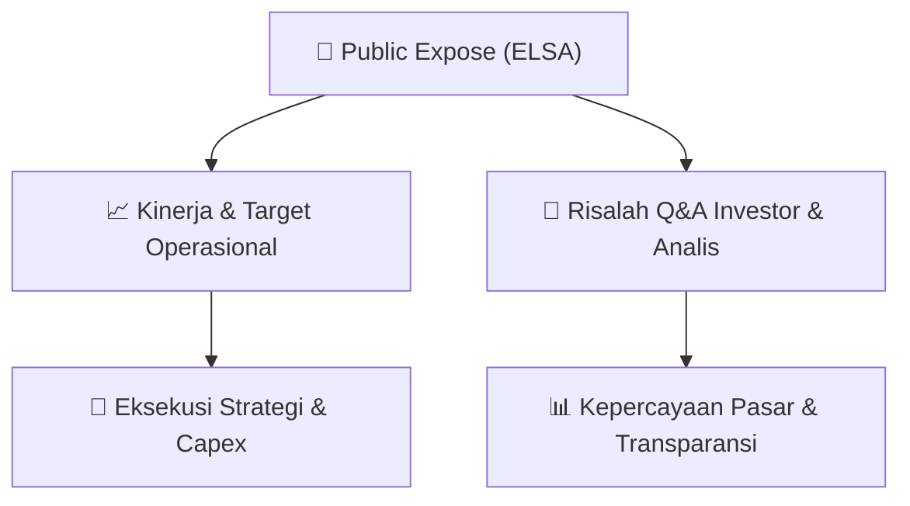

# 📢 Laporan Intelijen Paparan Publik (Public Expose) - [[ELSA]]
🏢 **Emiten**: `[[ELSA]]` | 📅 **Tanggal Pelaksanaan**: `2026-09-02` | 📑 **Dokumen**: `Public Expose`
⬅️ [[knowledge-base/daily-digests/Daily_Digest_20260902|Kembali ke Daily Digest]] | 🎛️ [[Dashboard|Ke Dashboard Utama]]

---

## 📌 1. Ringkasan Eksekutif & Paparan Direksi
> [!NOTE]
> Dokumen yang diterima merupakan surat pengantar penyampaian materi Public Expose Tahunan Elnusa Tbk (ELSA) kepada otoritas/publik, bukan materi presentasi itu sendiri. Surat bernomor L9.013C-2026.163 tanggal 2 September 2026 ini merujuk pada rencana penyelenggaraan Public Expose Tahunan yang telah disampaikan sebelumnya melalui Surat No. L9.013C-2026.156 tanggal 21 Agustus 2026. Dalam surat ini Perseroan menyampaikan lampiran materi Public Expose Tahunan 2026, namun isi rinci materi, data kinerja, proyeksi, serta tanya jawab tidak tercantum dalam dokumen yang tersedia.

#### 🎯 Guidance Operasional & Target Strategis
- Tidak tersedia dalam dokumen. Dokumen hanya berupa surat pengantar penyampaian materi Public Expose Tahunan tanpa memuat rincian target kinerja, ekspansi, belanja modal, atau panduan operasional.

## 📊 2. Matriks Indikator Operasional & Parameter Kunci
| Parameter Utama | Nilai / Keterangan Resmi |
| :--- | :--- |
| **Nama Perusahaan** | `Elnusa Tbk` |
| **Kode Emiten** | `ELSA` |
| **Nomor Surat** | `L9.013C-2026.163` |
| **Perihal** | `Penyampaian Materi Public Expose Tahunan` |
| **Tanggal Surat** | `02-09-2026 16:48` |
| **Rujukan Surat Sebelumnya** | `L9.013C-2026.156 tanggal 21 Agustus 2026` |
| **Lampiran** | `1. Surat pengantar materi Pubex 2026.pdf; 2. Materi Pubex ELSA 2026.pdf` |
| **Pengirim** | `Sevy Liana, Manager Corporate Governance & BOD Support` |

---

## 💬 3. Risalah Tanya Jawab (Q&A Session)
`Materi presentasi Public Expose / Risalah Q&A terlampir dalam dokumen resmi bursa.`

## 📌 4. Peta Jalur Strategis & Roadmap

---

## 🔗 Knowledge Graph
- [[knowledge-base/daily-digests/Daily_Digest_20260902|📄 Daily Digest 2026-09-02]]
- [[knowledge-base/calendars/Action_Calendar|🗓️ Kalender Terpusat Aksi Korporasi]]
- [[Dashboard|🎛️ Kembali ke Dashboard Utama]]