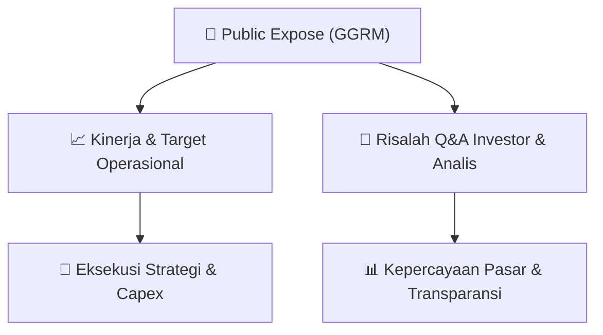

# 📢 Laporan Intelijen Paparan Publik (Public Expose) - [[GGRM]]
🏢 **Emiten**: `[[GGRM]]` | 📅 **Tanggal Pelaksanaan**: `2026-08-27` | 📑 **Dokumen**: `Public Expose`
⬅️ [[knowledge-base/daily-digests/Daily_Digest_20260827|Kembali ke Daily Digest]] | 🎛️ [[Dashboard|Ke Dashboard Utama]]

---

## 📌 1. Ringkasan Eksekutif & Paparan Direksi
> [!NOTE]
> PT Gudang Garam Tbk (GGRM) melalui Corporate Secretary Heru Budiman mengumumkan rencana penyelenggaraan Public Expose Tahunan untuk Tahun Buku 2026. Acara akan diselenggarakan secara virtual/live melalui website IDX pada tanggal 10 September 2026 pukul 09:00 WIB. Agenda utama paparan publik ini adalah presentasi kinerja Perseroan untuk periode Januari - Juni 2026 (semester I 2026). Pengumuman ini disampaikan melalui sistem pelaporan elektronik pada 27 Agustus 2026.

#### 🎯 Guidance Operasional & Target Strategis
- Belum ada guidance atau target kinerja spesifik yang diungkapkan dalam pengumuman ini. Katalis utama yang dinantikan pasar adalah paparan kinerja keuangan semester I 2026 yang akan dipresentasikan pada 10 September 2026, mencakup pendapatan, laba, margin, dan perkembangan operasional GGRM di tengah kondisi industri rokok yang kompetitif.

## 📊 2. Matriks Indikator Operasional & Parameter Kunci
| Parameter Utama | Nilai / Keterangan Resmi |
| :--- | :--- |
| **Jenis Acara** | `Public Expose Tahunan (Annual Public Expose)` |
| **Tahun Buku** | `2026` |
| **Tanggal Penyelenggaraan** | `10 September 2026` |
| **Waktu** | `09:00 WIB` |
| **Tempat / Media** | `Public Expose Live 2026 melalui website www.idx.co.id` |
| **Agenda** | `Presentasi Kinerja Perseroan Januari - Juni 2026` |
| **Tanggal Pengumuman** | `27 Agustus 2026` |
| **Narahubung** | `Heru Budiman (Corporate Secretary), Telepon: (0354) 682091-97 / (021) 29557000` |

---

## 💬 3. Risalah Tanya Jawab (Q&A Session)
### ❓ Pertanyaan 1 (Belum tersedia (acara belum berlangsung))
**Pertanyaan**: Belum ada sesi tanya jawab karena ini adalah pengumuman rencana acara, bukan risalah paparan.

**Jawaban Manajemen**: Belum tersedia. Manajemen baru mengumumkan jadwal dan agenda acara.

> [!TIP]
> **Implikasi Bagi Investor**: Investor dan analis diharapkan menyiapkan pertanyaan terkait kinerja semester I 2026, outlook industri rokok, kebijakan dividen, dan strategi menghadapi regulasi cukai untuk diajukan pada sesi tanya jawab 10 September 2026.

## 📌 4. Peta Jalur Strategis & Roadmap

---

## 🔗 Knowledge Graph
- [[knowledge-base/daily-digests/Daily_Digest_20260827|📄 Daily Digest 2026-08-27]]
- [[knowledge-base/calendars/Action_Calendar|🗓️ Kalender Terpusat Aksi Korporasi]]
- [[Dashboard|🎛️ Kembali ke Dashboard Utama]]