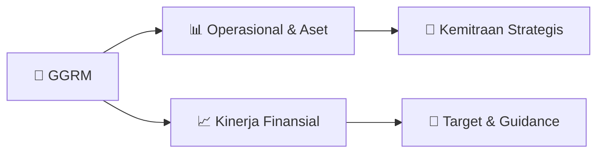

# 📊 Materi Public Expose: [GGRM]

🏢 **Emiten**: `GGRM` | 📅 **Tanggal Pelaksanaan**: `2026-08-27` | 📑 **Total Slide**: `2 Slide`
⬅️ [[knowledge-base/daily-digests/GGRM_20260827|Kembali ke Daily Digest]] | 🎛️ [[Dashboard/GGRM|Ke Dashboard Emiten]]

> [!NOTE]
> Ringkasan materi presentasi resmi Public Expose GGRM yang disampaikan oleh manajemen kepada investor dan bursa. Seluruh poin strategis, matriks operasional, dan angka kinerja diekstrak langsung dari slide deck resmi.

---

## 📅 1. Jadwal & Metadata Penyelenggaraan

| Parameter | Detail Informasi |
|---|---|
| **Nomor Surat Pengantar** | E0022/GG-17/VIII-26 |
| **Perihal Pengumuman** | Rencana Penyelenggaraan Public Expose Tahunan |
| **Waktu Pelaksanaan** | 10 September 2026 09:00 |
| **Lokasi / Media** | Public Expose Live 2026 |
| **Lampiran Resmi** | `0` |

## 📋 2. Agenda Paparan Publik

1. Nama Perusahaan
2. Kode Emiten
3. Lampiran
4. Perihal
5. E0022/GG-17/VIII-26
6. Gudang Garam Tbk
7. Rencana Penyelenggaraan Public Expose Tahunan
8. Go To English Page
9. Perseroan melaporkan rencana Public Expose Tahunan sebagai berikut:
10. Rencana Penyelenggaraan Public Expose
11. Tahun Buku yang Berakhir pada
12. Tempat
13. : Public Expose Live 2026
14. yang tercantum pada website www.idx.co.id
15. Hari/Tanggal
16. : 10 September 2026
17. Waktu
18. 09:00
19. Agenda
20. : Presentasi Kinerja Perseroan Januari - Juni 2026
21. Hormat Kami,
22. Demikian untuk diketahui.
23. Jl. Semampir II/1 Kediri 64121, Jl. Jend. A. Yani No. 75-79 Jakarta 10510
24. Corporate Secretary
25. Nama Pengirim
26. Telepon : (0354) 682091-97, (021) 29557000, Fax : (0354) 681555, (021) 29557009,
27. Gudang Garam Tbk
28. Heru Budiman
29. Gudang Garam Tbk
30. Heru Budiman
31. Jabatan
32. Corporate Secretary
33. Tanggal dan Waktu
34. 27-08-2026 13:08
35. Dokumen ini merupakan dokumen resmi Gudang Garam Tbk yang tidak memerlukan tanda tangan karena
36. dihasilkan secara elektronik oleh sistem pelaporan elektronik. Gudang Garam Tbk bertanggung jawab penuh atas
37. informasi yang tertera didalam dokumen ini.
38. Issuer Name
39. Issuer Code
40. Attachment
41. Subject
42. E0022/GG-17/VIII-26
43. Gudang Garam Tbk
44. General Announcement Public Expose
45. Go To Indonesian Page
46. Company announces public expose plan Annual as follows:
47. Public Expose Announcement
48. Fiscal Year
49. Place
50. : Public Expose Live 2026
51. yang tercantum pada website www.idx.co.id
52. : 10 September 2026
53. 09:00
54. Agenda
55. : Company's January - June 2026 Result Presentation
56. Respectfully,
57. Thus to be informed accordingly.
58. Gudang Garam Tbk
59. Heru Budiman
60. Corporate Secretary
61. Heru Budiman
62. Sender Name
63. Gudang Garam Tbk
64. Jl. Semampir II/1 Kediri 64121, Jl. Jend. A. Yani No. 75-79 Jakarta 10510
65. Phone : (0354) 682091-97, (021) 29557000, Fax : (0354) 681555, (021) 29557009,
66. Corporate Secretary
67. Function
68. Date and Time
69. 27-08-2026 13:08
70. This is an official document of Gudang Garam Tbk that does not require a signature as it was generated
71. electronically by the electronic reporting system. Gudang Garam Tbk is fully responsible for the information

## 🏢 3. Profil & Pilar Portofolio Bisnis

## 🏗️ 4. Kinerja Operasional & Portofolio Aset

*Detail aset operasional terlampir pada dokumen slide resmi.*

## 📈 5. Kinerja Keuangan & Posisi Finansial

## 🧭 6. Inisiatif Strategis, Kolaborasi, & Kemitraan

*Strategi usaha difokuskan pada penguatan fundamental dan ekspansi operasional.*

## 🎯 7. Target Pertumbuhan & Guidance Manajemen

*Target pertumbuhan ditetapkan mengacu pada prospek industri dan kondisi makroekonomi terkini.*

## 🗺️ 8. Peta Jalur Strategis & Eksekusi

## 📑 9. Daftar Indeks Slide Presentasi

| Slide # | Judul / Topik Slide | Ringkasan Konten |
|---|---|---|
| Slide 1 | **Nomor Surat** | Nama Perusahaan Kode Emiten Lampiran |
| Slide 2 | **Letter / Announcement No.** | Issuer Name Issuer Code Attachment |

---

*Dokumen diolah otomatis oleh **Swarm Intelijen Pasar Modal Indonesia** pada 2026-10-12 16:44 WIB.*