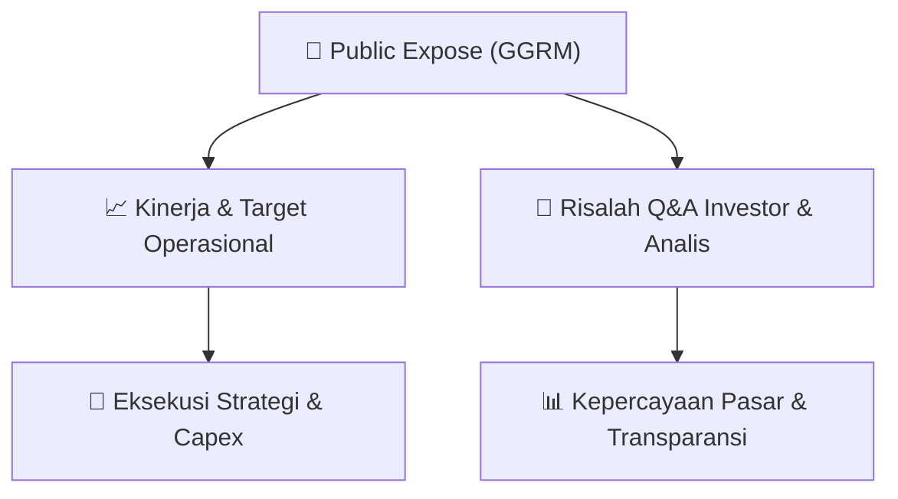

# 📢 Laporan Intelijen Paparan Publik (Public Expose) - [[GGRM]]
🏢 **Emiten**: `[[GGRM]]` | 📅 **Tanggal Pelaksanaan**: `2026-09-15` | 📑 **Dokumen**: `Public Expose`
⬅️ [[knowledge-base/daily-digests/Daily_Digest_20260915|Kembali ke Daily Digest]] | 🎛️ [[Dashboard|Ke Dashboard Utama]]

---

## 📌 1. Ringkasan Eksekutif & Paparan Direksi
> [!NOTE]
> PT Gudang Garam Tbk (GGRM) menyelenggarakan Public Expose Tahunan pada tanggal 07 September 2026, berdasarkan surat penyampaian materi No. E0024/GG-17/IX-26. Acara ini dihadiri oleh 103 peserta (tidak termasuk manajemen dan karyawan). Hasil paparan publik dilaporkan melalui surat No. E0026/GG-17/IX-26 pada tanggal 15 September 2026 oleh Corporate Secretary Heru Budiman. Paparan ini membahas kinerja operasional, strategi bisnis, dan prospek perusahaan di tengah kondisi industri rokok yang menantang.

#### 🎯 Guidance Operasional & Target Strategis
- Berdasarkan dokumen yang tersedia, tidak terdapat rincian spesifik mengenai target kinerja kuantitatif, rencana belanja modal (capex), atau ekspansi yang diungkapkan secara eksplisit dalam laporan hasil public expose ini. Dokumen ini hanya berisi konfirmasi penyelenggaraan acara dan jumlah peserta. Informasi lebih lanjut mengenai guidance operasional perusahaan kemungkinan terdapat dalam laporan paparan publik terlampir (GGRM_PE2026_Report.pdf) yang tidak disertakan dalam teks ini.

## 📊 2. Matriks Indikator Operasional & Parameter Kunci
| Parameter Utama | Nilai / Keterangan Resmi |
| :--- | :--- |
| **Tanggal Penyelenggaraan Public Expose** | `07 September 2026` |
| **Jumlah Peserta Hadir** | `103 orang (tidak termasuk manajemen dan karyawan)` |
| **Nomor Surat Penyampaian Materi** | `E0024/GG-17/IX-26` |
| **Nomor Surat Laporan Hasil Public Expose** | `E0026/GG-17/IX-26` |
| **Tanggal Pelaporan Hasil** | `15 September 2026` |
| **Corporate Secretary** | `Heru Budiman` |

---

## 💬 3. Risalah Tanya Jawab (Q&A Session)
### ❓ Pertanyaan 1 (Tidak tersedia dalam dokumen)
**Pertanyaan**: Tidak ada sesi tanya jawab yang tercantum dalam dokumen hasil public expose ini.

**Jawaban Manajemen**: Tidak ada jawaban manajemen yang tercantum dalam dokumen hasil public expose ini.

> [!TIP]
> **Implikasi Bagi Investor**: Investor perlu merujuk pada laporan paparan publik terlampir (GGRM_PE2026_Report.pdf) untuk mendapatkan informasi detail mengenai sesi tanya jawab dan panduan manajemen.

## 📌 4. Peta Jalur Strategis & Roadmap

---

## 🔗 Knowledge Graph
- [[knowledge-base/daily-digests/Daily_Digest_20260915|📄 Daily Digest 2026-09-15]]
- [[knowledge-base/calendars/Action_Calendar|🗓️ Kalender Terpusat Aksi Korporasi]]
- [[Dashboard|🎛️ Kembali ke Dashboard Utama]]