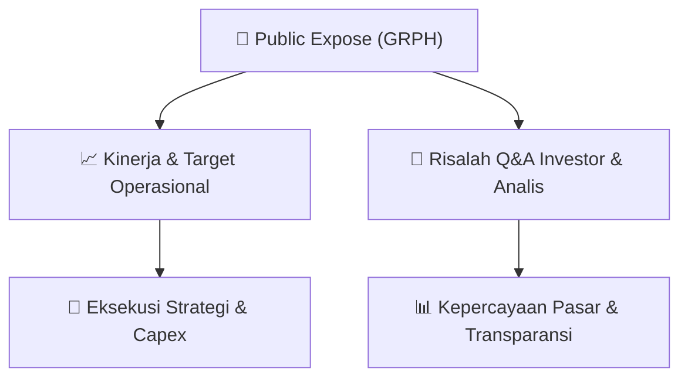

# 📢 Laporan Intelijen Paparan Publik (Public Expose) - [[GRPH]]
🏢 **Emiten**: `[[GRPH]]` | 📅 **Tanggal Pelaksanaan**: `2026-09-09` | 📑 **Dokumen**: `Public Expose`
⬅️ [[knowledge-base/daily-digests/Daily_Digest_20260909|Kembali ke Daily Digest]] | 🎛️ [[Dashboard|Ke Dashboard Utama]]

---

## 📌 1. Ringkasan Eksekutif & Paparan Direksi
> [!NOTE]
> PT Griptha Putra Persada Tbk. (GRPH) mengumumkan rencana penyelenggaraan Public Expose Insidentil yang bersifat sukarela atas permintaan Bursa Efek Indonesia (BEI) berdasarkan surat referensi Peng-SPT-00169/BEI.WAS/09-2026. Acara akan diselenggarakan secara online melalui platform Zoom pada tanggal 15 September 2026 pukul 14:00 WIB. Agenda utama paparan publik ini adalah pemaparan kinerja operasional dan keuangan Perseroan. Pengumuman ini ditandatangani secara elektronik oleh Direktur Utama, Edwin Leonardo, dan disampaikan pada 9 September 2026.

#### 🎯 Guidance Operasional & Target Strategis
- Dokumen ini hanya mengumumkan rencana pelaksanaan Public Expose Insidentil. Tidak terdapat informasi spesifik mengenai target kinerja, ekspansi, atau capex dalam pengumuman ini. Katalis utama yang dapat diantisipasi investor adalah potensi pengumuman kinerja operasional dan keuangan terbaru Perseroan yang akan dipaparkan pada acara 15 September 2026, serta sesi tanya jawab yang dapat memberikan wawasan lebih dalam mengenai prospek bisnis GRPH.

## 📊 2. Matriks Indikator Operasional & Parameter Kunci
| Parameter Utama | Nilai / Keterangan Resmi |
| :--- | :--- |
| **Jenis Paparan** | `Public Expose Insidentil` |
| **Latar Belakang Pelaksanaan** | `Sukarela / Permintaan Bursa Efek Indonesia (BEI)` |
| **Referensi Surat BEI** | `Peng-SPT-00169/BEI.WAS/09-2026` |
| **Tanggal Pelaksanaan** | `15 September 2026` |
| **Waktu Pelaksanaan** | `14:00 WIB` |
| **Tempat Pelaksanaan** | `Online melalui Zoom` |
| **Agenda Acara** | `Kinerja Operasional dan Keuangan Perseroan` |
| **Penanggung Jawab / Penandatangan** | `Edwin Leonardo (Direktur Utama)` |

---

## 💬 3. Risalah Tanya Jawab (Q&A Session)
### ❓ Pertanyaan 1 (Tidak tersedia (dokumen pengumuman))
**Pertanyaan**: Tidak ada sesi tanya jawab yang tercantum dalam dokumen pengumuman ini.

**Jawaban Manajemen**: Tidak tersedia. Dokumen ini hanya berisi pengumuman rencana pelaksanaan Public Expose, bukan risalah acara.

> [!TIP]
> **Implikasi Bagi Investor**: Investor diharapkan menunggu pelaksanaan acara pada 15 September 2026 untuk mendapatkan informasi kinerja dan kesempatan bertanya langsung kepada manajemen.

## 📌 4. Peta Jalur Strategis & Roadmap

---

## 🔗 Knowledge Graph
- [[knowledge-base/daily-digests/Daily_Digest_20260909|📄 Daily Digest 2026-09-09]]
- [[knowledge-base/calendars/Action_Calendar|🗓️ Kalender Terpusat Aksi Korporasi]]
- [[Dashboard|🎛️ Kembali ke Dashboard Utama]]