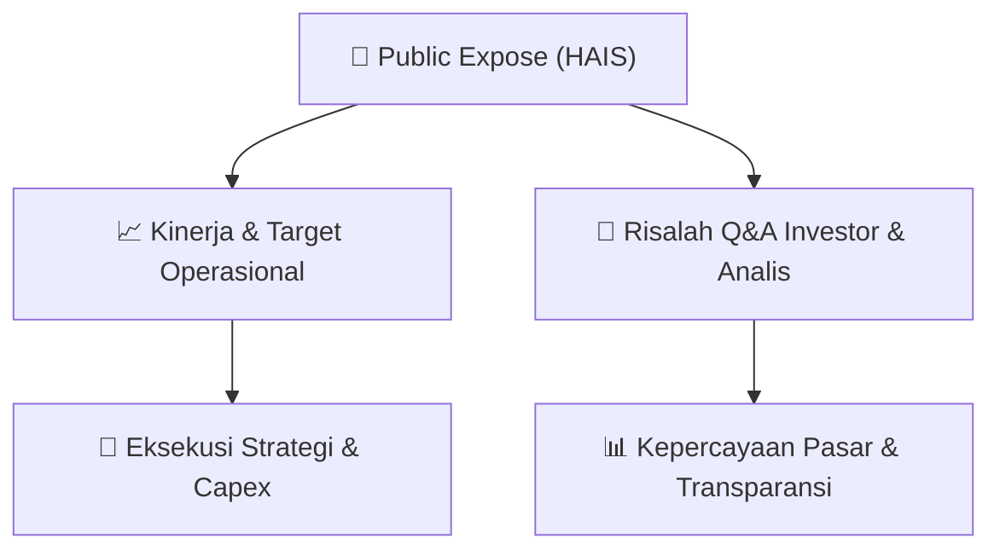

# 📢 Laporan Intelijen Paparan Publik (Public Expose) - [[HAIS]]
🏢 **Emiten**: `[[HAIS]]` | 📅 **Tanggal Pelaksanaan**: `2026-08-26` | 📑 **Dokumen**: `Public Expose`
⬅️ [[knowledge-base/daily-digests/Daily_Digest_20260826|Kembali ke Daily Digest]] | 🎛️ [[Dashboard|Ke Dashboard Utama]]

---

## 📌 1. Ringkasan Eksekutif & Paparan Direksi
> [!NOTE]
> PT Hasnur Internasional Shipping Tbk (HAIS) menyampaikan pemberitahuan resmi rencana penyelenggaraan Public Expose Tahunan untuk tahun buku yang berakhir pada 2026. Kegiatan akan dilaksanakan secara daring melalui Zoom Meeting pada 09 September 2026 pukul 09:30 WIB dengan agenda Paparan Publik Tahunan. Dokumen ini merupakan pemberitahuan elektronik resmi dari Sekretaris Perusahaan dan tidak memuat paparan kinerja, data keuangan, maupun materi presentasi.

#### 🎯 Guidance Operasional & Target Strategis
- Tidak terdapat pengungkapan target kinerja, rencana ekspansi, alokasi belanja modal (capex), proyeksi pendapatan, atau guidance operasional dalam dokumen ini. Dokumen hanya memuat informasi logistik penyelenggaraan Public Expose Tahunan.

## 📊 2. Matriks Indikator Operasional & Parameter Kunci
| Parameter Utama | Nilai / Keterangan Resmi |
| :--- | :--- |
| **Nama Perusahaan** | `PT Hasnur Internasional Shipping Tbk` |
| **Kode Emiten** | `HAIS` |
| **Jenis Kegiatan** | `Public Expose Tahunan` |
| **Tahun Buku** | `2026` |
| **Hari/Tanggal** | `09 September 2026` |
| **Waktu** | `09:30 WIB` |
| **Tempat** | `Video Live Conference melalui Zoom Meeting` |
| **Link Zoom Meeting** | `https://us06web.zoom.us/j/88575936748?pwd=BbVEQYkxBaeorCsopdTFn5FO31jSN9.1` |
| **Meeting ID** | `885 7593 6748` |
| **Passcode** | `2026` |
| **Agenda** | `Paparan Publik Tahunan` |
| **Nama Pengirim** | `Rengga Temenggung` |
| **Jabatan Pengirim** | `Sekretaris Perusahaan` |
| **Tanggal dan Waktu Pemberitahuan** | `26-08-2026 15:54` |
| **Alamat Perusahaan** | `Gedung Office 8 Lantai 3, Jl. Senopati No. 8B, Kel. Senayan, Kec. Kebayoran Baru` |
| **Telepon** | `(62-21) 29343888` |
| **Fax** | `(62-21) 29343777` |
| **Situs Resmi** | `https://www.pthis.id` |

---

## 💬 3. Risalah Tanya Jawab (Q&A Session)
`Materi presentasi Public Expose / Risalah Q&A terlampir dalam dokumen resmi bursa.`

## 📌 4. Peta Jalur Strategis & Roadmap

---

## 🔗 Knowledge Graph
- [[knowledge-base/daily-digests/Daily_Digest_20260826|📄 Daily Digest 2026-08-26]]
- [[knowledge-base/calendars/Action_Calendar|🗓️ Kalender Terpusat Aksi Korporasi]]
- [[Dashboard|🎛️ Kembali ke Dashboard Utama]]