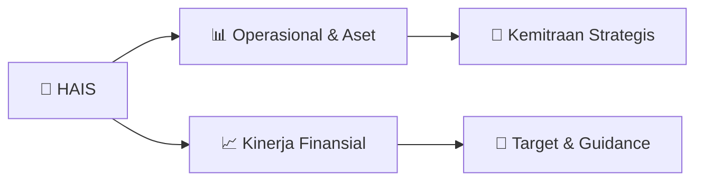

# 📊 Materi Public Expose: [HAIS]

🏢 **Emiten**: `HAIS` | 📅 **Tanggal Pelaksanaan**: `2026-09-04` | 📑 **Total Slide**: `22 Slide`
⬅️ [[knowledge-base/daily-digests/HAIS_20260904|Kembali ke Daily Digest]] | 🎛️ [[Dashboard/HAIS|Ke Dashboard Emiten]]

> [!NOTE]
> Ringkasan materi presentasi resmi Public Expose HAIS yang disampaikan oleh manajemen kepada investor dan bursa. Seluruh poin strategis, matriks operasional, dan angka kinerja diekstrak langsung dari slide deck resmi.

---

## 📅 1. Jadwal & Metadata Penyelenggaraan

| Parameter | Detail Informasi |
|---|---|
| **Nomor Surat Pengantar** | 322/HIS-JKT/CORSEC-UM06/IX/2026 |
| **Perihal Pengumuman** | Penyampaian Materi Public Expose Tahunan |
| **Waktu Pelaksanaan** | 2026-09-04 04-09-2026 15:40 |
| **Lokasi / Media** | Aplikasi Zoom / Daring |
| **Lampiran Resmi** | `2` |

## 📋 2. Agenda Paparan Publik

- Pemaparan Profil & Struktur Bisnis Perseroan
- Kinerja Operasional & Keuangan
- Arah Strategi Usaha & Target Pertumbuhan
- Sesi Tanya Jawab (Q&A)

## 🏢 3. Profil & Pilar Portofolio Bisnis

## 🏗️ 4. Kinerja Operasional & Portofolio Aset

> PT Hasnur Internasional Shipping
Tbk PT Hasnur Internasional Shipping Tbk Jasa Pelayaran PT Hasnur Resources Terminal Jasa Pengelola Pelabuhan
PT Hasnur Mitra
Sarana & PT Barito
Jaya Sarana
Servis Bongkar Muat
PT Hasnur Multi
Sinergi Pelabuhan Apung
dan B ongkar Muat
•
Mengoperasikan
24 set kapal tugboat & barge .
•
Menyediakan layanan transportasi dari Port of Loading
(POL) ke floating facility
dan/ atau Port of Discharging
(POD).
•
Pemilik jasa pengelola pelabuhan .
•
Mengoperasikan
dua pelabuhan yang berlokasi di Sungai
Puting (Kalimantan Selatan) dan Sungai Pendang
(Kalimantan Tengah).
•
Memiliki kapasitas stockpile 260.000 MT,
dengan luas area
12,3 Ha.
•
Pemberi jasa bongkar muat dengan aktivitas seperti
loading tongkang, penyandaran
tongkang, dan
manajemen stockpile , dan lainnya .
•
Pemberi jasa bongkar muat dengan aktivitas di tengah
laut dengan menggunakan
pelabuhan apung atau
floating loading facility yang saat ini dalam proses
konstruksi pembuatan aset .
Sekilas Tentang Perusahaan
End to End Logistic Solution

> Perusahaan Fokus Meningkatkan Utilisasi
Armada dari Aset Milik Perusahaan
PT Hasnur Internasional Shipping
Tbk Perusahaan mencatat penyesuaian
volume kargo sebesar 14,3%
selama 6 bulan 2026 , seiring dengan dinamika pasar di sektor
pelayaran dan logistik .
61% Menggunakan
Kapal Milik HIS
Pada periode ini terjadi
peningkatan penggunaan
kapal HIS, sejalan dengan
bertambahnya armada. 71% Transhipment
Mayoritas jasa pengangkutan
dilakukan dalam bentuk
transhipment dari pelabuhan ke
pelabuhan apung .
74% Kontribusi Group
Perusahan tetap fokus
melayani pelanggan utama ,
yaitu Hasnur Group. Secara
bertahap Perusahaan melakukan diversifikasi pelanggan . 99% Shipment Batu Bara
Batu bara kargo angkutan
utama bagi Perusahaan.
7,4 9,6 11,2 12,1 10,6 5,1 4,3 2021 2022 2023 2024 2025 6B25 6B26 14.3%

> PT Hasnur Internasional Shipping
Tbk Juta Ton Jutaan Rupiah 68.810 80.435
-
20.000 40.000 60.000 80.000 100.000 120.000
1Q24 2Q24 3Q24 4Q24
1Q25 2Q25 3Q25 4Q25
1Q26 2Q26 0,6 0,6
-
0,1 0,2 0,3 0,4 0,5 0,6 0,7 0,8 0,9 1,0 1Q24 2Q24 3Q24 4Q24 1Q25 2Q25 3Q25 4Q25 1Q26 2Q26
Pendapatan kargo di luar captive market (grup ) relatif stabil terlepas dari tantangan industri .
Sejalan dengan meningkatnya
armada, Perusahaan
terus fokus mencari mitra dan pelanggan
baru untuk terus meningkatkan
kinerja . Perusahaan
selalu fokus menjaga kinerja operasional
untuk meningkatkan
kepuasan pelanggan .
Perusahaan Konsisten Meningkatkan
Porsi Kargo & Pendapatan
Non - Group

> PT Hasnur Internasional Shipping
Tbk NERACA 2025
Jun - 26
Kas dan Bank
122.845 84.315 Piutang Usaha 173.845 195.237 Persediaan 12.155 22.105 Aset Tetap
1.098.040
1.168.582
Aset Lain 127.554 109.298 Jumlah Aset
1.534.439
1.579.537
Utang Usaha 100.789 120.598 Pinjaman Berbunga 519.521 551.407 Liabilitas Sewa 24.210 16.635 Liabilitas Lain 51.061 59.352 Liabilitas Total 695.581 747.992 Ekuitas Total 838.858 831.545
Jumlah Liabilitas + Ekuitas
1.534.439
1.579.537
Posisi Keuangan Perusahaan TOTAL ASET Rp1,58 triliun
Meningkat dari Rp1,53 triliun di
tahun 2025 LIABILITAS Rp747,99 miliar
Meningkat dari Rp695,58 miliar
di tahun 2025
EKUITAS Rp831,55 miliar
Relatif terjaga dari Rp838,86 miliar
di tahun 2025

> Update:
Proyek Floating Loading Facility
(FLF)

> Sekilas Tentang Perusahaan
Perusahaan
Patungan Baru – PT Hasnur Multi Sinergi
PT Hasnur Internasional Shipping Tbk melalui PT Hasnur Resources
Terminal telah mendirikan anak usaha patungan baru bersama PT Multi Guna
Maritim . Perusahaan
patungan tersebut berinvestasi dalam pembangunan
Floating Loading Facility (FLF) .
• Klasifikasi
: LR (Lloyd’s Register )
• Kapasitas
: 30 .000 MT /hari
• Peralatan Utama  :
a. Crane (Liebherr)
b. Conveyor (Bedeschi )
* Dokumentasi
Pendirian PT Hasnur Multi Sinergi
* Dokumentasi
Milestone Pembangunan FLF HMS 88
Struktur Kepemilikan PT Hasnur Resources Terminal (55%)
PT Multi Guna
Maritim (45%)
Floating Loading Facility (FLF) ini akan memiliki kapasitas minimal 30 .000 MT per hari dan
akan beroperasi di wilayah Kalimantan Selatan . Nilai investasi diperkirakan mencapai
Rp 420 - 500 miliar .
Ringkasan Proyek ▪
Hingga Juni 2026 , pencapaian
progress proyek telah mencapai 75,25 % .
▪
Hingga akhir tahun 2026 , HMS bersama pihak galangan akan terus
berfokus pada proses konstruksi serta instalasi peralatan crane dan
conveyor , guna mendukung penyelesaian
proyek secara keseluruhan dan
mencapai target commencement
of operation pada Q1 2027 .
2025 Juni 2026 A

## 📈 5. Kinerja Keuangan & Posisi Finansial

### 📊 Ringkasan Finansial
```text
Highlight
Kinerja Keuangan Perusahaan
Periode 6B dan Kuartal II 2026
PT Hasnur Internasional Shipping
Tbk
Details (Rp Juta/
IDRmn ) 2Q26 1Q26 2Q25 YoY QoQ 6B26 6B25 YoY
Pendapatan / Revenue
209.445 162.900 199.499 5,0% 28,6% 372.345 434.860
- 14,4%
Beban pokok / COGS
165.724 134.964 152.206 8,9% 22,8% 300.689 338.402
- 11,1%
Laba Bruto/ Gross Profit
43.721 27.935 47.292
- 7,6%
56,5% 71.657 96.459
- 25,7%
Biaya umum dan administrasi / G&A expenses
17.631 15.733 20.479
- 13,9%
12,1% 33.363 44.124
- 24,4%
Laba Operasional
/ Operating Profit
26.091 12.203 26.813
- 2,7%
113,8% 38.293 52.334
- 26,8%
Laba Bersih / Net Profit
15.668
3.141
17.775
- 11,9%
398,8% 18.810 34.095
- 44,8%
EBITDA 54.365 41.956 54.095 0,5% 29,6% 96.321 108.275
- 11,0%
Margins Gross margin 20,9% 17,1% 23,7%
- 2,8%
3,7% 19,2% 22,2%
- 2,9%
Operating margin 12,5% 7,5% 13,4%
- 0,9 %
5,0% 10,3% 12,0%
- 1,7%
Net margin 7,5% 1,9% 8,9%
- 1,4%
5,6% 5,1% 7,8%
- 2,8%
EBITDA margin 26,0% 25,8% 27,1%
- 1,1%
0,2% 25,9% 24,9% 1,0% Meskipun terjadi penyesuaian pendapatan
pada periode 6 bulan 2026
karena dinamika industri ,
Perusahaan tetap mampu mempertahankan margin
yang stabil .
Pada kuartal II 2026,
Perusahaan mencatat kinerja
y
```

## 🧭 6. Inisiatif Strategis, Kolaborasi, & Kemitraan

*Strategi usaha difokuskan pada penguatan fundamental dan ekspansi operasional.*

## 🎯 7. Target Pertumbuhan & Guidance Manajemen

*Target pertumbuhan ditetapkan mengacu pada prospek industri dan kondisi makroekonomi terkini.*

## 🗺️ 8. Peta Jalur Strategis & Eksekusi



## 📑 9. Daftar Indeks Slide Presentasi

| Slide # | Judul / Topik Slide | Ringkasan Konten |
|---|---|---|
| Slide 1 | **PUBLIC EXPOSE TAHUN 2026** | NAVIGATING FORWARD PT Hasnur Internasional Shipping Tbk |
| Slide 2 | **Informasi Penting** | Disclaimer Materi ini disusun oleh PT Hasnur Internasional Shipping Tbk sebagai informasi bagi para pemangku kepentingan . Sebagian informasi dapat be |
| Slide 3 | **3 Sekilas** | Sekilas Tentang Perusahaan PT Hasnur Internasional Shipping Tbk (IDX ticker : "HAIS") adalah Perusahaan |
| Slide 4 | **4 PT Hasnur Internasional Shipping** | PT Hasnur Internasional Shipping Tbk 24 |
| Slide 5 | **5 PT Hasnur Internasional Shipping** | PT Hasnur Internasional Shipping Tbk PT Hasnur |
| Slide 6 | **6 Jajaran Dewan Komisaris** | Jajaran Dewan Komisaris dan Direksi Komisaris |
| Slide 7 | **7 Kinerja Perusahaan** | Kinerja Perusahaan Januari s.d. Juni 2026 |
| Slide 8 | **8 Perusahaan Fokus** | Perusahaan Fokus Meningkatkan Utilisasi |
| Slide 9 | **9 PT Hasnur Internasional Shipping** | PT Hasnur Internasional Shipping Tbk Juta Ton |
| Slide 10 | **10 Highlight** | Highlight Kinerja Keuangan Perusahaan Periode 6B dan Kuartal II 2026 |
| Slide 11 | **11 PT Hasnur Internasional Shipping** | PT Hasnur Internasional Shipping Tbk Margin EBITDA |
| Slide 12 | **12 PT Hasnur Internasional Shipping** | PT Hasnur Internasional Shipping Tbk NERACA |
| Slide 13 | **13 Strategi Perusahaan** | Strategi Perusahaan |
| Slide 14 | **14 Strategi Perusahaan** | Strategi Perusahaan PT Hasnur Internasional Shipping Tbk |
| Slide 15 | **15 Update:** | Update: Proyek Floating Loading Facility (FLF) |
| Slide 16 | **16 Sekilas Tentang Perusahaan** | Sekilas Tentang Perusahaan Perusahaan Patungan Baru – PT Hasnur Multi Sinergi |
| Slide 17 | **17 Informasi Program CSR dan Lainnya** | Informasi Program CSR dan Lainnya |
| Slide 18 | **18 Program CSR** | Program CSR Tahun 2026 PT Hasnur Internasional Shipping |
| Slide 19 | **19 Aksi Cepat Tanggap** | Aksi Cepat Tanggap Kru TB Hasnur 26 dalam Evakuasi Korban KMP Mutiara Sentosa 2 PT Hasnur Internasional Shipping |
| Slide 20 | **20 Penghargaan Perusahaan** | Penghargaan Perusahaan |
| Slide 21 | **21 Penghargaan** | Penghargaan Perusahaan Tahun 2026 |
| Slide 22 | **Terima Kasih** | 22 Tetap Terhubung dengan PT Hasnur Internasional Shipping |

---

*Dokumen diolah otomatis oleh **Swarm Intelijen Pasar Modal Indonesia** pada 2026-10-12 16:45 WIB.*