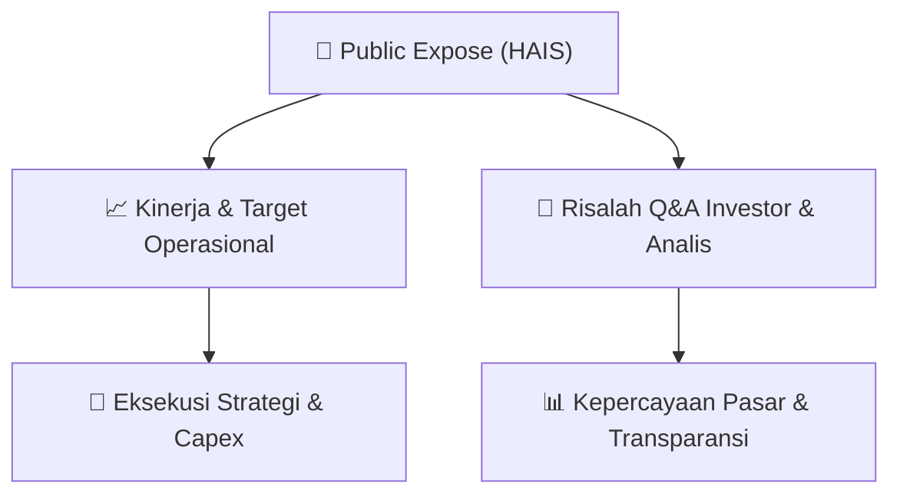

# 📢 Laporan Intelijen Paparan Publik (Public Expose) - [[HAIS]]
🏢 **Emiten**: `[[HAIS]]` | 📅 **Tanggal Pelaksanaan**: `2026-09-11` | 📑 **Dokumen**: `Public Expose`
⬅️ [[knowledge-base/daily-digests/Daily_Digest_20260911|Kembali ke Daily Digest]] | 🎛️ [[Dashboard|Ke Dashboard Utama]]

---

## 📌 1. Ringkasan Eksekutif & Paparan Direksi
> [!NOTE]
> PT Hasnur Internasional Shipping Tbk (HAIS) menyelenggarakan Public Expose Tahunan pada 04 September 2026, dengan laporan hasil disampaikan pada 11 September 2026. Acara dihadiri oleh 29 peserta (tidak termasuk manajemen dan karyawan). Paparan ini merupakan agenda tahunan untuk memaparkan kinerja, strategi, dan menjawab pertanyaan investor/analis. Dokumen yang tersedia hanya mencakup laporan administratif penyelenggaraan, tanpa detail materi paparan atau transkrip tanya jawab yang disertakan dalam teks mentah.

#### 🎯 Guidance Operasional & Target Strategis
- Tidak ada informasi spesifik mengenai target kinerja, ekspansi, capex, atau isu pasar yang dapat diekstraksi dari dokumen ini karena teks mentah hanya berisi laporan administratif penyelenggaraan Public Expose, bukan materi paparan atau hasil Q&A. Untuk mendapatkan katalis dan guidance, diperlukan dokumen lampiran 'Laporan Hasil Paparan Publik (Pubex)_Signed.pdf' yang tidak tersedia dalam teks.

## 📊 2. Matriks Indikator Operasional & Parameter Kunci
| Parameter Utama | Nilai / Keterangan Resmi |
| :--- | :--- |
| **Tanggal Penyelenggaraan Public Expose** | `04 September 2026` |
| **Tanggal Pelaporan Hasil Public Expose** | `11 September 2026` |
| **Jumlah Peserta Hadir (tidak termasuk manajemen/karyawan)** | `29 orang` |
| **Nomor Surat Pengumuman** | `334/HIS-JKT/CORSEC-UM06/IX/2026` |
| **Sekretaris Perusahaan** | `Rengga Temenggung` |
| **Alamat Kantor** | `Gedung Office 8 Lantai 3, Jl. Senopati No. 8B, Kel. Senayan, Kec. Kebayoran Baru` |

---

## 💬 3. Risalah Tanya Jawab (Q&A Session)
`Materi presentasi Public Expose / Risalah Q&A terlampir dalam dokumen resmi bursa.`

## 📌 4. Peta Jalur Strategis & Roadmap

---

## 🔗 Knowledge Graph
- [[knowledge-base/daily-digests/Daily_Digest_20260911|📄 Daily Digest 2026-09-11]]
- [[knowledge-base/calendars/Action_Calendar|🗓️ Kalender Terpusat Aksi Korporasi]]
- [[Dashboard|🎛️ Kembali ke Dashboard Utama]]