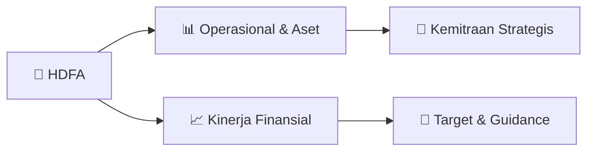

# 📊 Materi Public Expose: [HDFA]

🏢 **Emiten**: `HDFA` | 📅 **Tanggal Pelaksanaan**: `2026-09-07` | 📑 **Total Slide**: `22 Slide`
⬅️ [[knowledge-base/daily-digests/HDFA_20260907|Kembali ke Daily Digest]] | 🎛️ [[Dashboard/HDFA|Ke Dashboard Emiten]]

> [!NOTE]
> Ringkasan materi presentasi resmi Public Expose HDFA yang disampaikan oleh manajemen kepada investor dan bursa. Seluruh poin strategis, matriks operasional, dan angka kinerja diekstrak langsung dari slide deck resmi.

---

## 📅 1. Jadwal & Metadata Penyelenggaraan

| Parameter | Detail Informasi |
|---|---|
| **Nomor Surat Pengantar** | 166/LCS/BEI/IX/2026 |
| **Perihal Pengumuman** | Penyampaian Materi Public Expose Tahunan |
| **Waktu Pelaksanaan** | 2026-09-07 07-09-2026 17:52 |
| **Lokasi / Media** | Aplikasi Zoom / Daring |
| **Lampiran Resmi** | `1` |

## 📋 2. Agenda Paparan Publik

- Pemaparan Profil & Struktur Bisnis Perseroan
- Kinerja Operasional & Keuangan
- Arah Strategi Usaha & Target Pertumbuhan
- Sesi Tanya Jawab (Q&A)

## 🏢 3. Profil & Pilar Portofolio Bisnis

> Profil Perusahaan
PT Radana Bhaskara Finance Tbk (Radana Finance) pertama kali didirikan dengan nama
PT Indonesia Lease Corporation (Indo Lease) pada 20 September 1972. Perseroan
beberapa kali berganti nama, yaitu pada 1988 menjadi PT Mitra Pradityatama Leasing,
kemudian PT Niaga Leasing Corporation pada 1995, PT Niaga Leasing pada 2000, dan PT
Niaga Indovest Finance pada 2001. Pada 2005, Orang Tua Group mengakuisisi PT Niaga
Indovest Finance lalu mengubah namanya menjadi PT HD Finance.
Pada 2011, PT HD Finance melaksanakan Penawaran Umum Perdana (IPO) dan
mencatatkan sahamnya di Bursa Efek Indonesia dengan kode HDFA. Pada 2013, PT Tiara
Marga Trakindo menjadi pemegang saham pengendali Perseroan. Selanjutnya pada
2014, PT HD Finance Tbk kembali mengubah nama menjadi PT Radana Bhaskara Finance
Tbk. Pada 2015, Perseroan melaksanakan PMHMETD I. Kemudian pada 2019, Rubicon
Investments Holding Pte Ltd ("Rubicon") menjadi pemegang saham pengendali Radana
Finance. Pada 2021, RUPSLB menyetujui penambahan modal melalui mekanisme
PMTHMETD maksimal 10% dari modal ditempatkan dan disetor Perseroan. Pada 26
November 2021, sebanyak 445.473.000 saham baru telah diterbitkan. Komposisi
pemegang saham Radana Finance adalah sebagai berikut:
Keunggulan Perusahaan 55.2% 37.2% 7.6%
Rubicon Investments Holding Pte Ltd
PT Tiara Marga Trakindo
Public
-
Perusahaan multifinance dengan posisi yang kuat di Indonesia yang
tidak terafiliasi bank maupun dealer
-
Solusi pembiayaan investasi yang fleksibel
-

## 🏗️ 4. Kinerja Operasional & Portofolio Aset

> Paparan Publik 2026
PT Radana Bhaskara Finance Tbk
3 -
- 1
9 - Sekilas Perusahaan
Kinerja Operasional & Keuangan
Kondisi Makroekonomi & Industri
Dukungan Perbankan Strategi 2026

> Paparan Publik 2026
PT Radana Bhaskara Finance Tbk
3 -
- 1
9 - Sekilas Perusahaan
Kinerja Operasional & Keuangan
Kondisi Makroekonomi & Industri
Dukungan Perbankan Strategi 2026

> Paparan Publik 2026
PT Radana Bhaskara Finance Tbk
3 -
- 1
9 - Sekilas Perusahaan
Kinerja Operasional & Keuangan
Kondisi Makroekonomi & Industri
Dukungan Perbankan Strategi 2026

> Laba Pembiayaan Baru Rasio NPF-Net 2,62% Total Liabilitas 2,50 T Total Ekuitas Total Aset 2,99 T
Catatan: T = triliun, M = miliar, dalam Rupiah
Sumber: Radana Finance
1,64 T 493 M Laba Bersih 1,53 M
Kinerja Operasional & Keuangan – hingga Semester 1 - 2026
Paparan Publik 2026
PT Radana Bhaskara Finance Tbk

> Sumber: Radana Finance
Pada 1H 2026, Radana menyalurkan pembiayaan
Rp1.642 miliar dengan komposisi:
2.871
5.227
5,028 1,642 4,146 2023 2024 2025 1H 2026
FY 2026 P
1.987
2.691
2.970
2,609 3,197 2023 2024 2025 1H 2026
FY 2026 P
-14%
1,83% 3,30%
2.62%
2.60%
2023 2024 2025 1H 2026
FY 2026 P
-0,50%
1,33% 1,97% 0,68%
Pada 1H 2026, Radana mencatat piutang pembiayaan
Rp2.599 miliar dengan komposisi:
• NPF-Net 2,62% per Jun 2026 membaik 68 bps
dibanding 2025  merupakan hasil dari upaya konsisten
Perseroan dalam menjaga kualitas pembiayaan dan
melakukan mitigasi Risiko yang berkesinambungan.
+35% +12% Pembiayaan Baru Piutang Pembiayaan
NPF-Net (in %)
-4%
+82% Produk FY 2025 1H 2026 Factoring
Rp 2,29 triliun
Rp 0,9 triliun
54.88% ABF
Rp 1,96 triliun
Rp 0,56 triliun
34.15% FMU
Rp 0,78 triliun
Rp 0,18 triliun
10.98% Produk Des-25 Jun-26 Factoring
Rp 0,66  triliun
Rp 0,63  triliun
24.23% ABF
Rp 2,12 triliun
Rp 1,86 triliun
71.54% FMU
Rp 0,19 triliun
Rp 0,11 triliun
4.23%
Kinerja Operasional & Keuangan – hingga Semester 1 - 2026

> Sumber: Radana Finance
260 387 417 200 445 2023 2024 2025 1H 2026
FY 2026 P
+49% +8%
Ringkasan Laba Rugi 1H 2026:
• Pendapatan
Rp200 miliar
• Beban
Rp199 miliar
• Laba / (Rugi) bersih  Rp1.53 milliar
Pendapatan (Rp miliar)
Beban Operasional (Rp miliar)
255 386 515 199 435 2023 2024 2025 1H 2026
FY 2026 P
+33% +51%
Paparan Publik 2026
PT Radana Bhaskara Finance Tbk
Kinerja Operasional & Keuangan – hingga Semester 1 - 2026

> Sumber: Radana Finance
• Pencapaian tersebut menunjukkan,
kinerja keuangan yang baik
selama Semester 1 2026. Pada
akhir 2025, Perseroan mencatat
kerugian 82 Miliar sebagai hasil
pembentukan pencadangan
sebagai penerapan prudential risk
management.
Laba/Rugi Bersih (Rp miliar)
(57) (43) (82) 2023 2024 2025 1H 2026
FY 2026 P
-91%
+25%
Termasuk beban pajak
penghasilan IDR 44 Bn
Termasuk Pendapatan pajak
penghasilan IDR 16 Bn
Kinerja Operasional & Keuangan – hingga Semester 1 - 2026
Paparan Publik 2026
PT Radana Bhaskara Finance Tbk

> Sumber: Radana Finance
Ringkasan Neraca 1H 2026:
Total aset
Rp 3,0 triliun
Total liabilitas
Rp 2,5 triliun
Total ekuitas
Rp 0,5 triliun
Aset (Rp miliar)
Liabilitas (Rp miliar)
Ekuitas (Rp miliar)
2.460
3.191
3,389 2,993 3,627 2023 2024 2025 1H 2026
FY 2026 P
+30% +6%
1.844
2.618
2,898 2,500 2,828 2023 2024 2025 1H 2026
FY 2026 P
+42% +11% 616 573 491 493 799 2023 2024 2025 1H 2026
FY 2026 P
-14%
-7%
Kinerja Operasional & Keuangan – hingga Semester 1 - 2026
Paparan Publik 2026
PT Radana Bhaskara Finance Tbk

> Paparan Publik 2026
PT Radana Bhaskara Finance Tbk
3 -
- 1
9 - Sekilas Perusahaan
Kinerja Operasional & Keuangan
Kondisi Makroekonomi & Industri
Dukungan Perbankan Strategi 2026

> Paparan Publik 2026
PT Radana Bhaskara Finance Tbk
3 -
- 1
9 - Sekilas Perusahaan
Kinerja Operasional & Keuangan
Kondisi Makroekonomi & Industri
Dukungan Perbankan Strategi 2026

## 📈 5. Kinerja Keuangan & Posisi Finansial

## 🧭 6. Inisiatif Strategis, Kolaborasi, & Kemitraan

*Strategi usaha difokuskan pada penguatan fundamental dan ekspansi operasional.*

## 🎯 7. Target Pertumbuhan & Guidance Manajemen

*Target pertumbuhan ditetapkan mengacu pada prospek industri dan kondisi makroekonomi terkini.*

## 🗺️ 8. Peta Jalur Strategis & Eksekusi

## 📑 9. Daftar Indeks Slide Presentasi

| Slide # | Judul / Topik Slide | Ringkasan Konten |
|---|---|---|
| Slide 1 | **PUBLIC EXPOSE 2026** | (Paparan Publik) PT Radana Bhaskara Finance Tbk Jakarta, 8 September 2026 |
| Slide 2 | **Paparan Publik 2026** | PT Radana Bhaskara Finance Tbk 3 - 7 |
| Slide 3 | **Profil Perusahaan** | PT Radana Bhaskara Finance Tbk (Radana Finance) pertama kali didirikan dengan nama PT Indonesia Lease Corporation (Indo Lease) pada 20 September 1972. |
| Slide 4 | **PT Indonesia Lease** | Corporation (Indo Lease) didirikan Orang Tua Group |
| Slide 5 | **The Company’s Board of** | Commissioners Ir Gottfried Tampubolon President Commisioner and |
| Slide 6 | **The Company’s Board of Directors** | Lim Eng Khim President Director Setiawan Nurtjahja |
| Slide 7 | **Dewan Pengawas Syariah** | Ikhwan Abidin Basri 7 |
| Slide 8 | **Paparan Publik 2026** | PT Radana Bhaskara Finance Tbk 3 - 7 |
| Slide 9 | **49,828** | 51,686 51,018 56,111 |
| Slide 10 | **719.6** | 983.5 1231.2 1358.1 |
| Slide 11 | **Paparan Publik 2026** | PT Radana Bhaskara Finance Tbk 3 - 7 |
| Slide 12 | **Laba Pembiayaan** | Pembiayaan Baru Rasio |
| Slide 13 | **Sumber: Radana Finance** | Pada 1H 2026, Radana menyalurkan pembiayaan Rp1.642 miliar dengan komposisi: 2.871 |
| Slide 14 | **Sumber: Radana Finance** | 260 387 417 |
| Slide 15 | **Sumber: Radana Finance** | • Pencapaian tersebut menunjukkan, kinerja keuangan |
| Slide 16 | **Sumber: Radana Finance** | Ringkasan Neraca 1H 2026: Total aset Rp 3,0 triliun |
| Slide 17 | **Brand Partner** | 17 |
| Slide 18 | **Paparan Publik 2026** | PT Radana Bhaskara Finance Tbk 3 - 7 |
| Slide 19 | **Sharia Banks** | Syndication Agent Banking Partners Banking Partners |
| Slide 20 | **Paparan Publik 2026** | PT Radana Bhaskara Finance Tbk 3 - 7 |
| Slide 21 | **STRATEGI 2026** | Meningkatkan pangsa pasar dengan mengoptimalkan cakupan pasar yang sudah dimiliki. Memperkuat hubungan dengan dealer eksisting dan dealer potensial ba |
| Slide 22 | **THANK YOU** | Paparan Publik 2026 PT Radana Bhaskara Finance Tbk 22 |

---

*Dokumen diolah otomatis oleh **Swarm Intelijen Pasar Modal Indonesia** pada 2026-10-12 16:45 WIB.*