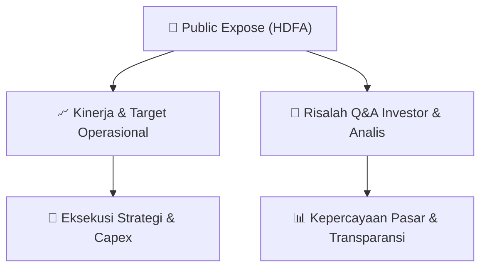

# 📢 Laporan Intelijen Paparan Publik (Public Expose) - [[HDFA]]
🏢 **Emiten**: `[[HDFA]]` | 📅 **Tanggal Pelaksanaan**: `2026-09-07` | 📑 **Dokumen**: `Public Expose`
⬅️ [[knowledge-base/daily-digests/Daily_Digest_20260907|Kembali ke Daily Digest]] | 🎛️ [[Dashboard|Ke Dashboard Utama]]

---

## 📌 1. Ringkasan Eksekutif & Paparan Direksi
> [!NOTE]
> PT Radana Bhaskara Finance Tbk (HDFA) menyampaikan materi Public Expose Tahunan melalui surat resmi No. 166/LCS/BEI/IX/2026 tanggal 07 September 2026, yang mengoreksi surat sebelumnya No. 164/LCS/BEI/IX/2026 tanggal 03 September 2026. Penyampaian materi ini merujuk pada rencana penyelenggaraan Public Expose Tahunan yang diumumkan melalui surat No. 159/LCD/BEI/VIII/2026 tanggal 24 Agustus 2026. Dokumen ini merupakan pengumuman formal penyampaian materi paparan publik, namun tidak memuat isi detail materi paparan itu sendiri, melainkan hanya konfirmasi administratif bahwa materi telah disampaikan sebagai lampiran.

#### 🎯 Guidance Operasional & Target Strategis
- Dokumen ini tidak memuat informasi spesifik mengenai target kinerja, ekspansi, atau capex. Namun, penyampaian materi Public Expose Tahunan ini merupakan katalis informasi bagi investor untuk mendapatkan pemaparan kinerja dan rencana perseroan. Investor diharapkan menantikan isi materi paparan yang akan disampaikan dalam acara Public Expose Tahunan yang direncanakan, yang dapat berisi guidance operasional dan strategi perusahaan ke depan.

## 📊 2. Matriks Indikator Operasional & Parameter Kunci
| Parameter Utama | Nilai / Keterangan Resmi |
| :--- | :--- |
| **Nomor Surat** | `166/LCS/BEI/IX/2026` |
| **Tanggal Surat** | `07 September 2026` |
| **Perihal** | `Penyampaian Materi Public Expose Tahunan` |
| **Koreksi Surat Sebelumnya** | `No. 164/LCS/BEI/IX/2026 tanggal 03 September 2026` |
| **Rujukan Pengumuman Public Expose** | `No. 159/LCD/BEI/VIII/2026 tanggal 24 Agustus 2026` |
| **Nama Emiten** | `Radana Bhaskara Finance Tbk` |
| **Kode Emiten** | `HDFA` |
| **Corporate Secretary** | `Hanindya Aryoputro` |
| **Lampiran** | `Material submission - Pubex Sept 2026_07SEP26.pdf` |

---

## 💬 3. Risalah Tanya Jawab (Q&A Session)
### ❓ Pertanyaan 1 (Tidak ada (dokumen administratif))
**Pertanyaan**: Tidak ada pertanyaan yang tercantum dalam dokumen ini.

**Jawaban Manajemen**: Tidak ada jawaban manajemen yang tercantum dalam dokumen ini.

> [!TIP]
> **Implikasi Bagi Investor**: Dokumen ini hanya merupakan pengumuman administratif penyampaian materi Public Expose. Investor perlu menunggu dan mengakses lampiran materi Public Expose untuk mendapatkan informasi detail mengenai kinerja, strategi, dan panduan perusahaan.

## 📌 4. Peta Jalur Strategis & Roadmap

---

## 🔗 Knowledge Graph
- [[knowledge-base/daily-digests/Daily_Digest_20260907|📄 Daily Digest 2026-09-07]]
- [[knowledge-base/calendars/Action_Calendar|🗓️ Kalender Terpusat Aksi Korporasi]]
- [[Dashboard|🎛️ Kembali ke Dashboard Utama]]