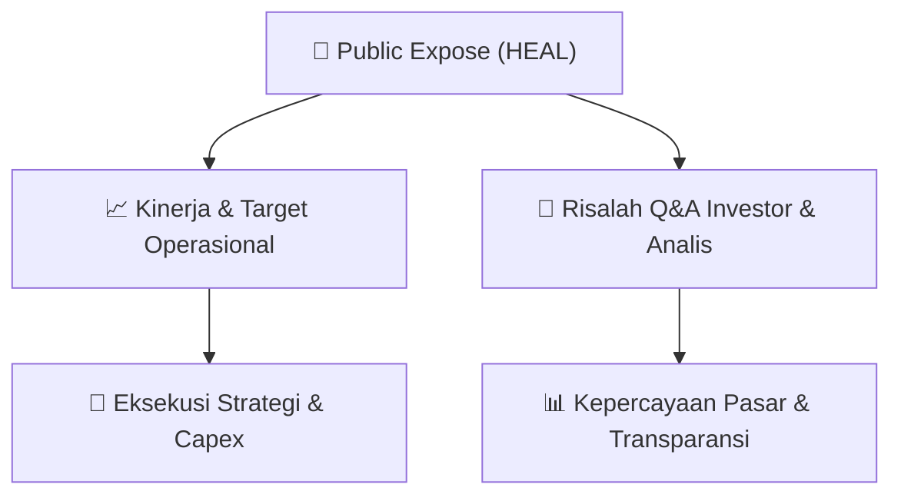

# 📢 Laporan Intelijen Paparan Publik (Public Expose) - [[HEAL]]
🏢 **Emiten**: `[[HEAL]]` | 📅 **Tanggal Pelaksanaan**: `2026-09-11` | 📑 **Dokumen**: `Public Expose`
⬅️ [[knowledge-base/daily-digests/Daily_Digest_20260911|Kembali ke Daily Digest]] | 🎛️ [[Dashboard|Ke Dashboard Utama]]

---

## 📌 1. Ringkasan Eksekutif & Paparan Direksi
> [!NOTE]
> PT Medikaloka Hermina Tbk. (HEAL) menyelenggarakan Public Expose Tahunan pada tanggal 03 September 2026, berdasarkan surat pengajuan materi No. 468/DIR/MH/IX/2026. Acara ini dihadiri oleh 68 peserta (tidak termasuk manajemen dan karyawan). Hasil Public Expose dilaporkan melalui surat No. 479/DIR/MH/IX/2026 yang ditandatangani oleh Direktur Perusahaan, Yulisar Khiat, pada 11 September 2026. Dokumen ini merupakan laporan resmi penyampaian hasil kegiatan paparan publik tahunan emiten rumah sakit jaringan Hermina.

#### 🎯 Guidance Operasional & Target Strategis
- Dokumen yang tersedia hanya berisi laporan administratif penyelenggaraan Public Expose Tahunan. Tidak terdapat rincian spesifik mengenai target kinerja, rencana ekspansi, belanja modal (capex), atau panduan operasional (guidance) dalam teks yang diberikan. Informasi material tersebut kemungkinan terdapat dalam lampiran 'Laporan PUBEX 2026.pdf' yang tidak disertakan dalam teks mentah dokumen ini.

## 📊 2. Matriks Indikator Operasional & Parameter Kunci
| Parameter Utama | Nilai / Keterangan Resmi |
| :--- | :--- |
| **Tanggal Penyelenggaraan Public Expose** | `03 September 2026` |
| **Jumlah Peserta Hadir (di luar manajemen/karyawan)** | `68 orang` |
| **Nomor Surat Pengajuan Materi** | `468/DIR/MH/IX/2026` |
| **Nomor Surat Laporan Hasil Public Expose** | `479/DIR/MH/IX/2026` |
| **Tanggal Pelaporan Hasil Public Expose** | `11 September 2026` |
| **Penanggung Jawab Laporan** | `Yulisar Khiat (Direktur Perusahaan)` |

---

## 💬 3. Risalah Tanya Jawab (Q&A Session)
### ❓ Pertanyaan 1 (Tidak tersedia dalam dokumen)
**Pertanyaan**: Tidak ada sesi tanya jawab yang tercantum dalam teks dokumen yang diberikan.

**Jawaban Manajemen**: Tidak ada jawaban manajemen yang tercantum dalam teks dokumen yang diberikan.

> [!TIP]
> **Implikasi Bagi Investor**: Tidak ada implikasi investasi yang dapat dianalisis karena dokumen hanya berisi laporan administratif penyelenggaraan acara, tanpa rincian materi paparan atau sesi Q&A.

## 📌 4. Peta Jalur Strategis & Roadmap

---

## 🔗 Knowledge Graph
- [[knowledge-base/daily-digests/Daily_Digest_20260911|📄 Daily Digest 2026-09-11]]
- [[knowledge-base/calendars/Action_Calendar|🗓️ Kalender Terpusat Aksi Korporasi]]
- [[Dashboard|🎛️ Kembali ke Dashboard Utama]]