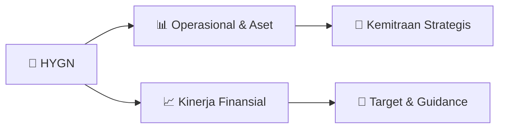

# 📊 Materi Public Expose: [HYGN]

🏢 **Emiten**: `HYGN` | 📅 **Tanggal Pelaksanaan**: `2026-09-17` | 📑 **Total Slide**: `21 Slide`
⬅️ [[knowledge-base/daily-digests/HYGN_20260917|Kembali ke Daily Digest]] | 🎛️ [[Dashboard/HYGN|Ke Dashboard Emiten]]

> [!NOTE]
> Ringkasan materi presentasi resmi Public Expose HYGN yang disampaikan oleh manajemen kepada investor dan bursa. Seluruh poin strategis, matriks operasional, dan angka kinerja diekstrak langsung dari slide deck resmi.

---

## 📅 1. Jadwal & Metadata Penyelenggaraan

| Parameter | Detail Informasi |
|---|---|
| **Nomor Surat Pengantar** | 102/Corsec/09/2026/Pubex |
| **Perihal Pengumuman** | Penyampaian Materi Public Expose Tahunan |
| **Waktu Pelaksanaan** | 2026-09-17 17-09-2026 16:06 |
| **Lokasi / Media** | Aplikasi Zoom / Daring |
| **Lampiran Resmi** | `1` |

## 📋 2. Agenda Paparan Publik

1. Fondasi eksekusi digital yang telah diluncurkan untuk memperkuat sales, operasional, pembelajaran, dan
2. keberlanjutan.
3. 01  Super Sales App
4. Workflow sales terintegrasi CRM,
5. geotagging, check-in digital,
6. quotation, kontrak, dan reporting.
7. 02  e-Pest Monitoring
8. Laporan paperless real-time, jadwal
9. layanan, aktivitas teknisi, traceability
10. bahan kimia, dan dokumen audit-
11. ready.
12. 03  ERP Enhancement
13. Integrasi finance, supply chain,
14. operasional, dan reporting sebagai
15. backbone proses bisnis.
16. 04  CRM & Omnichannel
17. Sentralisasi komunikasi pelanggan,
18. lead digital, feedback, follow-up, dan
19. analitik customer journey.
20. 05  ecoDemy
21. LMS untuk standardisasi training,
22. onboarding, dan pengembangan
23. kapabilitas karyawan lintas cabang.
24. 06  EV Initiative
25. Inisiatif kendaraan listrik untuk
26. efisiensi operasional dan dukungan
27. terhadap agenda keberlanjutan.
28. Fokus 2025: memperkuat fondasi digital sebelum akselerasi data, AI, dan skalabilitas nasional.
29. Ekspansi armada listrik untuk efisiensi operasional dan dukungan terhadap agenda keberlanjutan.
30. Pertumbuhan Armada EV
31. Unit kendaraan listrik berdasarkan tahun operasional
32. 10 unit
33. EV motor 10 unit
34. 26 unit
35. EV motor 25 unit + EV mobil 1 unit
36. 52 unit
37. EV motor 50 unit + EV mobil 2 unit (per Q1 2026)
38. TOTAL UNIT EV
39. Per Mei 2026
40. EV MOTOR VS 2024
41. Dari 10 unit menjadi 50 unit
42. EV MOBIL
43. Perluasan armada roda empat
44. Dampak: armada EV meningkat dari 10 unit pada 2024 menjadi 52 unit per Mei 2026 untuk mendukung efisiensi dan sustainability.

## 🏢 3. Profil & Pilar Portofolio Bisnis

## 🏗️ 4. Kinerja Operasional & Portofolio Aset

*Detail aset operasional terlampir pada dokumen slide resmi.*

## 📈 5. Kinerja Keuangan & Posisi Finansial

### 📊 Ringkasan Finansial
```text
LAPORAN LABA RUGI KONSOLIDASIAN
KINERJA KEUANGAN
```

### 📊 Ringkasan Finansial
```text
LAPORAN POSISI KEUANGAN KONSOLIDASIAN
KINERJA KEUANGAN
```

### 📊 Ringkasan Finansial
```text
KINERJA KEUANGAN
Penggunaan laba bersih Perseroan untuk tahun buku yang berakhir
pada tanggal 31 Desember 2025 sebesar Rp 19.714.109.181 (Sembilan
belas miliar tujuh ratus empat belas juta seratus sembilan ribu seratus
delapan puluh satu rupiah) untuk digunakan sebagai berikut:
1.
Sebesar Rp 7.493.460.900 (Tujuh miliar empat ratus sembilan
puluh tiga juta empat ratus enam puluh ribu sembilan ratus
rupiah) atau 38,01% (tiga puluh delapan koma dua persen) dari
Laba Bersih didistribusikan sebagai dividen tunai kepada
Pemegang Saham secara proporsional sesuai persentase
kepemilikan sahamnya. Harga Dividen per lembar saham adalah
sebesar Rp3 (tiga Rupiah) per lembar saham
2.
Sisa dari laba bersih Perseroan sebesar Rp 12.220.648.281 (dua
belas miliar dua ratus dua puluh juta enam ratus empat puluh
delapan ribu dua ratus delapan puluh satu rupiah) akan
menambah saldo laba ditahan.
PENGGUNAAN LABA BERSIH
UNTUK TAHUN BUKU 2025
Laba Bersih yang didapat
didistribusikan kepada entitas
induk IDR 19.714.109.181 Pembagian Dividen 38,01% Pembagian Dividen IDR 7.493.460.900
Dividen per lembar saham
IDR 3,0
```

## 🧭 6. Inisiatif Strategis, Kolaborasi, & Kemitraan

*Strategi usaha difokuskan pada penguatan fundamental dan ekspansi operasional.*

## 🎯 7. Target Pertumbuhan & Guidance Manajemen

*Target pertumbuhan ditetapkan mengacu pada prospek industri dan kondisi makroekonomi terkini.*

## 🗺️ 8. Peta Jalur Strategis & Eksekusi



## 📑 9. Daftar Indeks Slide Presentasi

| Slide # | Judul / Topik Slide | Ringkasan Konten |
|---|---|---|
| Slide 1 | **Jakarta, 17 September 2026** | Nomor : 102/Corsec/09/2026/Pubex Lampiran : 1 (satu) Kepada Yth. |
| Slide 3 | **PUBLIC EXPOSE** | TAHUN 2026 PT Ecocare Indo Pasifik Tbk COMPANY & BUSINESS |
| Slide 4 | **COMPANY &** | BUSINESS OVERVIEW PT ECOCARE INDO PASIFIK TBK HYGN |
| Slide 5 | **PT Ecocare Indo Pasifik Tbk** | (sebelumnya bernama PT Indocare Pacific) didirikan pada tahun 2007 sebagai perusahaan sistem higienis |
| Slide 6 | **Membangkitkan “citra** | perusahaan lokal Indonesia” agar setara, disegani, dan mampu |
| Slide 7 | **Hendrik Yong** | 47,53% Rondy Yunanda 8,04% |
| Slide 8 | **SUSUNAN DEWAN KOMISARIS** | ecoCare Group Company HERMES THAMRIN KOMISARIS |
| Slide 9 | **SUSUNAN DIREKSI** | ecoCare Group Company WINCENT  YUNANDA DIREKTUR UTAMA |
| Slide 10 | **FINANCIAL** | OVERVIEW PT ECOCARE INDO PASIFIK TBK HYGN |
| Slide 11 | **LAPORAN LABA RUGI KONSOLIDASIAN** | KINERJA KEUANGAN |
| Slide 12 | **LAPORAN POSISI KEUANGAN KONSOLIDASIAN** | KINERJA KEUANGAN |
| Slide 13 | **KINERJA KEUANGAN** | Penggunaan laba bersih Perseroan untuk tahun buku yang berakhir pada tanggal 31 Desember 2025 sebesar Rp 19.714.109.181 (Sembilan belas miliar tujuh r |
| Slide 14 | **Dari Digitalisasi menuju Layanan** | Hygiene, Pest Control, dan Cleaning berbasis Data & AI |
| Slide 15 | **PENCAPAIAN DIGITAL 2025** | Fondasi eksekusi digital yang telah diluncurkan untuk memperkuat sales, operasional, pembelajaran, dan keberlanjutan. 01  Super Sales App |
| Slide 16 | **EV INITIATIVE 2024–2026** | Ekspansi armada listrik untuk efisiensi operasional dan dukungan terhadap agenda keberlanjutan. Pertumbuhan Armada EV Unit kendaraan listrik berdasark |
| Slide 17 | **AKSELERASI DATA & AI** | Mengubah fondasi digital menjadi mesin pertumbuhan, efisiensi layanan, keputusan real-time, dan kontrol profitabilitas. Mesin Pertumbuhan Berbasis Dat |
| Slide 18 | **Inisiatif ini menjadi langkah strategis HYGN dalam memperluas portofolio berbasis** | teknologi serta menciptakan pertumbuhan jangka panjang di sektor environmental health ECOCARE PURE AIR – PELUNCURAN UNIT BISNIS BARU |
| Slide 19 | **ecoCare Scent Nano menghadirkan distribusi aroma yang konsisten dan efisien untuk mendukung** | peningkatan kualitas lingkungan sekaligus memperkuat citra premium di berbagai sektor bisnis. ECOCARE SCENT NANO – INOVASI PRODUK BARU Memperkuat posi |
| Slide 20 | **ecoCare Diamond Series menghadirkan solusi hygiene & air care yang memadukan desain elegan,** | fungsi praktis, dan performa yang mendukung kebutuhan operasional berbagai fasilitas bisnis. ECOCARE DIAMOND SERIES – INOVASI PRODUK BARU Meningkatkan |
| Slide 21 | **TERIMA KASIH** |  |

---

*Dokumen diolah otomatis oleh **Swarm Intelijen Pasar Modal Indonesia** pada 2026-10-12 16:45 WIB.*