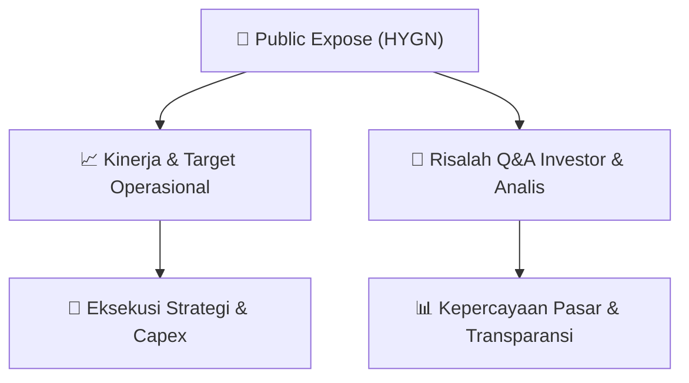

# 📢 Laporan Intelijen Paparan Publik (Public Expose) - [[HYGN]]
🏢 **Emiten**: `[[HYGN]]` | 📅 **Tanggal Pelaksanaan**: `2026-09-17` | 📑 **Dokumen**: `Public Expose`
⬅️ [[knowledge-base/daily-digests/Daily_Digest_20260917|Kembali ke Daily Digest]] | 🎛️ [[Dashboard|Ke Dashboard Utama]]

---

## 📌 1. Ringkasan Eksekutif & Paparan Direksi
> [!NOTE]
> PT Ecocare Indo Pasifik Tbk. (HYGN) menyelenggarakan Public Expose Tahunan pada 17 September 2026, dengan materi paparan yang disampaikan oleh Direktur Utama, Wincent Yunanda. Paparan ini merupakan bagian dari kepatuhan regulasi BEI dan menjadi wadah bagi manajemen untuk memaparkan kinerja, strategi, serta menjawab pertanyaan investor dan analis. Dokumen yang diunggah adalah pengumuman resmi penyampaian materi Public Expose, yang mencakup agenda utama perusahaan dalam meningkatkan transparansi dan komunikasi dengan pemangku kepentingan di tengah dinamika industri.

#### 🎯 Guidance Operasional & Target Strategis
- Berdasarkan dokumen yang tersedia, belum terdapat rincian spesifik mengenai target kinerja, ekspansi, atau capex karena materi paparan (file lampiran) tidak disertakan dalam teks. Namun, penyelenggaraan Public Expose Tahunan ini sendiri menjadi katalis transparansi yang dapat meningkatkan kepercayaan investor. Investor diharapkan mencermati materi paparan yang dirilis secara terpisah untuk mendapatkan panduan operasional dan strategi pertumbuhan HYGN ke depan.

## 📊 2. Matriks Indikator Operasional & Parameter Kunci
| Parameter Utama | Nilai / Keterangan Resmi |
| :--- | :--- |
| **Tanggal Penyelenggaraan Public Expose** | `17 September 2026` |
| **Nomor Surat Pengumuman** | `102/Corsec/09/2026/Pubex` |
| **Nomor Surat Rencana** | `101/Corsec/09/2026/Pubex (tanggal 08 September 2026)` |
| **Nama Direktur Utama** | `Wincent Yunanda` |
| **Alamat Kantor** | `Gedung Infinia Park, Jl. Dr. Saharjo No. 45 Blok A No. 55, Manggarai, Tebet, Jakarta` |
| **Kontak Perusahaan** | `Telepon: +62 2122083400, Fax: +62 22083400, www.ecocare.id` |
| **Lampiran Dokumen** | `Materi - Pubex - HYGN - Final.pdf` |

---

## 💬 3. Risalah Tanya Jawab (Q&A Session)
### ❓ Pertanyaan 1 (Tidak tersedia dalam dokumen)
**Pertanyaan**: Tidak tersedia dalam dokumen

**Jawaban Manajemen**: Tidak tersedia dalam dokumen

> [!TIP]
> **Implikasi Bagi Investor**: Tidak tersedia dalam dokumen

## 📌 4. Peta Jalur Strategis & Roadmap

---

## 🔗 Knowledge Graph
- [[knowledge-base/daily-digests/Daily_Digest_20260917|📄 Daily Digest 2026-09-17]]
- [[knowledge-base/calendars/Action_Calendar|🗓️ Kalender Terpusat Aksi Korporasi]]
- [[Dashboard|🎛️ Kembali ke Dashboard Utama]]