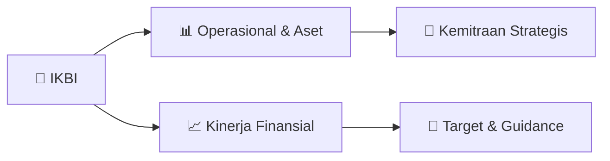

# 📊 Materi Public Expose: [IKBI]

🏢 **Emiten**: `IKBI` | 📅 **Tanggal Pelaksanaan**: `2026-08-14` | 📑 **Total Slide**: `17 Slide`
⬅️ [[knowledge-base/daily-digests/IKBI_20260814|Kembali ke Daily Digest]] | 🎛️ [[Dashboard/IKBI|Ke Dashboard Emiten]]

> [!NOTE]
> Ringkasan materi presentasi resmi Public Expose IKBI yang disampaikan oleh manajemen kepada investor dan bursa. Seluruh poin strategis, matriks operasional, dan angka kinerja diekstrak langsung dari slide deck resmi.

---

## 📅 1. Jadwal & Metadata Penyelenggaraan

| Parameter | Detail Informasi |
|---|---|
| **Nomor Surat Pengantar** | 032/SIK-CS/VIII/2026 |
| **Perihal Pengumuman** | Penyampaian Materi Public Expose Tahunan |
| **Waktu Pelaksanaan** | 2026-08-14 14-08-2026 16:31 |
| **Lokasi / Media** | Aplikasi Zoom / Daring |
| **Lampiran Resmi** | `1` |

## 📋 2. Agenda Paparan Publik

1. 1. Company Profile
2. 2. Management
3. 3. Vision & Mission
4. 4. Shareholders
5. 5. Products Portfolio
6. 6. Certifications and Awards
7. 7. Financial Highlight
8. 8. Analysis of Financial Performance
9. 9. Operational Review by Business
10. Segment
11. 10.Business Prospects
12. 1. Profil Perseroan
13. 2. Manajemen
14. 3. Visi & Misi
15. 4. Pemegang Saham
16. 5. Portofolio Produk
17. 6. Sertifikasi dan Penghargaan
18. 7. Ikhtisar Keuangan
19. 8. Analisa Kinerja Keuangan
20. 9. Tinjauan Operasional Per Segmen
21. Usaha
22. 10. Prospek Usaha

## 🏢 3. Profil & Pilar Portofolio Bisnis

## 🏗️ 4. Kinerja Operasional & Portofolio Aset

> 7. IKHTISAR DATA KEUANGAN FY2025
FINANCIAL HIGHLIGHTS FY2025
12/17
LAPORAN POSISI KEUANGAN
STATEMENT OF FINANCIAL POSITION
March 2023 March 2024 March 2025 Dalam AS$
Amounts in US$
60,131,546 79,703,861 69,040,338 Aset Lancar Current Assets 46,936,171 44,046.669 42,495,050
Aset Tidak Lancar                    Non-Current Assets
107,067,717 123,750,530 111,535,388
Total Aset                               Total Assets
24,482,869 38,362,552 19,828,188
Liabilitas Jangka Pendek
Current Liabilities 6,315,668 5,882,490 5,509,325
Liabilitas Jangka Panjang         Non-Current Liability
30,798,537 44,245,042 25,337,513 Total Liabilitas Total Liabilities 76,269,180 79,505,488 86,197,875
Total Ekuitas                          Total Equity
107,067,717 123,750,530 111,535,388
Total Liabilitas dan Ekuitas      Total Liabilities and Equity

> 8. Analisa Kinerja Keuangan FY2025
Analysis of Financial Performance FY2025
13/17 Penjualan Bersih Net Sales
(juta AS$ / Million US$)
Laba Bersih Net Income
(juta AS$ / Million US$)
Jumlah Aset Total Assets
(juta AS$ / Million US$)
Ekuitas Equity
(juta AS$ / Million US$)
230 262 247 2025 2024 2023 112 124 107 2025 2024 2023 8.2
5.7
7.5 2025 2024 2023 2025 2024 2023

> 10. PROSPEK USAHA
BUSINESS PROSPECTS
•
Pendekatan strategis untuk meraih kesuksesan adalah
mengkhususkan diri pada segmen bernilai tinggi,
berinvestasi pada peralatan pembuatan kabel canggih,
menjalin kemitraan dengan distributor, melindungi biaya bahan baku, dan meningkatkan merek dan kepatuhan.
•
Untuk kabel listrik dan jaringan tegangan menengah
khususnya di Indonesia pada tahun 2026, prospeknya
kuat, didorong oleh perluasan jaringan yang ambisius,
integrasi terbarukan, dan modernisasi infrastruktur.
•
Lini produksi
Kabel Tegangan Menengah kami
yang
baru, sudah mulai diproduksi secara massal pada awal
tahun 2022 diharapkan akan memperkuat daya saing
kami dalam bisnis kabel di dalam negeri.
•
Pada awal tahun fiscal 2026, Perseroan memproyeksikan target yang akan dicapai untuk
penjualan neto sebesar US$ 266 juta.
16/17
•
Strategic approaches for success are specialize in
high-value segments, invest in advanced cable- making equipment, pursue partnership with
distributors, hedge raw material costs, and enhance
branding and compliance.
•
For power cables and medium voltage lines
specifically in Indonesia in year 2026, the outlook is
strong, driven by ambitious grid expansion, renewa

## 📈 5. Kinerja Keuangan & Posisi Finansial

## 🧭 6. Inisiatif Strategis, Kolaborasi, & Kemitraan

*Strategi usaha difokuskan pada penguatan fundamental dan ekspansi operasional.*

## 🎯 7. Target Pertumbuhan & Guidance Manajemen

*Target pertumbuhan ditetapkan mengacu pada prospek industri dan kondisi makroekonomi terkini.*

## 🗺️ 8. Peta Jalur Strategis & Eksekusi

## 📑 9. Daftar Indeks Slide Presentasi

| Slide # | Judul / Topik Slide | Ringkasan Konten |
|---|---|---|
| Slide 1 | **Confidential** | PUBLIC EXPOSE 2026 PT SUMI INDO KABEL Tbk. Tanggal |
| Slide 2 | **Tata Tertib** | 2/17 1. A Question and Answer (Q&A) session will be held after this Public |
| Slide 3 | **Agenda** | 3/17 1. Company Profile 2. Management |
| Slide 4 | **1. PROFIL PERSEROAN** | CORPORATE PROFILE 4/17 The Company is engaged in the cable and electrical |
| Slide 5 | **2. MANAJEMEN** | MANAGEMENT 5/17 DEWAN KOMISARIS |
| Slide 6 | **3. VISI & MISI** | VISION & MISSION 6/17 VISION |
| Slide 7 | **3. VISI & MISI (2)** | VISION & MISSION (2) 7/17 All Employees shall understand the |
| Slide 8 | **4. PEMEGANG SAHAM** | SHAREHOLDERS 8/17 Sumitomo Electric |
| Slide 9 | **Photovoltaic Cable** | (PV) Solar Power Plant Cu/XLPE/LSHF |
| Slide 10 | **6. SERTIFIKASI & PENGHARGAAN** | CERTIFICATION & AWARDS 10/17 ISO 9001-2015 |
| Slide 11 | **6. IKHTISAR DATA KEUANGAN** | FINANCIAL HIGHLIGHTS 11/17 2023 |
| Slide 12 | **7. IKHTISAR DATA KEUANGAN FY2025** | FINANCIAL HIGHLIGHTS FY2025 12/17 LAPORAN POSISI KEUANGAN |
| Slide 13 | **8. Analisa Kinerja Keuangan FY2025** | Analysis of Financial Performance FY2025 13/17 Penjualan Bersih |
| Slide 14 | **9. Tinjauan Operasional Per Segmen Usaha** | Operational Review by Business Segment 14/17 Penjualan berdasarkan Produk |
| Slide 15 | **9. Tinjauan Operasional Per Segmen Usaha** | Operational Review by Business Segment 15/17 Penjualan Berdasarkan Pangsa Pasar |
| Slide 16 | **10. PROSPEK USAHA** | BUSINESS PROSPECTS • Pendekatan strategis untuk meraih kesuksesan adalah |
| Slide 17 | **Confidential** | TERIMA KASIH THANK YOU |

---

*Dokumen diolah otomatis oleh **Swarm Intelijen Pasar Modal Indonesia** pada 2026-10-12 16:45 WIB.*