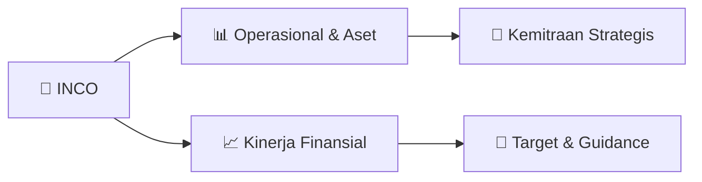

# 📊 Materi Public Expose: [INCO]

🏢 **Emiten**: `INCO` | 📅 **Tanggal Pelaksanaan**: `2026-08-27` | 📑 **Total Slide**: `2 Slide`
⬅️ [[knowledge-base/daily-digests/INCO_20260827|Kembali ke Daily Digest]] | 🎛️ [[Dashboard/INCO|Ke Dashboard Emiten]]

> [!NOTE]
> Ringkasan materi presentasi resmi Public Expose INCO yang disampaikan oleh manajemen kepada investor dan bursa. Seluruh poin strategis, matriks operasional, dan angka kinerja diekstrak langsung dari slide deck resmi.

---

## 📅 1. Jadwal & Metadata Penyelenggaraan

| Parameter | Detail Informasi |
|---|---|
| **Nomor Surat Pengantar** | 01661/IR-J/VIII/2026 |
| **Perihal Pengumuman** | Rencana Penyelenggaraan Public Expose Tahunan |
| **Waktu Pelaksanaan** | 10 September 2026 11:00 |
| **Lokasi / Media** | Public Expose Live 2026 |
| **Lampiran Resmi** | `0` |

## 📋 2. Agenda Paparan Publik

1. Nama Perusahaan
2. Kode Emiten
3. Lampiran
4. Perihal
5. 01661/IR-J/VIII/2026
6. Vale Indonesia Tbk
7. Rencana Penyelenggaraan Public Expose Tahunan
8. Go To English Page
9. Perseroan melaporkan rencana Public Expose Tahunan sebagai berikut:
10. Rencana Penyelenggaraan Public Expose
11. Tahun Buku yang Berakhir pada
12. Tempat
13. : Public Expose Live 2026
14. yang tercantum pada website idx.co.id
15. Hari/Tanggal
16. : 10 September 2026
17. Waktu
18. 11:00
19. Agenda
20. : 1. Laporan Kinerja Triwulan II Tahun 2026
21. 2. Proyek Pertumbuhan
22. 3. Strategi Usaha Perseroan
23. Hormat Kami,
24. Demikian untuk diketahui.
25. Sequis Tower, 20th Floor, Unit 6&7 - Jl. Jend. Sudirman Kav. 71, Jakarta 12190,
26. Corporate Secretary
27. Nama Pengirim
28. Telepon : (62) 21 524-9000, Fax : (62) 21 524-9020, http://www.vale.com/indonesia
29. Vale Indonesia Tbk
30. Ranty Astari Rachman
31. Vale Indonesia Tbk
32. Ranty Astari Rachman
33. Jabatan
34. Corporate Secretary
35. Tanggal dan Waktu
36. 27-08-2026 15:15
37. Dokumen ini merupakan dokumen resmi Vale Indonesia Tbk yang tidak memerlukan tanda tangan karena dihasilkan
38. secara elektronik oleh sistem pelaporan elektronik. Vale Indonesia Tbk bertanggung jawab penuh atas informasi
39. yang tertera didalam dokumen ini.
40. Issuer Name
41. Issuer Code
42. Attachment
43. Subject
44. 01661/IR-J/VIII/2026
45. Vale Indonesia Tbk
46. General Announcement Public Expose
47. Go To Indonesian Page
48. Company announces public expose plan Annual as follows:
49. Public Expose Announcement
50. Fiscal Year
51. Place
52. : Public Expose Live 2026
53. yang tercantum pada website idx.co.id
54. : 10 September 2026
55. 11:00
56. Agenda
57. Respectfully,
58. Thus to be informed accordingly.
59. Vale Indonesia Tbk
60. Ranty Astari Rachman
61. Corporate Secretary
62. Ranty Astari Rachman
63. Sender Name
64. Vale Indonesia Tbk
65. Sequis Tower, 20th Floor, Unit 6&7 - Jl. Jend. Sudirman Kav. 71, Jakarta 12190,
66. Phone : (62) 21 524-9000, Fax : (62) 21 524-9020, http://www.vale.com/indonesia
67. Corporate Secretary
68. Function
69. Date and Time
70. 27-08-2026 15:15
71. This is an official document of Vale Indonesia Tbk that does not require a signature as it was generated
72. electronically by the electronic reporting system. Vale Indonesia Tbk is fully responsible for the information

## 🏢 3. Profil & Pilar Portofolio Bisnis

## 🏗️ 4. Kinerja Operasional & Portofolio Aset

*Detail aset operasional terlampir pada dokumen slide resmi.*

## 📈 5. Kinerja Keuangan & Posisi Finansial

## 🧭 6. Inisiatif Strategis, Kolaborasi, & Kemitraan

*Strategi usaha difokuskan pada penguatan fundamental dan ekspansi operasional.*

## 🎯 7. Target Pertumbuhan & Guidance Manajemen

*Target pertumbuhan ditetapkan mengacu pada prospek industri dan kondisi makroekonomi terkini.*

## 🗺️ 8. Peta Jalur Strategis & Eksekusi

## 📑 9. Daftar Indeks Slide Presentasi

| Slide # | Judul / Topik Slide | Ringkasan Konten |
|---|---|---|
| Slide 1 | **Nomor Surat** | Nama Perusahaan Kode Emiten Lampiran |
| Slide 2 | **Letter / Announcement No.** | Issuer Name Issuer Code Attachment |

---

*Dokumen diolah otomatis oleh **Swarm Intelijen Pasar Modal Indonesia** pada 2026-10-12 16:45 WIB.*