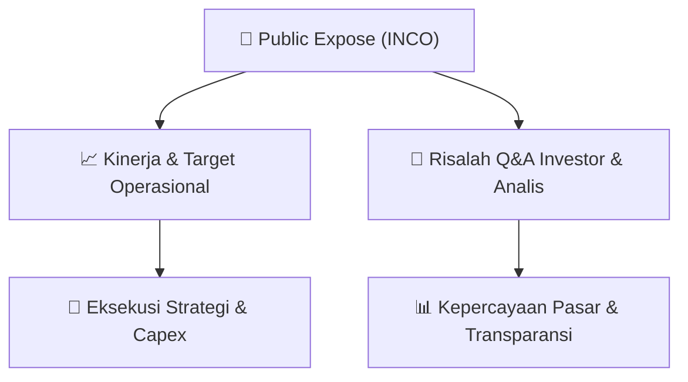

# 📢 Laporan Intelijen Paparan Publik (Public Expose) - [[INCO]]
🏢 **Emiten**: `[[INCO]]` | 📅 **Tanggal Pelaksanaan**: `2026-08-27` | 📑 **Dokumen**: `Public Expose`
⬅️ [[knowledge-base/daily-digests/Daily_Digest_20260827|Kembali ke Daily Digest]] | 🎛️ [[Dashboard|Ke Dashboard Utama]]

---

## 📌 1. Ringkasan Eksekutif & Paparan Direksi
> [!NOTE]
> Dokumen ini merupakan pengumuman resmi dari Vale Indonesia Tbk (INCO) mengenai rencana penyelenggaraan Public Expose Tahunan untuk Tahun Buku 2026. Acara akan diselenggarakan pada 10 September 2026 pukul 11:00 melalui platform Public Expose Live 2026 di website idx.co.id. Agenda acara meliputi: Laporan Kinerja Triwulan II Tahun 2026, Proyek Pertumbuhan, dan Strategi Usaha Perseroan. Pengumuman disampaikan oleh Corporate Secretary Ranty Astari Rachman pada 27 Agustus 2026.

#### 🎯 Guidance Operasional & Target Strategis
- Belum ada rincian target kinerja, ekspansi, atau capex yang diungkapkan dalam dokumen ini. Namun, agenda public expose mengindikasikan akan dibahas laporan kinerja kuartal II 2026, proyek pertumbuhan, dan strategi usaha, yang berpotensi menjadi katalis informasi bagi investor.

## 📊 2. Matriks Indikator Operasional & Parameter Kunci
| Parameter Utama | Nilai / Keterangan Resmi |
| :--- | :--- |
| **Nama Perusahaan** | `Vale Indonesia Tbk` |
| **Kode Emiten** | `INCO` |
| **Nomor Surat** | `01661/IR-J/VIII/2026` |
| **Perihal** | `Rencana Penyelenggaraan Public Expose Tahunan` |
| **Tanggal Public Expose** | `10 September 2026` |
| **Waktu** | `11:00` |
| **Tempat** | `Public Expose Live 2026 (website idx.co.id)` |
| **Agenda** | `Laporan Kinerja Triwulan II Tahun 2026, Proyek Pertumbuhan, Strategi Usaha Perseroan` |
| **Corporate Secretary** | `Ranty Astari Rachman` |
| **Tanggal Pengumuman** | `27 Agustus 2026` |

---

## 💬 3. Risalah Tanya Jawab (Q&A Session)
`Materi presentasi Public Expose / Risalah Q&A terlampir dalam dokumen resmi bursa.`

## 📌 4. Peta Jalur Strategis & Roadmap

---

## 🔗 Knowledge Graph
- [[knowledge-base/daily-digests/Daily_Digest_20260827|📄 Daily Digest 2026-08-27]]
- [[knowledge-base/calendars/Action_Calendar|🗓️ Kalender Terpusat Aksi Korporasi]]
- [[Dashboard|🎛️ Kembali ke Dashboard Utama]]