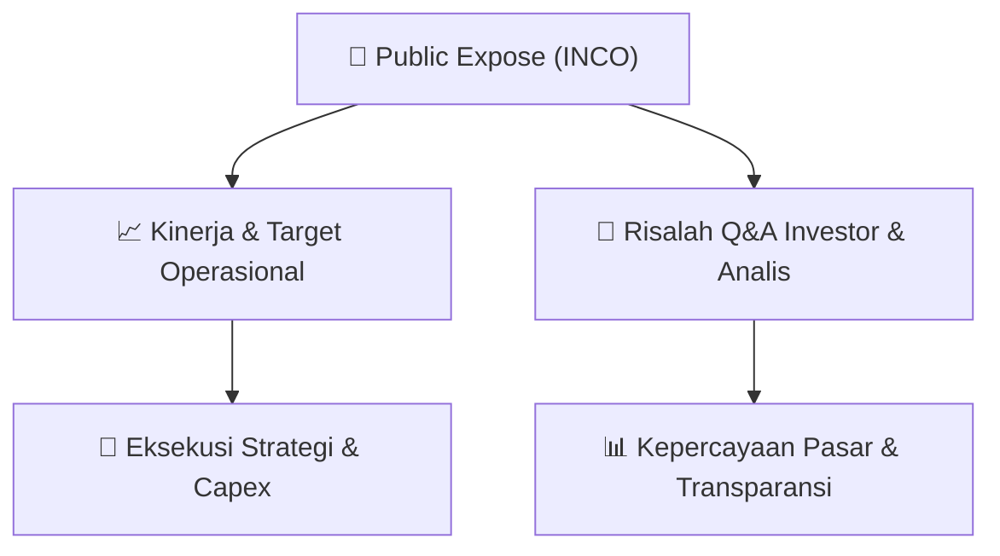

# 📢 Laporan Intelijen Paparan Publik (Public Expose) - [[INCO]]
🏢 **Emiten**: `[[INCO]]` | 📅 **Tanggal Pelaksanaan**: `2026-09-15` | 📑 **Dokumen**: `Public Expose`
⬅️ [[knowledge-base/daily-digests/Daily_Digest_20260915|Kembali ke Daily Digest]] | 🎛️ [[Dashboard|Ke Dashboard Utama]]

---

## 📌 1. Ringkasan Eksekutif & Paparan Direksi
> [!NOTE]
> Vale Indonesia Tbk (INCO) menyelenggarakan Public Expose Tahunan pada 07 September 2026, dengan laporan hasil disampaikan pada 15 September 2026. Acara dihadiri oleh 193 peserta (tidak termasuk manajemen dan karyawan). Paparan ini merupakan agenda tahunan perusahaan untuk mengkomunikasikan kinerja, strategi, dan rencana ke depan kepada investor dan pemangku kepentingan. Dokumen yang tersedia hanya memuat informasi administratif penyelenggaraan acara, tanpa detail materi paparan atau sesi tanya jawab yang disertakan dalam lampiran terpisah.

#### 🎯 Guidance Operasional & Target Strategis
- Dokumen yang tersedia tidak memuat rincian target kinerja, ekspansi, atau capex secara eksplisit. Namun, sebagai perusahaan tambang nikel terintegrasi yang berfokus pada hilirisasi dan transisi energi, Vale Indonesia diperkirakan membahas progres proyek-proyek strategis seperti smelter (termasuk proyek Pomalaa dan Bahodopi), komitmen terhadap praktik ESG, serta target produksi nikel dalam paparan tersebut. Detail lengkap guidance operasional dan finansial hanya tersedia pada lampiran dokumen yang tidak disertakan dalam teks ini.

## 📊 2. Matriks Indikator Operasional & Parameter Kunci
| Parameter Utama | Nilai / Keterangan Resmi |
| :--- | :--- |
| **Tanggal Penyelenggaraan Public Expose** | `07 September 2026` |
| **Tanggal Penyampaian Laporan Hasil** | `15 September 2026` |
| **Jumlah Peserta Hadir** | `193 orang (tidak termasuk manajemen dan karyawan)` |
| **Nomor Surat Pengantar Materi** | `01752/IR-J/IX/2026` |
| **Nomor Surat Penyampaian Hasil** | `01854/IR-J/IX/2026` |
| **Nama Corporate Secretary** | `Ranty Astari Rachman` |

---

## 💬 3. Risalah Tanya Jawab (Q&A Session)
### ❓ Pertanyaan 1 (Tidak tersedia dalam dokumen)
**Pertanyaan**: Dokumen yang diterima hanya berisi informasi administratif penyampaian hasil Public Expose. Rincian sesi tanya jawab antara manajemen dengan investor/analis tidak tercantum dalam teks yang diberikan.

**Jawaban Manajemen**: Tidak tersedia dalam dokumen

> [!TIP]
> **Implikasi Bagi Investor**: Investor perlu merujuk pada lampiran dokumen 'Penyampaian Hasil Pubex 2026.pdf' yang dirujuk dalam surat untuk mendapatkan detail lengkap Q&A dan materi paparan.

## 📌 4. Peta Jalur Strategis & Roadmap

---

## 🔗 Knowledge Graph
- [[knowledge-base/daily-digests/Daily_Digest_20260915|📄 Daily Digest 2026-09-15]]
- [[knowledge-base/calendars/Action_Calendar|🗓️ Kalender Terpusat Aksi Korporasi]]
- [[Dashboard|🎛️ Kembali ke Dashboard Utama]]