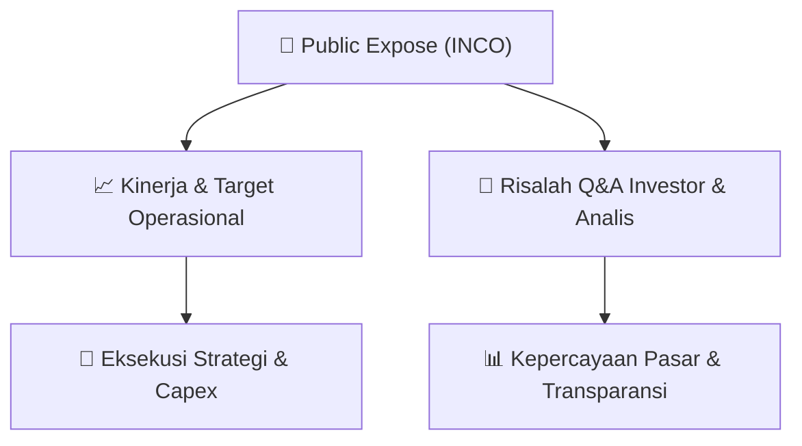

# 📢 Laporan Intelijen Paparan Publik (Public Expose) - [[INCO]]
🏢 **Emiten**: `[[INCO]]` | 📅 **Tanggal Pelaksanaan**: `2026-09-16` | 📑 **Dokumen**: `Public Expose`
⬅️ [[knowledge-base/daily-digests/Daily_Digest_20260916|Kembali ke Daily Digest]] | 🎛️ [[Dashboard|Ke Dashboard Utama]]

---

## 📌 1. Ringkasan Eksekutif & Paparan Direksi
> [!NOTE]
> Vale Indonesia Tbk (INCO) menyelenggarakan Public Expose Tahunan pada 07 September 2026, dengan laporan hasil disampaikan melalui surat nomor 01855/IR-J/IX/2026 tanggal 16 September 2026. Acara ini dihadiri oleh 193 peserta (tidak termasuk manajemen dan karyawan). Paparan ini merupakan bagian dari kepatuhan regulasi BEI dan menjadi sarana bagi manajemen untuk menyampaikan kinerja, strategi, serta menjawab pertanyaan investor dan analis. Dokumen ini adalah laporan resmi yang dikoreksi dari surat sebelumnya (01854/IR-J/IX/2026) dan disampaikan oleh Corporate Secretary, Ranty Astari Rachman.

#### 🎯 Guidance Operasional & Target Strategis
- Dokumen laporan hasil public expose ini tidak memuat rincian spesifik mengenai target kinerja, capex, atau ekspansi. Namun, sebagai emiten nikel terintegrasi di Indonesia, fokus utama Vale Indonesia (INCO) tetap pada operasional tambang nikel, pengolahan (smelter), serta komitmen terhadap proyek-proyek hilirisasi dan transisi energi. Investor diharapkan memantau pengumuman resmi selanjutnya untuk mendapatkan guidance kuantitatif terbaru mengenai produksi, biaya, dan belanja modal.

## 📊 2. Matriks Indikator Operasional & Parameter Kunci
| Parameter Utama | Nilai / Keterangan Resmi |
| :--- | :--- |
| **Tanggal Penyelenggaraan Public Expose** | `07 September 2026` |
| **Jumlah Peserta Hadir** | `193 orang (tidak termasuk manajemen dan karyawan)` |
| **Nomor Surat Laporan Hasil** | `01855/IR-J/IX/2026` |
| **Tanggal Laporan Hasil** | `16 September 2026` |
| **Jabatan Penandatangan** | `Corporate Secretary (Ranty Astari Rachman)` |

---

## 💬 3. Risalah Tanya Jawab (Q&A Session)
### ❓ Pertanyaan 1 (Tidak tersedia dalam dokumen)
**Pertanyaan**: Dokumen ini hanya merupakan laporan administratif penyampaian hasil public expose dan tidak menyertakan detail sesi tanya jawab.

**Jawaban Manajemen**: Manajemen tidak memberikan jawaban spesifik dalam lampiran ini karena dokumen hanya berisi konfirmasi penyampaian laporan.

> [!TIP]
> **Implikasi Bagi Investor**: Investor perlu merujuk pada materi paparan publik (lampiran terpisah) untuk mendapatkan detail Q&A dan strategi manajemen.

## 📌 4. Peta Jalur Strategis & Roadmap

---

## 🔗 Knowledge Graph
- [[knowledge-base/daily-digests/Daily_Digest_20260916|📄 Daily Digest 2026-09-16]]
- [[knowledge-base/calendars/Action_Calendar|🗓️ Kalender Terpusat Aksi Korporasi]]
- [[Dashboard|🎛️ Kembali ke Dashboard Utama]]