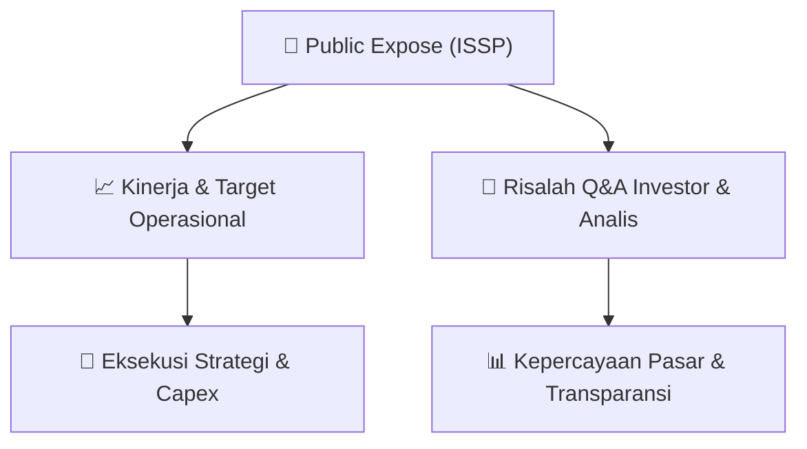

# 📢 Laporan Intelijen Paparan Publik (Public Expose) - [[ISSP]]
🏢 **Emiten**: `[[ISSP]]` | 📅 **Tanggal Pelaksanaan**: `2026-09-02` | 📑 **Dokumen**: `Public Expose`
⬅️ [[knowledge-base/daily-digests/Daily_Digest_20260902|Kembali ke Daily Digest]] | 🎛️ [[Dashboard|Ke Dashboard Utama]]

---

## 📌 1. Ringkasan Eksekutif & Paparan Direksi
> [!NOTE]
> Dokumen yang diberikan adalah surat pengantar resmi dari PT Steel Pipe Industry of Indonesia Tbk (ISSP) perihal penyampaian materi Public Expose Tahunan. Surat ini hanya berisi informasi administratif seperti nomor surat, tanggal, nama pengirim, dan lampiran. Tidak terdapat isi materi paparan publik, data kinerja, atau informasi operasional emiten di dalam teks yang disediakan.

#### 🎯 Guidance Operasional & Target Strategis
- Tidak ada informasi mengenai target kinerja, ekspansi, capex, atau guidance operasional karena materi Public Expose yang sebenarnya tidak disertakan dalam teks. Dokumen hanya menyebutkan bahwa materi Public Expose telah disampaikan sebagai lampiran.

## 💬 3. Risalah Tanya Jawab (Q&A Session)
`Materi presentasi Public Expose / Risalah Q&A terlampir dalam dokumen resmi bursa.`

## 📌 4. Peta Jalur Strategis & Roadmap

---

## 🔗 Knowledge Graph
- [[knowledge-base/daily-digests/Daily_Digest_20260902|📄 Daily Digest 2026-09-02]]
- [[knowledge-base/calendars/Action_Calendar|🗓️ Kalender Terpusat Aksi Korporasi]]
- [[Dashboard|🎛️ Kembali ke Dashboard Utama]]