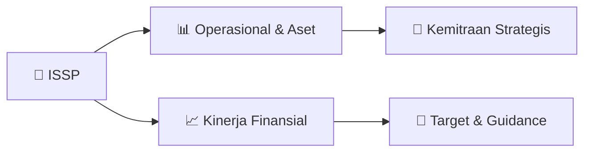

# 📊 Materi Public Expose: [ISSP]

🏢 **Emiten**: `ISSP` | 📅 **Tanggal Pelaksanaan**: `2026-09-02` | 📑 **Total Slide**: `43 Slide`
⬅️ [[knowledge-base/daily-digests/ISSP_20260902|Kembali ke Daily Digest]] | 🎛️ [[Dashboard/ISSP|Ke Dashboard Emiten]]

> [!NOTE]
> Ringkasan materi presentasi resmi Public Expose ISSP yang disampaikan oleh manajemen kepada investor dan bursa. Seluruh poin strategis, matriks operasional, dan angka kinerja diekstrak langsung dari slide deck resmi.

---

## 📅 1. Jadwal & Metadata Penyelenggaraan

| Parameter | Detail Informasi |
|---|---|
| **Nomor Surat Pengantar** | - |
| **Perihal Pengumuman** | Pemberitahuan Materi Public Expose Tahunan 2026 |
| **Waktu Pelaksanaan** | 2026-09-02  |
| **Lokasi / Media** | Aplikasi Zoom / Daring |
| **Lampiran Resmi** | `Materi Presentasi Slide Deck` |

## 📋 2. Agenda Paparan Publik

- Pemaparan Profil & Struktur Bisnis Perseroan
- Kinerja Operasional & Keuangan
- Arah Strategi Usaha & Target Pertumbuhan
- Sesi Tanya Jawab (Q&A)

## 🏢 3. Profil & Pilar Portofolio Bisnis

## 🏗️ 4. Kinerja Operasional & Portofolio Aset

> Educational Background
Bachelor of Economics from Airlangga University, Surabaya in 1984
Attended a professional business course by Arthur Andersen in St. Charles,
Chicago, USA and became a member of The Indonesian Institute of Accountants.
Professional Experience
Officiate as Member of Audit Committee in PT Steel Pipe Industry of Indonesia
Tbk (2012 – 2022)
Independent Commissioner in PT SekarLaut Tbk 2007 – 2019
Managing Partner (Surabaya Office) of Ernst & Young, Hanadi, Sarwoko &
Sandjaja (2002 – 2006)
Makmur Widjaja President Commissioner (Independent Commissioner) Welly Tantono Independent Commissioner
Entario Widjaja Susanto
Commissioner
Bing H. Poernomosidi
Independent Commissioner Educational Background
Bachelor of Mechanical Engineering fromi University of
Massachusetts, USA in
1996 Professional Experience
1997 – 1998
: MEP Program Mattel Indonesia
1998 – 1999
: System Engineer Ericsson Indonesia
1999 – 2000
: Trader for Myanmar and Singapore Market at Itochu Steel Asia
2000 – 2005
: Marketing Manager PT Saranacentral Bajatama Tbk
2005 – Sekarang
: Director PT Saranacentral Bajatama Tbk
Educational Background
He completed his education at the Faculty of Economics, Parahya

> Logistik
• Proyek Laut Kilo 2026
• Proyek Lanjutan Peningkatan Fasilitas Pelabuhan Laut
Matui
• Proyek Peningkatan Fasilitas Pelabuhan Laut Lampia
• Proyek Pelabuhan Saketa
• Proyek Replacement Fasilitas Pelabuhan Laut Tahuna
• Proyek Pembangunan Dermaga Alternatif Pel. Tanjung
Uban, Pembangunan Dolphin Telaga Punggur dan Tanjung
Uban, Pembangunan Dermaga II Pel. Tanjung Kalian
• Proyek Replacement Fasilitas Pelabuhan Laut Agats
• Proyek Replacement Fasilitas Pelabuhan Laut Boepinang
• Proyek Jetty Malili
• EPC Perpanjangan Dermaga 2, Pembangunan BSL 3 dan
Sistem Konveyor PT PKT Bontang
• Proyek Pembangunan Dermaga Babo, Teluk Bintuni,
Papua Barat
• Proyek Pembangunan Jalan Angkut Tambang
• Proyek Jembatan Pulau Laut Kabupaten Kotabaru, Kal-Sel
(Tahun Jamak)
• Proyek Dermaga Sapudi 2026 (Tambahan)
• Proyek Pembangunan Pelabuhan Penyeberangan Bakit,
Bangka Belitung (2026)
• Proyek Pembangunan Pelabuhan Penyeberangan Belinyu,
Bangka Belitung (2026)
• Pekerjaan Jetty Multipurpose Wanam Merauke (Tambahan)
• Proyek Peninggian Lantai Dermaga Samudera KADE 0-
275 Pelabuhan Tanjung Emas
• Proyek Dermaga di Malinau, Kalimantan Utara
Infrastructure
• Proyek Construction of KSCS Package 2
• P

## 📈 5. Kinerja Keuangan & Posisi Finansial

### 🧮 Rasio Keuangan Utama
```text
1.7%
6.0%
5.0%
12.9% 7.4% 10.8% 10.5% 9.4% 8.3% 0.8%
2.9%
2.8%
6.9%
4.1%
6.2% 6.4% 6.1%
4.6%
2018 2019 2020 2021 2022 2023 2024 2025 1H2026 ROE ROA 0.7%
1.9%
3.3%
2.3%
5.30%
5.97%
5.20%
2017 2021 2022 2023 2024 1H2025 1H2026 1616
ROE & ROA
Dividend Yield 2017 2018 2019 2020 2021 2022 2023 2024 2025 1H2026 EPS (Rp/Share)
1.2
6.9 26.3 24.9 68.9 43.3 70.5 75.0
Both Return on Equity (ROE) and Return on Assets (ROA) have shown a positive trend since 2023, reflecting improved profitability and
more efficient use of capital. While there is some normalization in 1H2026 due to increase in total assets, it is still in line with the
Company’s medium-term targets. The Company continues to target ROE of around 14% and ROA of approximately 10%, supported by
operational improvements and a better product mix.
In addition, the Company maintains a consistent dividend distribution policy. The most recent dividend distribution delivered a yield of
approximately 5.2%, demonstrating the Company’s commitment
```

## 🧭 6. Inisiatif Strategis, Kolaborasi, & Kemitraan

*Strategi usaha difokuskan pada penguatan fundamental dan ekspansi operasional.*

## 🎯 7. Target Pertumbuhan & Guidance Manajemen

*Target pertumbuhan ditetapkan mengacu pada prospek industri dan kondisi makroekonomi terkini.*

## 🗺️ 8. Peta Jalur Strategis & Eksekusi



## 📑 9. Daftar Indeks Slide Presentasi

| Slide # | Judul / Topik Slide | Ringkasan Konten |
|---|---|---|
| Slide 1 | **PT Steel Pipe Industry of Indonesia Tbk** | Company Presentation For Public Expose |
| Slide 2 | **Materi dalam presentasi ini telah disiapkan oleh PT Steel Pipe Industry Indonesia Tbk (“Spindo”) dan merupakan informasi bersifat umum** | tentang kinerja bisnis Spindo terkini pada tanggal presentasi dan dapat berubah tanpa pemberitahuan sebelumnya. Informasi ini diberikan dalam bentuk r |
| Slide 3 | **1** |  |
| Slide 4 | **4 Established in 1971 as a foreign investment corporation by PT Gayantara, Itochu Corporation, and Kawasaki** | Established in 1971 as a foreign investment corporation by PT Gayantara, Itochu Corporation, and Kawasaki Steel Corporation Jakarta |
| Slide 5 | **Educational Background** | Bachelor of Economics from Airlangga University, Surabaya in 1984 Attended a professional business course by Arthur Andersen in St. Charles, Chicago,  |
| Slide 6 | **Ibnu Susanto** | President Director Tedja Sukmana Hudianto |
| Slide 7 | **• ESG Disclosure Award 2022, Majalah Investor** | ESG Disclosure Award 2022, Majalah Investor • Best Stock 2022 Mid Cap Category, Majalah Investor |
| Slide 8 | **Carbon and** | stainless-steel coils Spindo’s Position in the Value Chain |
| Slide 9 | **More than 5,000** | Customers Registered 2,000 – 3,000 Active Customers |
| Slide 10 | **Annual average – company estimates** | SPINDO demonstrates a well-balanced customer sector exposure, ensuring |
| Slide 11 | **Note :** | Figure in Table 1 is obtained from respective companies Annual Report as of 14/05/2025  KRAS.IJ have not submitted their annual report (delayed) Compa |
| Slide 12 | **2** |  |
| Slide 13 | **13 Revenue and Margin 2018 – 1H2026** | Revenue and Margin 2018 – 1H2026 (in Billion Rupiah) in Billion Rupiah |
| Slide 14 | **15 Higher working capital requirements** | Higher working capital requirements Net cash used in operating activities stood at Rp1.10 trillion, primarily reflecting increased inventory and payme |
| Slide 15 | **1.7% 6.0%** | 6.0% 5.0% 12.9% |
| Slide 16 | **Jan Feb** | Feb Mar Jul |
| Slide 17 | **0.96%** | 1.27% 1.27% 3.77% |
| Slide 18 | **4.8%1.8%** | 13.7% 44.8% 7.6% |
| Slide 19 | **3** |  |
| Slide 20 | **Spindo is targeting to reach 1 T Net profit by 2027** | NEW MAJOR PRODUCT LINE 2025 |
| Slide 21 | **Phase 1: North Distribution Centre (Warehouse) – Completed 2024** | Construction of new 1 Ha Warehouse, to be functioned as distribution centre with significantly better layout to substantially reduce loading time and  |
| Slide 22 | **• Capture High-Growth Segments** | Capture High-Growth Segments Indonesia’s oil & gas, energy transition, and infrastructure projects are driving demand for API- grade and premium steel |
| Slide 23 | **Government policies strongly favor local capacity expansion like Unit 7. The Omnibus Law accelerates strategic** | projects and land clearance, while mandatory domestic gas allocation ensures steady pipeline development for power and industrial needs. Downstream re |
| Slide 29 | **Indonesia’s** | pipeline-heavy National Strategic |
| Slide 30 | **• The Ministry of Energy and Mineral Resources (ESDM) plans to expand the** | Cirebon-Semarang (CISEM) gas transmission pipeline to Bandung and Yogyakarta. • The project, valued at Rp1.7 trillion, will be divided into the Cirebo |
| Slide 31 | **Recent gas discoveries across Indonesia add significant long-term momentum to pipeline demand, directly reinforcing the rationale** | for Unit 7. World-class projects like Abadi LNG (Masela Block) and Andaman Block II will require hundreds of kilometers of subsea and onshore transmis |
| Slide 32 | **4** |  |
| Slide 33 | **Iron ore price decreased significantly on early June** | Source: Trading Economics Coaking coal price surged on mid-August Source: Trading Economics |
| Slide 34 | **5** |  |
| Slide 35 | **Accumulated Cost Saving for 25 Years** | IDR 8-25 Billion Accumulated CO2 Reduction in 25 Years |
| Slide 36 | **The installation of Solar PV panels at Plants 1,** | 2, 3, and 5 was successfully completed in July to October 2024. The total installed capacities are 651.75 kWp for Plant 1, 759 kWp for Plant |
| Slide 37 | **CSR Program by SPINDO that supports** | SDG 6: Clean Water and Sanitation  Conducted three times in three villages on the |
| Slide 38 | **6** |  |
| Slide 39 | **While** | SPINDO's financial projections |
| Slide 40 | **7** |  |
| Slide 41 | **Logistik** | • Proyek Laut Kilo 2026 • Proyek Lanjutan Peningkatan Fasilitas Pelabuhan Laut Matui |
| Slide 42 | **“SPINDO’s strategic roadmap focuses on sustainable growth by balancing sector diversification,** | operational excellence, and strategic partnerships, ensuring resilience and profitability in Indonesia’s evolving steel market landscape.” |
| Slide 43 | **facebook.com/spindosteelpipe** | @spindosteelpipe linkedin.com/company/spindo youtube.com/c/spindosteelpipe |

---

*Dokumen diolah otomatis oleh **Swarm Intelijen Pasar Modal Indonesia** pada 2026-10-12 16:45 WIB.*