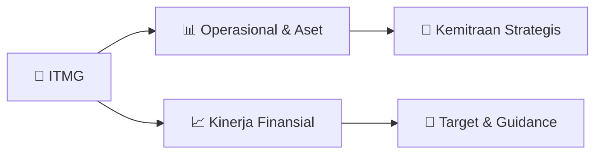

# 📊 Materi Public Expose: [ITMG]

🏢 **Emiten**: `ITMG` | 📅 **Tanggal Pelaksanaan**: `2026-08-27` | 📑 **Total Slide**: `2 Slide`
⬅️ [[knowledge-base/daily-digests/ITMG_20260827|Kembali ke Daily Digest]] | 🎛️ [[Dashboard/ITMG|Ke Dashboard Emiten]]

> [!NOTE]
> Ringkasan materi presentasi resmi Public Expose ITMG yang disampaikan oleh manajemen kepada investor dan bursa. Seluruh poin strategis, matriks operasional, dan angka kinerja diekstrak langsung dari slide deck resmi.

---

## 📅 1. Jadwal & Metadata Penyelenggaraan

| Parameter | Detail Informasi |
|---|---|
| **Nomor Surat Pengantar** | 2705/L/ITM/CorSec/8/2026 |
| **Perihal Pengumuman** | Rencana Penyelenggaraan Public Expose Tahunan |
| **Waktu Pelaksanaan** | 09 September 2026 09:00 |
| **Lokasi / Media** | Public Expose Live 2026 yang tercantum pada website idx.co.id |
| **Lampiran Resmi** | `0` |

## 📋 2. Agenda Paparan Publik

1. Nama Perusahaan
2. Kode Emiten
3. Lampiran
4. Perihal
5. 2705/L/ITM/CorSec/8/2026
6. Indo Tambangraya Megah Tbk
7. Rencana Penyelenggaraan Public Expose Tahunan
8. Go To English Page
9. Perseroan melaporkan rencana Public Expose Tahunan sebagai berikut:
10. Rencana Penyelenggaraan Public Expose
11. Tahun Buku yang Berakhir pada
12. Tempat
13. : Public Expose Live 2026 yang tercantum pada website idx.co.id
14. Hari/Tanggal
15. : 09 September 2026
16. Waktu
17. 09:00
18. Agenda
19. : 1. Laporan Kinerja Kuartal I Tahun 2026
20. 2. Prospek dan Strategi Usaha
21. 3. Lain lain
22. Hormat Kami,
23. Demikian untuk diketahui.
24. Pondok Indah Office Tower III, 3rd Floor
25. Corporate Secretary
26. Nama Pengirim
27. Telepon : 021 - 2932 8100, Fax : 021 - 2932 7999, -
28. Indo Tambangraya Megah Tbk
29. Monika Ida Krisnamurti
30. Indo Tambangraya Megah Tbk
31. Monika Ida Krisnamurti
32. Jabatan
33. Corporate Secretary
34. Tanggal dan Waktu
35. 27-08-2026 09:16
36. Dokumen ini merupakan dokumen resmi Indo Tambangraya Megah Tbk yang tidak memerlukan tanda tangan
37. karena dihasilkan secara elektronik oleh sistem pelaporan elektronik. Indo Tambangraya Megah Tbk bertanggung
38. jawab penuh atas informasi yang tertera didalam dokumen ini.
39. Issuer Name
40. Issuer Code
41. Attachment
42. Subject
43. 2705/L/ITM/CorSec/8/2026
44. Indo Tambangraya Megah Tbk
45. General Announcement Public Expose
46. Go To Indonesian Page
47. Company announces public expose plan Annual as follows:
48. Public Expose Announcement
49. Fiscal Year
50. Place
51. : Public Expose Live 2026 yang tercantum pada website idx.co.id
52. : 09 September 2026
53. 09:00
54. Agenda
55. : 1. First Quater 2026 Performance Report
56. 2. Business strategy and outlook
57. 3. Others
58. Respectfully,
59. Thus to be informed accordingly.
60. Indo Tambangraya Megah Tbk
61. Monika Ida Krisnamurti
62. Corporate Secretary
63. Monika Ida Krisnamurti
64. Sender Name
65. Indo Tambangraya Megah Tbk
66. Pondok Indah Office Tower III, 3rd Floor
67. Phone : 021 - 2932 8100, Fax : 021 - 2932 7999, -
68. Corporate Secretary
69. Function
70. Date and Time
71. 27-08-2026 09:16
72. This is an official document of Indo Tambangraya Megah Tbk that does not require a signature as it was generated
73. electronically by the electronic reporting system. Indo Tambangraya Megah Tbk is fully responsible for the

## 🏢 3. Profil & Pilar Portofolio Bisnis

## 🏗️ 4. Kinerja Operasional & Portofolio Aset

*Detail aset operasional terlampir pada dokumen slide resmi.*

## 📈 5. Kinerja Keuangan & Posisi Finansial

## 🧭 6. Inisiatif Strategis, Kolaborasi, & Kemitraan

*Strategi usaha difokuskan pada penguatan fundamental dan ekspansi operasional.*

## 🎯 7. Target Pertumbuhan & Guidance Manajemen

*Target pertumbuhan ditetapkan mengacu pada prospek industri dan kondisi makroekonomi terkini.*

## 🗺️ 8. Peta Jalur Strategis & Eksekusi

## 📑 9. Daftar Indeks Slide Presentasi

| Slide # | Judul / Topik Slide | Ringkasan Konten |
|---|---|---|
| Slide 1 | **Nomor Surat** | Nama Perusahaan Kode Emiten Lampiran |
| Slide 2 | **Letter / Announcement No.** | Issuer Name Issuer Code Attachment |

---

*Dokumen diolah otomatis oleh **Swarm Intelijen Pasar Modal Indonesia** pada 2026-10-12 16:45 WIB.*