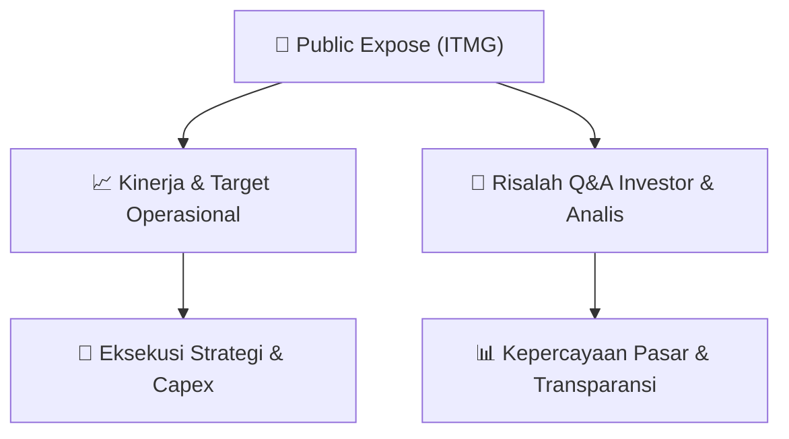

# 📢 Laporan Intelijen Paparan Publik (Public Expose) - [[ITMG]]
🏢 **Emiten**: `[[ITMG]]` | 📅 **Tanggal Pelaksanaan**: `2026-08-27` | 📑 **Dokumen**: `Public Expose`
⬅️ [[knowledge-base/daily-digests/Daily_Digest_20260827|Kembali ke Daily Digest]] | 🎛️ [[Dashboard|Ke Dashboard Utama]]

---

## 📌 1. Ringkasan Eksekutif & Paparan Direksi
> [!NOTE]
> Indo Tambangraya Megah Tbk (ITMG) menyampaikan pengumuman resmi rencana penyelenggaraan Public Expose Tahunan untuk tahun buku 2026. Acara akan dilaksanakan pada 09 September 2026 pukul 09:00 melalui platform Public Expose Live 2026 yang tercantum pada website idx.co.id. Agenda utama meliputi Laporan Kinerja Kuartal I Tahun 2026, Prospek dan Strategi Usaha, serta lain-lain. Pengumuman disampaikan oleh Corporate Secretary Monika Ida Krisnamurti melalui surat elektronik resmi bernomor 2705/L/ITM/CorSec/8/2026 tertanggal 27 Agustus 2026.

#### 🎯 Guidance Operasional & Target Strategis
- Dokumen ini hanya merupakan pengumuman rencana Public Expose dan belum memuat guidance numerik atau target kinerja spesifik. Katalis potensial akan muncul pada saat pelaksanaan Public Expose 9 September 2026, terutama dari pemaparan Laporan Kinerja Kuartal I 2026 serta Prospek dan Strategi Usaha perseroan.

## 📊 2. Matriks Indikator Operasional & Parameter Kunci
| Parameter Utama | Nilai / Keterangan Resmi |
| :--- | :--- |
| **Nama Perusahaan** | `Indo Tambangraya Megah Tbk` |
| **Kode Emiten** | `ITMG` |
| **Nomor Surat** | `2705/L/ITM/CorSec/8/2026` |
| **Perihal** | `Rencana Penyelenggaraan Public Expose Tahunan` |
| **Tahun Buku** | `2026` |
| **Tanggal Public Expose** | `09 September 2026` |
| **Waktu** | `09:00` |
| **Tempat** | `Public Expose Live 2026 yang tercantum pada website idx.co.id` |
| **Agenda** | `1. Laporan Kinerja Kuartal I Tahun 2026; 2. Prospek dan Strategi Usaha; 3. Lain-lain` |
| **Corporate Secretary** | `Monika Ida Krisnamurti` |
| **Tanggal dan Waktu Pengumuman** | `27-08-2026 09:16` |

---

## 💬 3. Risalah Tanya Jawab (Q&A Session)
`Materi presentasi Public Expose / Risalah Q&A terlampir dalam dokumen resmi bursa.`

## 📌 4. Peta Jalur Strategis & Roadmap

---

## 🔗 Knowledge Graph
- [[knowledge-base/daily-digests/Daily_Digest_20260827|📄 Daily Digest 2026-08-27]]
- [[knowledge-base/calendars/Action_Calendar|🗓️ Kalender Terpusat Aksi Korporasi]]
- [[Dashboard|🎛️ Kembali ke Dashboard Utama]]