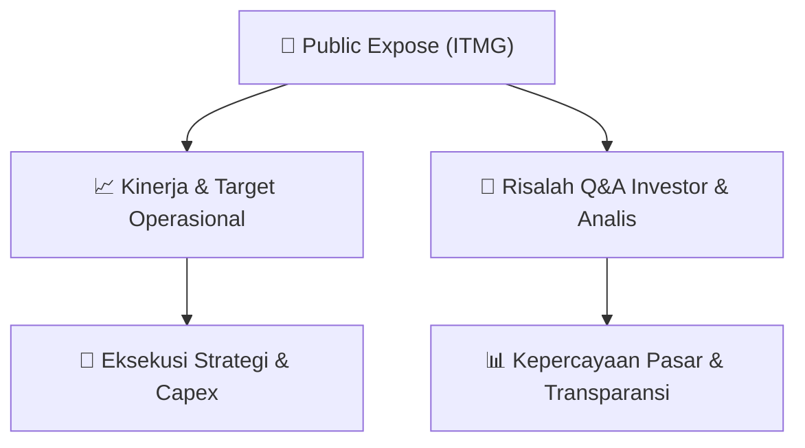

# 📢 Laporan Intelijen Paparan Publik (Public Expose) - [[ITMG]]
🏢 **Emiten**: `[[ITMG]]` | 📅 **Tanggal Pelaksanaan**: `2026-09-14` | 📑 **Dokumen**: `Public Expose`
⬅️ [[knowledge-base/daily-digests/Daily_Digest_20260914|Kembali ke Daily Digest]] | 🎛️ [[Dashboard|Ke Dashboard Utama]]

---

## 📌 1. Ringkasan Eksekutif & Paparan Direksi
> [!NOTE]
> Indo Tambangraya Megah Tbk (ITMG) menyelenggarakan Public Expose Tahunan pada 04 September 2026, dengan laporan hasil disampaikan pada 14 September 2026. Acara dihadiri oleh 195 peserta (tidak termasuk manajemen dan karyawan). Paparan ini merupakan agenda tahunan untuk mengkomunikasikan kinerja, strategi, dan rencana perusahaan kepada investor dan pemangku kepentingan. Dokumen yang tersedia hanya memuat informasi administratif penyelenggaraan acara, sementara detail materi paparan dan sesi tanya jawab tidak disertakan dalam lampiran yang diberikan.

#### 🎯 Guidance Operasional & Target Strategis
- Tidak tersedia dalam dokumen yang diberikan. Dokumen hanya berisi informasi administratif penyelenggaraan Public Expose, tanpa rincian target kinerja, ekspansi, atau capex. Untuk mendapatkan informasi tersebut, diperlukan akses ke materi paparan lengkap atau risalah rapat yang tidak dilampirkan.

## 📊 2. Matriks Indikator Operasional & Parameter Kunci
| Parameter Utama | Nilai / Keterangan Resmi |
| :--- | :--- |
| **Tanggal Penyelenggaraan Public Expose** | `04 September 2026` |
| **Tanggal Pelaporan Hasil Public Expose** | `14 September 2026` |
| **Jumlah Peserta Hadir** | `195 orang (tidak termasuk manajemen dan karyawan)` |
| **Nomor Surat Pengantar Materi** | `2811/L/ITM/CorSec/9/2026` |
| **Nomor Surat Laporan Hasil** | `2900/L/ITM/CorSec/9/2026` |
| **Jabatan Penandatangan** | `Corporate Secretary (Monika Ida Krisnamurti)` |

---

## 💬 3. Risalah Tanya Jawab (Q&A Session)
`Materi presentasi Public Expose / Risalah Q&A terlampir dalam dokumen resmi bursa.`

## 📌 4. Peta Jalur Strategis & Roadmap

---

## 🔗 Knowledge Graph
- [[knowledge-base/daily-digests/Daily_Digest_20260914|📄 Daily Digest 2026-09-14]]
- [[knowledge-base/calendars/Action_Calendar|🗓️ Kalender Terpusat Aksi Korporasi]]
- [[Dashboard|🎛️ Kembali ke Dashboard Utama]]