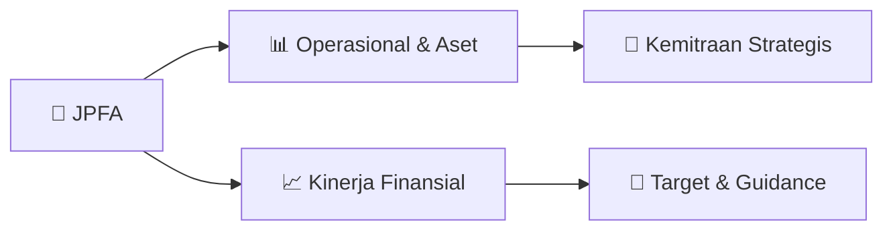

# 📊 Materi Public Expose: [JPFA]

🏢 **Emiten**: `JPFA` | 📅 **Tanggal Pelaksanaan**: `2026-10-08` | 📑 **Total Slide**: `4 Slide`
⬅️ [[knowledge-base/daily-digests/JPFA_20261008|Kembali ke Daily Digest]] | 🎛️ [[Dashboard/JPFA|Ke Dashboard Emiten]]

> [!NOTE]
> Ringkasan materi presentasi resmi Public Expose JPFA yang disampaikan oleh manajemen kepada investor dan bursa. Seluruh poin strategis, matriks operasional, dan angka kinerja diekstrak langsung dari slide deck resmi.

---

## 📅 1. Jadwal & Metadata Penyelenggaraan

| Parameter | Detail Informasi |
|---|---|
| **Nomor Surat Pengantar** | 159/JAPFA-OJK/LD-CS/X/2026 |
| **Perihal Pengumuman** | Rencana Penyelenggaraan Public Expose Tahunan |
| **Waktu Pelaksanaan** | 22 Oktober 2026 10:30 |
| **Lokasi / Media** | Hotel JS Luwansa, Ballroom 2, Lantai 1 |
| **Lampiran Resmi** | `0` |

## 📋 2. Agenda Paparan Publik

1. Nama Perusahaan
2. Kode Emiten
3. Lampiran
4. Perihal
5. 159/JAPFA-OJK/LD-CS/X/2026
6. JAPFA Comfeed Indonesia Tbk
7. Rencana Penyelenggaraan Public Expose Tahunan
8. Go To English Page
9. Perseroan melaporkan rencana Public Expose Tahunan sebagai berikut:
10. Rencana Penyelenggaraan Public Expose
11. Tahun Buku yang Berakhir pada
12. Tempat
13. : Hotel JS Luwansa, Ballroom 2, Lantai 1
14. Jl. HR. Rasuna Said Kav. C No. 22, RT 2 / RW 5, Karet Kuningan,
15. Kecamatan Setiabudi, Jakarta Selatan 12940
16. Hari/Tanggal
17. : 22 Oktober 2026
18. Waktu
19. 10:30
20. Agenda
21. : 1. Pembukaan
22. 2. Paparan Publik
23. 3. Sesi Tanya Jawab
24. 4. Penutup
25. Informasi Lain
26. Manajemen yang direncanakan akan hadir dalam Public Expose tersebut adalah Bpk. Leo Handoko Laksono, selaku
27. Direktur. Pengumuman ini merupakan undangan resmi bagi investor, analis dan pemangku kepentingan Perseroan
28. lainnya.
29. Hormat Kami,
30. Demikian untuk diketahui.
31. Wisma Millenia Lt. 7 Jl. MT Haryono Kav. 16 Jakarta 12810
32. Corporate Secretary
33. Nama Pengirim
34. Telepon : 021-28545680, Fax : 021-8310309, http://www.japfacomfeed.co.id
35. JAPFA Comfeed Indonesia Tbk
36. Maya Pradjono
37. JAPFA Comfeed Indonesia Tbk
38. Maya Pradjono
39. Jabatan
40. Corporate Secretary
41. Tanggal dan Waktu
42. 08-10-2026 16:39
43. Issuer Name
44. Issuer Code
45. Attachment
46. Subject
47. 159/JAPFA-OJK/LD-CS/X/2026
48. JAPFA Comfeed Indonesia Tbk
49. General Announcement Public Expose
50. Go To Indonesian Page
51. Company announces public expose plan Annual as follows:
52. Public Expose Announcement
53. Fiscal Year
54. Place
55. : Hotel JS Luwansa, Ballroom 2, Lantai 1
56. Jl. HR. Rasuna Said Kav. C No. 22, RT 2 / RW 5, Karet Kuningan,
57. Kecamatan Setiabudi, Jakarta Selatan 12940
58. : 22 October 2026
59. 10:30
60. Agenda
61. : 1. Opening
62. 2. Public Expose
63. 3. Q & A Session
64. 4. Closing
65. Other Information:
66. The Management who will attend the Public Expose is Mr. Leo Handoko Laksono, as Director. This announcement is an
67. official invitation to investors, analysts and other stakeholders of the Company.
68. Respectfully,
69. Thus to be informed accordingly.
70. JAPFA Comfeed Indonesia Tbk
71. Maya Pradjono
72. Corporate Secretary
73. Maya Pradjono
74. Sender Name
75. JAPFA Comfeed Indonesia Tbk
76. Wisma Millenia Lt. 7 Jl. MT Haryono Kav. 16 Jakarta 12810
77. Phone : 021-28545680, Fax : 021-8310309, http://www.japfacomfeed.co.id
78. Corporate Secretary
79. Function
80. Date and Time
81. 08-10-2026 16:39

## 🏢 3. Profil & Pilar Portofolio Bisnis

## 🏗️ 4. Kinerja Operasional & Portofolio Aset

*Detail aset operasional terlampir pada dokumen slide resmi.*

## 📈 5. Kinerja Keuangan & Posisi Finansial

## 🧭 6. Inisiatif Strategis, Kolaborasi, & Kemitraan

*Strategi usaha difokuskan pada penguatan fundamental dan ekspansi operasional.*

## 🎯 7. Target Pertumbuhan & Guidance Manajemen

*Target pertumbuhan ditetapkan mengacu pada prospek industri dan kondisi makroekonomi terkini.*

## 🗺️ 8. Peta Jalur Strategis & Eksekusi

## 📑 9. Daftar Indeks Slide Presentasi

| Slide # | Judul / Topik Slide | Ringkasan Konten |
|---|---|---|
| Slide 1 | **Nomor Surat** | Nama Perusahaan Kode Emiten Lampiran |
| Slide 2 | **Dokumen ini merupakan dokumen resmi JAPFA Comfeed Indonesia Tbk yang tidak memerlukan tanda tangan** | karena dihasilkan secara elektronik oleh sistem pelaporan elektronik. JAPFA Comfeed Indonesia Tbk bertanggung jawab penuh atas informasi yang tertera  |
| Slide 3 | **Letter / Announcement No.** | Issuer Name Issuer Code Attachment |
| Slide 4 | **This is an official document of JAPFA Comfeed Indonesia Tbk that does not require a signature as it was generated** | electronically by the electronic reporting system. JAPFA Comfeed Indonesia Tbk is fully responsible for the |

---

*Dokumen diolah otomatis oleh **Swarm Intelijen Pasar Modal Indonesia** pada 2026-10-12 16:45 WIB.*