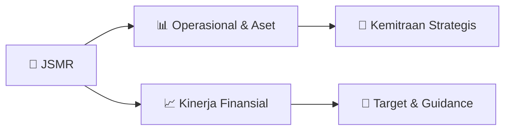

# 📊 Materi Public Expose: [JSMR]

🏢 **Emiten**: `JSMR` | 📅 **Tanggal Pelaksanaan**: `2026-09-04` | 📑 **Total Slide**: `16 Slide`
⬅️ [[knowledge-base/daily-digests/JSMR_20260904|Kembali ke Daily Digest]] | 🎛️ [[Dashboard/JSMR|Ke Dashboard Emiten]]

> [!NOTE]
> Ringkasan materi presentasi resmi Public Expose JSMR yang disampaikan oleh manajemen kepada investor dan bursa. Seluruh poin strategis, matriks operasional, dan angka kinerja diekstrak langsung dari slide deck resmi.

---

## 📅 1. Jadwal & Metadata Penyelenggaraan

| Parameter | Detail Informasi |
|---|---|
| **Nomor Surat Pengantar** | AB.HM.02.04.347 |
| **Perihal Pengumuman** | Penyampaian Materi Public Expose Tahunan |
| **Waktu Pelaksanaan** | 2026-09-04 04-09-2026 10:48 |
| **Lokasi / Media** | Aplikasi Zoom / Daring |
| **Lampiran Resmi** | `2` |

## 📋 2. Agenda Paparan Publik

- Pemaparan Profil & Struktur Bisnis Perseroan
- Kinerja Operasional & Keuangan
- Arah Strategi Usaha & Target Pertumbuhan
- Sesi Tanya Jawab (Q&A)

## 🏢 3. Profil & Pilar Portofolio Bisnis

## 🏗️ 4. Kinerja Operasional & Portofolio Aset

> Dengan menghadiri presentasi ini, Anda setuju untuk terikat dengan batasan yang ditetapkan di bawah ini. Kegagalan untuk
mematuhi pembatasan ini dapat merupakan pelanggaran terhadap undang-undang yang berlaku.
Pemaparan ini memuat pernyataan-pernyataan yang merupakan dan bersifat “pernyataan prospektif” yang terkait dengan kejadian di masa mendatang. Informasi
kejadian di masa depan umumnya mengandung pernyataan dengan kalimat yang diawali atau mengandung makna “antisipasi”, “yakin”, “mengharapkan”,
“merencanakan”, “bermaksud”, “memperkirakan”, “mengusulkan”, atau kata-kata serupa yang mengisyaratkan hasil di masa mendatang atau pernyataan mengenai
suatu pandangan. Setiap pernyataan, selain pernyataan yang bersifat fakta historis yang terkandung dalam Pemaparan ini, meliputi namun tidak terbatas pada hal-
hal mengenai posisi keuangan di masa depan dan hasil operasi, strategi, rencana, tujuan, sasaran dan target, termasuk hal-hal yang berkaitan dengan
pengembangan atau ekspansi, pembagian dividen, serta kalimat-kalimat yang diawali, diikuti, atau yang mengandung makna “yakin”, “mengharapkan”, “tujuan”,
“bermaksud”, “akan”, “kemungkinan”, “proyek”, “memperkirakan”, “Target”, “antisip

> Industri Jalan Tol Memiliki Karakteristik Bisnis Investasi Jangka
Panjang dengan Pendapatan yang Solid
Karakteristik Bisnis Konsesi Jalan Tol
Sumber Pendanaan untuk Proyek Jalan Tol
Cara Memperoleh Konsesi Jalan Tol
Akuisisi Tender Investasi
Inisiator : JSMR
Inisiator :  JSMR
30%
Penyertaan Modal dari
Pemegang Saham 70% Pendanaan Eksternal
•
Untuk pembiayaan proyek greenfield akan menggunakan fasilitas kredit.
•
Untuk proyek brownfield, skema
pembiayaan dapat beralih dari
fasilitas kredit ke pasar modal /
refinancing.
Sumber Pendanaan Investasi Baru
▪Biaya konstruksi awal ±200-400 miliar rupiah/km.
▪Arus kas negatif pada periode awal (5-10 tahun pertama).
▪Periode pengembalian investasi biasanya 15-25 tahun.
▪Pendapatan yang solid.
Periode Konstruksi Arus Kas Negatif Periode Konstruksi Periode Negatif Periode Pengembalian Periode Mature Tahun
Biaya Bunga dan
Pembayaran Pokok
Inisiator :  PU
Prakarsa Pemerintah Prakarsa Badan Usaha

> Akselerasi Operasional Cerdas Berbasis Ekosistem Digital
Terintegrasi Menuju Smart Infrastructure
Layanan Lalu Lintas
Jasa Marga Tollroad
Command Center (JMTC)
Pengelolaan informasi, komunikasi,
dan pusat kendali lalu lintas
Layanan Transaksi Peningkatan Keselamatan Contra Flow
Water barrier setiap 50m, LED clip,
pace car, dan Lane Control Signal
Jasamarga Integrated Digitalmap
(JID) dashboard pemantauan kondisi lalin dengan parameter
kecepatan, VC ratio, MIDAS s.d.
proyeksi lalin
Automatic Vehicle Classification
(AVC) Otomatisasi penggolongan kendaraan untuk peningkatan akurasi
Pengembangan Data Warehouse
Pemantauan data transaksi seluruh
ruas secara real-time
Layanan Preservasi Jasamarga Integrated
Maintenance Management System
(JIMMS)
Aplikasi Database Digital Layanan
Preservasi, untuk inventarisasi data-
data, pemantauan kondisi secara
realtime sebagai Penerapan Sistem
Managemen Aset SMART PJU
Sistem penerangan dengan sensor
dan perangkat lunak untuk
pengelolaan daya listrik yang lebih
efisien
Integrasi Weigh in Motion (WIM)
dan Speed Cam dengan Stakeholder Integrasi sistem WIM dengan
sistem ETLE Kepolisan dan Speed
Cam dengan ETLE untuk
penindakan pelanggaran, integrasi
sistem

## 📈 5. Kinerja Keuangan & Posisi Finansial

### 📊 Ringkasan Finansial
```text
9.58 10.31
2.50
4.50
6.50 8.50 10.50 12.50 1H2025* 1H2026
Inisiatif Strategis dan Transformasi Mengantarkan pada Capaian
Kinerja Keuangan yang Solid
Kinerja Perseroan pada Semester I 2026 tumbuh positif secara tahunan (YoY), didorong antara lain oleh implementasi penyesuaian tarif tol dan pertumbuhan traffic. Di sisi lain,
komitmen Perusahaan dalam mengendalikan pertumbuhan beban operasional agar tetap berada di bawah laju pertumbuhan pendapatan usaha turut memperkuat peningkatan
EBITDA. Selain itu, Jasa Marga berhasil mencatatkan kenaikan pendapatan usaha di luar konstruksi, pertumbuhan laba inti yang solid, serta menjaga kinerja rasio keuangan yang
semakin membaik sepanjang Semester I 2026.
Pendapatan Usaha di luar Pendapatan
Konstruksi
(dalam triliun rupiah)
(dalam triliun rupiah)
EBITDA
Pendapatan Usaha di luar Pendapatan Konstruksi
1H2026 tumbuh sebesar 7,6% YoY dibandingkan
tahun sebelumnya. Hal ini sejalan dengan peningkatan volume lalu lintas, pengoperasian
jalan tol Jogja-Solo seksi Klaten-Prambanan pada
Agustus 2025, dan dampak dari penyesuaian tarif
di beberapa ruas Jasa Marga.
▪
EBITDA 1H2026 tumbuh sebesar 8,1% YoY
sebagai bentuk komitmen Perusahaan dalam
mengendalikan
```

### 🧮 Rasio Keuangan Utama
```text
Jasa Marga Selalu Memperhatikan Keberlanjutan Bisnisnya dan
Menyeimbangkan Antara Pencapaian Kinerja dengan Ekspansi Usaha
Rasio keuangan Jasa Marga pada 1H2026 lebih baik dari pada tahun sebelumnya, hal ini menunjukan Perseroan selalu memperhatikan keberlanjutan
bisnisnya dan menyeimbangkan antara pencapaian kinerja dengan ekspansi usaha. Perseroan tetap mampu menjaga gearing ratio dan memiliki kapasitas
yang baik dalam hal memenuhi pembayaran kewajibannya.
Interest Bearing Debt to Total Equity
Interest Coverage Ratio
Maks. 5x Min. 1,1x Rasio Keuangan Uraian Realisasi 2025 Realisasi 1H2026 Target 2026
Peningkatan Pendapatan Jalan
Tol [%] 5,4 6,8
4 – 6
Pertumbuhan EBITDA [%]
5,2 8,1
4 – 6
EBITDA Margin [%]
67,0 67,8
65 – 67
Gearing Ratio [x]
1,2 1,2 <1,5 ICR [x] 3,7 3,9 >2,5
Target Finansial 2026
1.20x
1.23x
FY2025 1H2026
3.69
3.90
2.00
2.40
2.80
3.20
3.60
4.00
1H2025* 1H2026
*Disajikan kembali
```

## 🧭 6. Inisiatif Strategis, Kolaborasi, & Kemitraan

*Strategi usaha difokuskan pada penguatan fundamental dan ekspansi operasional.*

## 🎯 7. Target Pertumbuhan & Guidance Manajemen

*Target pertumbuhan ditetapkan mengacu pada prospek industri dan kondisi makroekonomi terkini.*

## 🗺️ 8. Peta Jalur Strategis & Eksekusi



## 📑 9. Daftar Indeks Slide Presentasi

| Slide # | Judul / Topik Slide | Ringkasan Konten |
|---|---|---|
| Slide 1 | **Public Expose Live 2026** | PT Jasa Marga (Persero) Tbk 9 September 2026 |
| Slide 2 | **2 Dengan menghadiri presentasi ini, Anda setuju untuk terikat dengan batasan yang ditetapkan di bawah ini. Kegagalan untuk** | Dengan menghadiri presentasi ini, Anda setuju untuk terikat dengan batasan yang ditetapkan di bawah ini. Kegagalan untuk mematuhi pembatasan ini dapat |
| Slide 3 | **50%* 50%** | 50% JMTO Operator lainnya |
| Slide 4 | **Portofolio Bisnis Konsesi Jalan Tol Jasa Marga Tersebar di** | Seluruh Indonesia 4 Dalam Proses Pembebasan Lahan dan |
| Slide 5 | **Industri Jalan Tol Memiliki Karakteristik Bisnis Investasi Jangka** | Panjang dengan Pendapatan yang Solid 5 Karakteristik Bisnis Konsesi Jalan Tol |
| Slide 6 | **Industri yang Resilience dengan Pertumbuhan Traffic yang** | Tetap Terjaga Seiring Berlanjutnya Penyesuaian Tarif Jalan Tol 6 6 |
| Slide 7 | **Jasa Marga Berkomitmen Memperkuat Konektivitas** | melalui Pengembangan Jalan Tol Nasional Berkelanjutan 7 7 |
| Slide 8 | **Jasa Marga Terus Menggali Potensi Koridor Tol Melaui** | Transformasi Ekosistem Bisnis dan Pendapatan Non-Tol 8 8 |
| Slide 9 | **Akselerasi Operasional Cerdas Berbasis Ekosistem Digital** | Terintegrasi Menuju Smart Infrastructure Layanan Lalu Lintas Jasa Marga Tollroad |
| Slide 10 | **Melalui Inovasi Digital, Jasa Marga Terus Mewujudkan** | Pengalaman Berkendara yang Lebih Baik di Jalan Tol 10 10 |
| Slide 11 | **Transformasi Jasa Marga Kini Bergerak Dari Sekedar Membangun Infrastructure** | Menuju Penguatan Infra-culture yang Menghadirkan Pengalaman, Menumbuhkan Kepercayaan, dan Menciptakan Nilai Berkelanjutan BUDAYA JSMR MOVE |
| Slide 12 | **Menumbuhkan Employee Experience, Jasa Marga** | Melangkah Menuju Future-Ready Capabilities Learning Journey (Program Pengembangan) Meningkatkan Employee |
| Slide 13 | **9.58 10.31** | 10.31 2.50 4.50 |
| Slide 14 | **Jasa Marga Selalu Memperhatikan Keberlanjutan Bisnisnya dan** | Menyeimbangkan Antara Pencapaian Kinerja dengan Ekspansi Usaha 14 Rasio keuangan Jasa Marga pada 1H2026 lebih baik dari pada tahun sebelumnya, hal ini |
| Slide 15 | **Komitmen dan Arah Strategis Perseroan sebagai Upaya dalam** | Meningkatkan Kinerja Secara Berkelanjutan 15 Menjaga Pemenuhan Standar |
| Slide 16 | **Terima Kasih** | PT Jasa Marga (Persero) Tbk Plaza Tol Taman Mini Indonesia Indah Jakarta 13550 – Indonesia |

---

*Dokumen diolah otomatis oleh **Swarm Intelijen Pasar Modal Indonesia** pada 2026-10-12 16:46 WIB.*